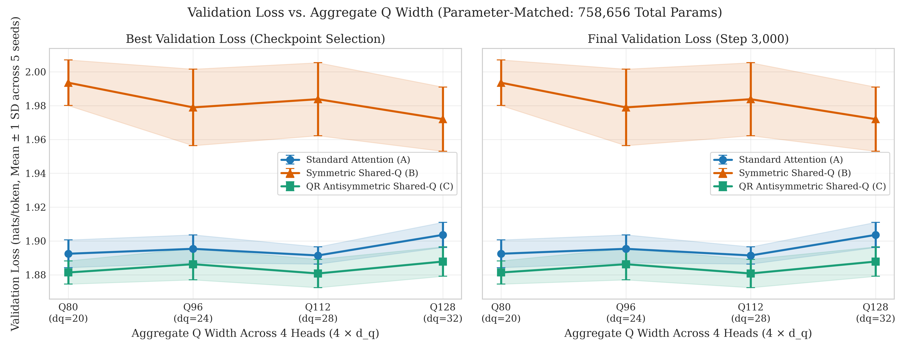
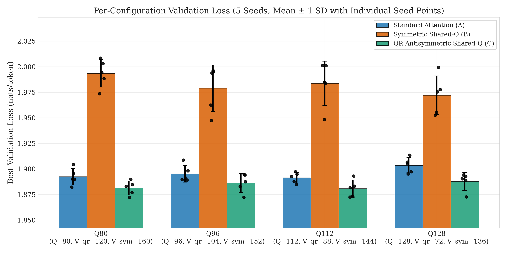
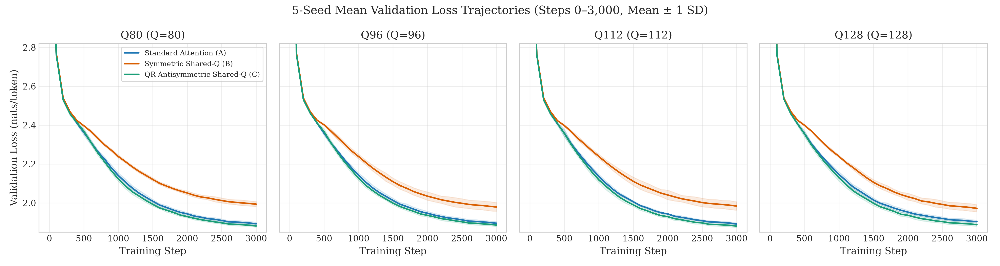
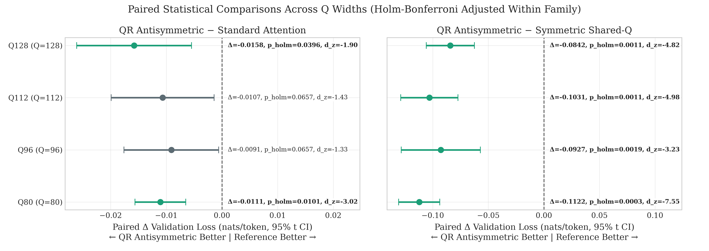
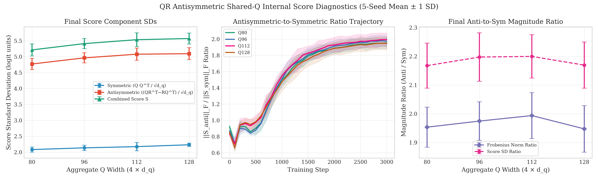
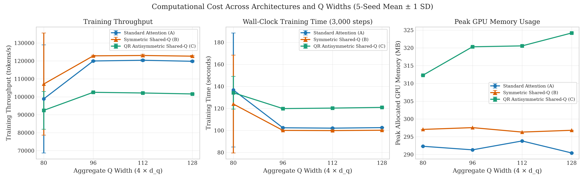

# Research Report: QR-Based Antisymmetric Shared-Q Attention

**Project:** Transformer Architecture Research (`Rsearch`)  
**Investigation:** Parameter-Matched Evaluation of QR-Based Antisymmetric Shared-Q Causal Self-Attention  
$$Q = XW_Q, \quad R = XW_R, \quad V = XW_V, \qquad A = QR^T - RQ^T, \qquad S = \frac{QQ^T + \lambda A}{\sqrt{d_q}} \quad (\lambda = 1.0 \text{ fixed})$$  
**Hardware:** NVIDIA GeForce RTX 3050 6GB Laptop GPU (`cuda`, CUDA 12.4), PyTorch `2.6.0+cu124`, Python `3.13.14`  
**Dataset:** Tiny Shakespeare (`data/tinyshakespeare.txt`, SHA256 `86c4e6aa...`, 65-character vocabulary; 1,003,854 train / 111,540 validation chars)  
**Seeds:** `[1337, 2024, 42, 1234, 2026]` (60 completed deterministic FP32 runs across 4 Q widths × 3 architectures × 5 seeds, 3,000 updates/run)  
**Isolated Artifacts Root:** [`outputs/qr_antisymmetric/`](outputs/qr_antisymmetric/)

---

## 1. Executive Summary

This experiment investigates whether introducing a second, independently learned linear projection $R = XW_R$ into Shared-Q attention to form the skew-symmetric score component $S_{\text{anti}} = QR^T - RQ^T$ overcomes the symmetry bottleneck of $QQ^T$ and competes directly with unconstrained Standard Attention ($QK^T$) under **strictly parameter-matched** budgets.

Across **60 full 3,000-step runs** (`4` Q widths × `3` architectures × `5` seeds, exact **`758,656`** total parameters / **`51,200`** attention parameters per layer), **QR Antisymmetric Shared-Q** achieved:
- **Lower validation loss than Standard Attention in 20 out of 20 paired seed comparisons** (5/5 wins at Q80, Q96, Q112, and Q128), with paired improvements of **$-0.0091$ to $-0.0158$ nats/token**; **statistically significant after Holm-Bonferroni correction** at **Q80** ($p_{\text{holm}} = 0.0101$, $d_z = -3.02$) and **Q128** ($p_{\text{holm}} = 0.0396$, $d_z = -1.90$), while **Q96** and **Q112** show positive directional consistency ($p_{\text{raw}} = 0.0412$ and $0.0329$, 5/5 wins) that **does not clear the $\alpha = 0.05$ Holm threshold** ($p_{\text{holm}} = 0.0657$ for both).
- **Large, statistically significant gains over Symmetric Shared-Q across all 4 Q widths** (20/20 paired seed wins; **$-0.0842$ to $-0.1122$ nats/token**, $p_{\text{holm}} \in [0.0003, 0.0019]$, $d_z \in [-7.55, -3.23]$), closing >100% of Symmetric Shared-Q's deficit relative to Standard Attention despite having smaller $V$ capacity than Symmetric Shared-Q.
- **Best overall validation loss at Q112 ($d_q = 28, d_v = 22$):** **`1.8808 ± 0.0084`** nats (perplexity **`6.56 ± 0.06`**), closely followed by Q80 (**`1.8814 ± 0.0069`**, PPL `6.56 ± 0.05`).
- **Clear antisymmetric score utilization:** Starting near $||S_{\text{anti}}||_F / ||S_{\text{sym}}||_F \approx 0.83\text{--}0.92$ at initialization, the antisymmetric-to-symmetric Frobenius ratio grows during training to **`1.95–1.99×`** by step 3,000, peaking in middle transformer layers (Layers 1–2 at `2.20–2.31×`).
- **Measurable compute and memory overhead:** In steady-state runs (Q96–Q128), QR Antisymmetric runs at **`102,091 ± 451 tok/s`** (`120.37 ± 0.53s` for 3,000 steps) compared to Standard (`120,052 ± 490 tok/s`, `102.36 ± 0.42s`) and Symmetric Shared-Q (`122,843 ± 491 tok/s`, `100.03 ± 0.40s`) — a **~15.0% training throughput reduction** (~1.18× training time) and **+24–34 MB** higher peak allocated GPU memory (`312.3–324.2 MB` vs `290.4–297.6 MB`).

---

## 2. Exact Architecture & Parameter-Matching Verification

### 2.1 Attention Formulations (`d_model = 128`, `n_heads = 4`, `n_layers = 4`, bias-free projections)

For each head (`Q, K, R` shapes `[B, H, T, d_q]`; `V` shape `[B, H, T, d_v]`; `S` shape `[B, H, T, T]`):
1. **Architecture A — Standard Attention (`standard_q*`):**  
   $$Q = XW_Q, \quad K = XW_K, \quad V = XW_V, \qquad S = \frac{QK^T}{\sqrt{d_q}}$$
2. **Architecture B — Symmetric Shared-Q (`shared_q_q*`):**  
   $$Q = XW_Q, \quad K = Q, \quad V = XW_V, \qquad S = \frac{QQ^T}{\sqrt{d_q}}$$
3. **Architecture C — QR Antisymmetric Shared-Q (`qr_antisymmetric_q*`):**  
   $$Q = XW_Q, \quad R = XW_R, \quad V = XW_V, \qquad S = \frac{QQ^T + \lambda\left(QR^T - RQ^T\right)}{\sqrt{d_q}}, \quad \lambda = 1.0 \text{ (fixed)}$$

All linear projections ($W_Q, W_K, W_R, W_V, W_O$) are **bias-free** (`bias=False`), initialized independently with $\mathcal{N}(0, 0.02)$ via `DecoderLM._initialize`, and have `0` stored buffers and no learned $B$-matrix. Causal masking (`triu(diagonal=1) -> -inf`) is applied after combining $S_{\text{sym}}$ and $\lambda S_{\text{anti}}$, followed by exact FP32 row softmax and attention dropout (`0.1`).

### 2.2 Programmatic Parameter Audit Across All 12 Models

Verified programmatically via [`verify_qr_parameter_budgets`](model.py#L373-L424) and recorded across every one of the 60 `summary.json` files ([`parameter_budget_audit.csv`](outputs/qr_antisymmetric/parameter_budget_audit.csv)):

| Q Config | Aggregate $Q$ ($4 d_q$) | Architecture | $d_q$ | $d_k$ | $d_r$ | $d_v$ | $W_Q$ /Layer | $W_K$ /Layer | $W_R$ /Layer | $W_V$ /Layer | $W_O$ /Layer | Attn /Layer | Attn Total | Non-Attn | **Total Params** |
|---|---:|---|---:|---:|---:|---:|---:|---:|---:|---:|---:|---:|---:|---:|---:|
| **Q80** | 80 | Standard (A) | 20 | 20 | 0 | 30 | 10,240 | 10,240 | 0 | 15,360 | 15,360 | **51,200** | 204,800 | 553,856 | **758,656** |
| **Q80** | 80 | Sym Shared-Q (B) | 20 | 0 | 0 | 40 | 10,240 | 0 | 0 | 20,480 | 20,480 | **51,200** | 204,800 | 553,856 | **758,656** |
| **Q80** | 80 | QR Anti (C) | 20 | 0 | 20 | 30 | 10,240 | 0 | 10,240 | 15,360 | 15,360 | **51,200** | 204,800 | 553,856 | **758,656** |
| **Q96** | 96 | Standard (A) | 24 | 24 | 0 | 26 | 12,288 | 12,288 | 0 | 13,312 | 13,312 | **51,200** | 204,800 | 553,856 | **758,656** |
| **Q96** | 96 | Sym Shared-Q (B) | 24 | 0 | 0 | 38 | 12,288 | 0 | 0 | 19,456 | 19,456 | **51,200** | 204,800 | 553,856 | **758,656** |
| **Q96** | 96 | QR Anti (C) | 24 | 0 | 24 | 26 | 12,288 | 0 | 12,288 | 13,312 | 13,312 | **51,200** | 204,800 | 553,856 | **758,656** |
| **Q112** | 112 | Standard (A) | 28 | 28 | 0 | 22 | 14,336 | 14,336 | 0 | 11,264 | 11,264 | **51,200** | 204,800 | 553,856 | **758,656** |
| **Q112** | 112 | Sym Shared-Q (B) | 28 | 0 | 0 | 36 | 14,336 | 0 | 0 | 18,432 | 18,432 | **51,200** | 204,800 | 553,856 | **758,656** |
| **Q112** | 112 | QR Anti (C) | 28 | 0 | 28 | 22 | 14,336 | 0 | 14,336 | 11,264 | 11,264 | **51,200** | 204,800 | 553,856 | **758,656** |
| **Q128** | 128 | Standard (A) | 32 | 32 | 0 | 18 | 16,384 | 16,384 | 0 | 9,216 | 9,216 | **51,200** | 204,800 | 553,856 | **758,656** |
| **Q128** | 128 | Sym Shared-Q (B) | 32 | 0 | 0 | 34 | 16,384 | 0 | 0 | 17,408 | 17,408 | **51,200** | 204,800 | 553,856 | **758,656** |
| **Q128** | 128 | QR Anti (C) | 32 | 0 | 32 | 18 | 16,384 | 0 | 16,384 | 9,216 | 9,216 | **51,200** | 204,800 | 553,856 | **758,656** |

> **Formula check:**  
> - Standard & QR Antisymmetric: $128(4d_q) + 128(4d_q) + 128(4d_v) + 128(4d_v) = 1024(d_q + d_v) = 1024 \times 50 = 51,200$  
> - Symmetric Shared-Q: $128(4d_q) + 2 \times 128(4d_v) = 512(d_q + 2d_v) = 512 \times 100 = 51,200$  
> - Non-attention parameters: token embedding (`65 × 128 = 8,320`, tied with `lm_head`), position embedding (`128 × 128 = 16,384`), 4 FFN blocks (`4 × [66,048 + 65,664] = 4 × 131,712 = 526,848`), and 9 LayerNorms (`9 × 256 = 2,304`) = **`553,856`** exact -> Total = $553,856 + 4 \times 51,200 =$ **`758,656`** (`0` stored buffers).

---

## 3. Main Performance & Compute Results (`N = 5` Seeds)

Across all 60 runs, validation loss reached its minimum at **step 3,000** (`best_step = 3000`), so best validation loss and final validation loss are identical (`max |best - final| = 0.0`). Every paired triplet under `(q_config, seed)` verified bitwise-identical `training_batch_sha256` and `12,288,000` training tokens.

**Table 1: Validation Loss, Perplexity, Training Throughput, and Peak GPU Memory (Mean ± SD across 5 Seeds)**

| Q Config | Architecture | Total Params | Val Loss (Mean ± SD) | Val PPL (Mean ± SD) | Train Time (s) | Train tok/s | Inf tok/s | Peak GPU Mem (MB) |
|---|---|---:|:---:|:---:|---:|---:|---:|---:|
| **Q80** | Standard (A) | 758,656 | `1.8924 ± 0.0082` | `6.64 ± 0.05` | `136.74 ± 51.77`* | `98,851 ± 30,118`* | `507,916 ± 177,343`* | `292.31` |
| **Q80** | Sym Shared-Q (B) | 758,656 | `1.9936 ± 0.0135` | `7.34 ± 0.10` | `124.01 ± 44.45`* | `107,128 ± 28,435`* | `576,984 ± 46,007` | `297.06` |
| **Q80** | **QR Anti (C)** | 758,656 | **`1.8814 ± 0.0069`** | **`6.56 ± 0.05`** | `134.26 ± 14.85`* | `92,454 ± 10,517`* | `385,247 ± 45,546` | `312.31` |
| **Q96** | Standard (A) | 758,656 | `1.8953 ± 0.0083` | `6.66 ± 0.06` | `102.42 ± 0.30` | `119,978 ± 357` | `615,131 ± 7,308` | `291.31` |
| **Q96** | Sym Shared-Q (B) | 758,656 | `1.9790 ± 0.0226` | `7.24 ± 0.16` | `100.04 ± 0.28` | `122,836 ± 348` | `612,913 ± 6,381` | `297.56` |
| **Q96** | **QR Anti (C)** | 758,656 | **`1.8863 ± 0.0093`** | **`6.59 ± 0.06`** | `119.86 ± 0.23` | `102,520 ± 194` | `431,517 ± 3,189` | `320.31` |
| **Q112** | Standard (A) | 758,656 | `1.8914 ± 0.0051` | `6.63 ± 0.03` | `102.09 ± 0.49` | `120,372 ± 581` | `607,272 ± 8,954` | `293.81` |
| **Q112** | Sym Shared-Q (B) | 758,656 | `1.9838 ± 0.0216` | `7.27 ± 0.16` | `99.87 ± 0.55` | `123,037 ± 677` | `587,777 ± 34,543` | `296.31` |
| **Q112** | **QR Anti (C)** | 758,656 | **`1.8808 ± 0.0084`** | **`6.56 ± 0.06`** | `120.30 ± 0.34` | `102,144 ± 288` | `421,049 ± 4,466` | `320.56` |
| **Q128** | Standard (A) | 758,656 | `1.9036 ± 0.0074` | `6.71 ± 0.05` | `102.57 ± 0.35` | `119,808 ± 408` | `610,506 ± 6,635` | `290.44` |
| **Q128** | Sym Shared-Q (B) | 758,656 | `1.9720 ± 0.0190` | `7.19 ± 0.14` | `100.18 ± 0.34` | `122,655 ± 416` | `597,757 ± 6,267` | `296.81` |
| **Q128** | **QR Anti (C)** | 758,656 | **`1.8878 ± 0.0087`** | **`6.61 ± 0.06`** | `120.93 ± 0.31` | `101,609 ± 263` | `407,109 ± 19,495` | `324.19` |

*\*Note on Q80 Timing Variance:* During `q80` seeds `2024` and `42`, transient laptop GPU clock throttling temporarily slowed throughput (`56k–88k tok/s`, also reducing `standard` inference on `q80/seed=42` to `200.8k tok/s`). In Q80 seeds `1337`/`2026` and all `45` runs across **Q96–Q128**, throughput was highly stable (`<0.6%` CV): **`120,052 ± 490 tok/s`** (Standard), **`122,843 ± 491 tok/s`** (Symmetric Shared-Q), and **`102,091 ± 451 tok/s`** (QR Antisymmetric). Peak GPU memory had `0.0 MB` SD across all 5 seeds of every single configuration.







---

## 4. Paired Statistical Analysis with Holm-Bonferroni Correction

Two comparison families are evaluated across the 4 Q configurations ($m = 4$ tests per family, step-down Holm-Bonferroni correction within each family) using two-sided paired Student $t$-tests ($\text{df} = 4$, 95% $t$-intervals) on identical-stream seed pairs ($N = 5$). Negative differences ($\Delta = \mathcal{L}_{\text{QR}} - \mathcal{L}_{\text{ref}} < 0$) favor QR Antisymmetric.

**Table 2: Paired Statistical Comparisons Across Families (`best_validation_loss` = `final_validation_loss`)**

| Family | Q Config | Mean $\Delta$ | 95% $t$ CI | $t$-stat (`df=4`) | $p_{\text{raw}}$ | $p_{\text{holm}}$ | Cohen's $d_z$ | Hedges' $g_z$ | QR Wins | Holm Sig. ($\alpha=0.05$) |
|---|---|---:|:---:|---:|---:|---:|---:|---:|:---:|:---:|
| **QR vs Standard** | **Q80** | **$-0.0111$** | $[-0.0156, -0.0065]$ | $-6.75$ | `0.0025` | **`0.0101`** | $-3.02$ | $-2.41$ | **5 / 5** | **Yes** |
| QR vs Standard | **Q96** | $-0.0091$ | $[-0.0176, -0.0006]$ | $-2.97$ | `0.0412` | **`0.0657`** | $-1.33$ | $-1.06$ | **5 / 5** | **No** |
| QR vs Standard | **Q112** | $-0.0107$ | $[-0.0199, -0.0014]$ | $-3.20$ | `0.0329` | **`0.0657`** | $-1.43$ | $-1.15$ | **5 / 5** | **No** |
| **QR vs Standard** | **Q128** | **$-0.0158$** | $[-0.0261, -0.0055]$ | $-4.25$ | `0.0132` | **`0.0396`** | $-1.90$ | $-1.52$ | **5 / 5** | **Yes** |
| **QR vs Sym Shared-Q** | **Q80** | **$-0.1122$** | $[-0.1307, -0.0938]$ | $-16.87$ | `7.23e-5` | **`0.0003`** | $-7.55$ | $-6.04$ | **5 / 5** | **Yes** |
| **QR vs Sym Shared-Q** | **Q96** | **$-0.0927$** | $[-0.1283, -0.0571]$ | $-7.23$ | `0.0019` | **`0.0019`** | $-3.23$ | $-2.59$ | **5 / 5** | **Yes** |
| **QR vs Sym Shared-Q** | **Q112** | **$-0.1031$** | $[-0.1288, -0.0773]$ | $-11.13$ | `0.0004` | **`0.0011`** | $-4.98$ | $-3.98$ | **5 / 5** | **Yes** |
| **QR vs Sym Shared-Q** | **Q128** | **$-0.0842$** | $[-0.1059, -0.0625]$ | $-10.78$ | `0.0004` | **`0.0011`** | $-4.82$ | $-3.86$ | **5 / 5** | **Yes** |

**Table 3: Per-Seed Paired Differences ($\Delta = \mathcal{L}_{\text{QR}} - \mathcal{L}_{\text{ref}}$; every cell is $< 0$)**

| Q Config | Comparison | Seed `1337` | Seed `2024` | Seed `42` | Seed `1234` | Seed `2026` |
|---|---|---:|---:|---:|---:|---:|
| **Q80** | QR − Standard | $-0.0127$ | $-0.0052$ | $-0.0130$ | $-0.0144$ | $-0.0100$ |
| **Q96** | QR − Standard | $-0.0082$ | $-0.0036$ | $-0.0016$ | $-0.0145$ | $-0.0175$ |
| **Q112** | QR − Standard | $-0.0042$ | $-0.0129$ | $-0.0192$ | $-0.0017$ | $-0.0152$ |
| **Q128** | QR − Standard | $-0.0178$ | $-0.0123$ | $-0.0225$ | $-0.0231$ | $-0.0031$ |
| **Q80** | QR − Sym Shared-Q | $-0.1254$ | $-0.1037$ | $-0.0968$ | $-0.1045$ | $-0.1307$ |
| **Q96** | QR − Sym Shared-Q | $-0.1134$ | $-0.0528$ | $-0.0749$ | $-0.0997$ | $-0.1227$ |
| **Q112** | QR − Sym Shared-Q | $-0.1081$ | $-0.0666$ | $-0.1117$ | $-0.1178$ | $-0.1112$ |
| **Q128** | QR − Sym Shared-Q | $-0.0863$ | $-0.0597$ | $-0.0826$ | $-0.1090$ | $-0.0835$ |



---

## 5. Additional Diagnostics: Internal Score Components, Layer Breakdown & Cost

### 5.1 Symmetric vs. Antisymmetric Score Component Evolution (`QR Antisymmetric`)

Because $S_{\text{sym}}^T = S_{\text{sym}}$ and $S_{\text{anti}}^T = -S_{\text{anti}}$ are orthogonal under the Frobenius inner product ($\langle S_{\text{sym}}, S_{\text{anti}} \rangle_F = 0$), the unmasked logit variance decomposes cleanly as $\text{Var}(S) \approx \text{Var}(S_{\text{sym}}/\sqrt{d_q}) + \text{Var}(S_{\text{anti}}/\sqrt{d_q})$.

**Table 4: QR Score Diagnostics Across Q Widths (5-Seed Mean ± SD across all 4 layers on 20 validation batches)**

| Q Config | Step 0 $\sigma_{\text{sym}}$ | Step 0 $\sigma_{\text{anti}}$ | Step 0 Ratio $\|A\|_F/\|S_{\text{sym}}\|_F$ | Final $\sigma_{\text{sym}}$ (Full / Causal) | Final $\sigma_{\text{anti}}$ (Full / Causal) | Final $\sigma_{\text{comb}}$ (Full / Causal) | Final Ratio $\|A\|_F/\|S_{\text{sym}}\|_F$ | Final Causal Ratio |
|---|---:|---:|---:|---:|---:|---:|---:|---:|
| **Q80** | `0.0643` | `0.0697` | `0.924 ± 0.022` | `2.082 ± 0.079` / `2.092` | `4.771 ± 0.178` / `2.932` | `5.213 ± 0.189` / `3.749` | **`1.953 ± 0.069`** | `1.932 ± 0.069` |
| **Q96** | `0.0669` | `0.0695` | `0.869 ± 0.053` | `2.137 ± 0.085` / `2.147` | `4.963 ± 0.160` / `3.033` | `5.411 ± 0.160` / `3.863` | **`1.975 ± 0.067`** | `1.953 ± 0.066` |
| **Q112** | `0.0694` | `0.0693` | `0.834 ± 0.027` | `2.175 ± 0.132` / `2.185` | `5.078 ± 0.190` / `3.124` | `5.534 ± 0.216` / `3.979` | **`1.994 ± 0.080`** | `1.972 ± 0.078` |
| **Q128** | `0.0719` | `0.0695` | `0.852 ± 0.025` | `2.233 ± 0.051` / `2.244` | `5.094 ± 0.189` / `3.096` | `5.570 ± 0.173` / `4.017` | **`1.948 ± 0.081`** | `1.926 ± 0.080` |

*Trajectory highlights ([`qr_step_diagnostics_summary.csv`](outputs/qr_antisymmetric/qr_step_diagnostics_summary.csv)):* At step 0, $\sigma_{\text{sym}} \approx \sigma_{\text{anti}} \approx 0.064\text{--}0.072$ logit units. During early warmup (step 100), the symmetric score grows faster, dipping the Frobenius ratio to `0.66–0.72`; between steps 200 and 2,500, $S_{\text{anti}}$ grows steadily faster than $S_{\text{sym}}$, stabilizing at **`1.95–1.99×`** ($S_{\text{anti}}$ contributes ~80% of total unmasked score variance and dominates directional attention selectivity).

### 5.2 Per-Layer Profile and Layer-0 Raw Symmetry Statistics

Across layers at step 3,000 ([`qr_layer_diagnostics_summary.csv`](outputs/qr_antisymmetric/qr_layer_diagnostics_summary.csv)), antisymmetry concentrates strongly in **Layers 1 and 2** (`ratio ≈ 2.12–2.31×`, $\sigma_{\text{anti}} \approx 5.71\text{--}8.20$), while Layer 0 (`1.69–1.74×`) and Layer 3 (`1.71–1.72×`) stay more balanced. In standalone prefix-prompt `attention_stats.json` (all 60 runs aggregated at layer 0):
- **Symmetric Shared-Q:** `raw_score_symmetry_max_abs_error = 0.0000` (all 20 runs), `mean_diagonal_mass = 0.1854 ± 0.0078`, `entropy = 2.4049 ± 0.0397`.
- **Standard Attention:** `raw_score_symmetry_max_abs_error = 4.5386 ± 1.2410`, `mean_diagonal_mass = 0.1491 ± 0.0039`, `entropy = 2.4437 ± 0.0178`.
- **QR Antisymmetric:** `raw_score_symmetry_max_abs_error = 5.2315 ± 1.0769`, `mean_diagonal_mass = 0.1927 ± 0.0090`, `entropy = 2.3963 ± 0.0324`.





---

## 6. Direct Answers to Research Questions

1. **Does QR Antisymmetric attention outperform Standard Attention at matched parameter counts?**  
   **Partially / conditionally yes (consistently lower mean in all configs; Holm-significant in 2 of 4).** QR Antisymmetric achieved lower validation loss than Standard Attention in **20/20** individual paired seed runs across all four Q widths (`-0.0091` to `-0.0158` nats). After Holm-Bonferroni correction across the 4 Q widths, the gain is **statistically significant** at **Q80** (`-0.0111` nats, $p_{\text{holm}} = 0.0101$, $d_z = -3.02$) and **Q128** (`-0.0158` nats, $p_{\text{holm}} = 0.0396$, $d_z = -1.90$). At **Q96** (`-0.0091` nats, $p_{\text{raw}} = 0.0412$, $p_{\text{holm}} = 0.0657$) and **Q112** (`-0.0107` nats, $p_{\text{raw}} = 0.0329$, $p_{\text{holm}} = 0.0657$), improvement is consistent across all 5 seeds but **not Holm-significant at $\alpha = 0.05$**.

2. **Does it outperform Symmetric Shared-Q?**  
   **Yes, decisively and universally.** QR Antisymmetric outperforms Symmetric Shared-Q in **20/20** runs across every Q width and every seed by **`-0.0842` to `-0.1122` nats** (`-0.58` to `-0.78` perplexity points), with **$p_{\text{holm}} \le 0.0019$** and very large paired effect sizes ($d_z \in [-7.55, -3.23]$) across all 4 configurations — even though Symmetric Shared-Q receives `+40` to `+64` more aggregate Value dimensions (`V_sym = 136–160` vs `V_qr = 72–120`).

3. **Which Q dimension gives the best validation loss?**  
   - **QR Antisymmetric:** **Q112** ($d_q = 28, d_v = 22$, `V = 88`) gives the lowest overall validation loss (**`1.8808 ± 0.0084`**, PPL `6.559`), practically tied with **Q80** (`1.8814 ± 0.0069`, PPL `6.563`; within-architecture paired difference $+0.0006$, $p = 0.85$).  
   - **Standard Attention:** Also best at **Q112** (`1.8914 ± 0.0051`) / **Q80** (`1.8924 ± 0.0082`).  
   - **Symmetric Shared-Q:** Best at **Q128** (`1.9720 ± 0.0190`), where wider $Q$ helps while `V_sym = 136` remains unbottlenecked.

4. **Does increasing Q improve performance or reduce V capacity too much?**  
   **Both effects appear depending on architecture.** Under the fixed `51,200`/layer budget, raising aggregate $Q$ from `80 -> 112` keeps QR Antisymmetric flat/slightly improved (`1.8814 -> 1.8808`), while pushing to `Q128` (`d_v = 18`, aggregate `V = 72`) increases validation loss to `1.8878` (`+0.0070` vs Q112, though paired `t = -1.55`, $p = 0.197$ over 5 seeds). Crucially, **Standard Attention suffers a clear V-capacity degradation** at Q128 (`1.9036` vs `1.8924` at Q80: paired diff `-0.0112 ± 0.0042`, $p_{\text{raw}} = 0.0040$). By contrast, **Symmetric Shared-Q improves from Q80 to Q128** (`1.9936 -> 1.9720`, paired diff `+0.0215`, $p_{\text{raw}} = 0.0415$) because omitting $W_K$ leaves `V_sym = 136` (`d_v = 34`) even at `Q128`, avoiding the Value bottleneck.

5. **Does the antisymmetric component make a measurable contribution?**  
   **Yes, both structurally and functionally.** (a) By step 3,000, $\sigma_{\text{anti}}$ reaches **`4.77–5.09` logit units** vs $\sigma_{\text{sym}}$ of **`2.08–2.23`**, giving an anti-to-sym Frobenius magnitude ratio of **`1.95–1.99×`** (~80% of combined unmasked score variance) and layer-0 raw asymmetry error `5.23` (vs `0.00` for Symmetric Shared-Q). (b) Functionally, adding $QR^T - RQ^T$ closes more than 100% of the ~0.084–0.112 nat deficit of Symmetric Shared-Q despite shrinking $V$ capacity.

6. **Is the improvement consistent across all five seeds?**  
   **Yes — 100% win consistency (40/40 paired comparisons).** Across all 5 seeds `[1337, 2024, 42, 1234, 2026]` and all 4 Q widths, QR Antisymmetric achieved strictly lower validation loss than Standard Attention in **20/20 pairs** and strictly lower validation loss than Symmetric Shared-Q in **20/20 pairs** (zero seed reversals in either family).

7. **What is the computational cost of the new architecture?**  
   For identical parameter counts (`758,656` params) on an RTX 3050 GPU:
   - **Training throughput (steady Q96–Q128):** QR trains at **`102,091 ± 451 tok/s`** (`120.4s` / 3,000 steps) vs **`120,052 ± 490 tok/s`** (`102.4s`) for Standard and **`122,843 ± 491 tok/s`** (`100.0s`) for Symmetric Shared-Q — a **~15.0% throughput penalty** relative to Standard (+18.0s/run) and **~16.9%** relative to Symmetric Shared-Q (+20.3s/run). Including Q80's 2 throttled runs, the 20-run averages are `99,682 ± 6,463` (QR) vs `114,752 ± 16,729` (Std) vs `118,914 ± 14,803 tok/s` (Sym Shared-Q).
   - **Full-context inference throughput (`Q96–Q128`):** `419.9k tok/s` (`9.77 ms`/batch) vs `611.0k tok/s` (`6.70 ms`) for Standard (**~31% slower full-context forward**, **~1.46× latency**) due to evaluating 3 `[B, H, T, T]` score matmuls ($QQ^T$, $QR^T$, $RQ^T$) instead of 1 ($QK^T$).
   - **Peak GPU memory:** **`312.3–324.2 MB`** vs `290.4–293.8 MB` (Standard) and `296.3–297.6 MB` (Symmetric Shared-Q) — an overhead of **`+20.0` to `+33.8 MB`** (+7% to +12%) from storing $R$ and the extra $T \times T$ score intermediates.

---

## 7. Scientific Interpretation: Measured Facts vs. Hypotheses

### Strictly Measured Empirical Facts
1. Under fixed total (`758,656`) and attention (`51,200`/layer) parameter budgets on Tiny Shakespeare (4-layer `d=128` decoder, $\lambda = 1.0$, 3,000 steps), $S = (QQ^T + QR^T - RQ^T)/\sqrt{d_q}$ eliminates Symmetric Shared-Q's symmetry penalty across all four Q/V tradeoffs (`-0.084` to `-0.112` nats, $p_{\text{holm}} \le 0.0019$, 20/20 seed wins).
2. QR Antisymmetric also achieved lower mean validation loss than parameter-matched Standard Attention ($QK^T$) at every tested Q width (`-0.0091` to `-0.0158` nats, 20/20 seed wins), reaching Holm-corrected significance ($\alpha=0.05$) at **Q80** ($p_{\text{holm}} = 0.0101$) and **Q128** ($p_{\text{holm}} = 0.0396$), while **Q96** and **Q112** did not reach Holm-corrected significance ($p_{\text{holm}} = 0.0657$ despite $p_{\text{raw}} < 0.05$).
3. During optimization, the antisymmetric score magnitude grows steadily after step 100 from `0.66–0.72×` to `1.95–1.99×` the symmetric norm, especially in intermediate layers (`L1`–`L2`), accompanied by ~15% lower training throughput, ~31% lower full-context inference throughput, and ~24–34 MB higher peak allocated GPU memory.

### Mechanistic Hypotheses (Consistent with Data, Requiring Separate Causal Verification)
1. **Effective bilinear rank & structured decomposition:** Standard Attention parametrizes a rank-$\le d_q$ bilinear form $M_{\text{std}} = W_Q W_K^T$ per head. In contrast, QR Antisymmetric parametrizes $M_{\text{qr}} = W_Q W_Q^T + \lambda(W_Q W_R^T - W_R W_Q^T) = [W_Q, W_R] \begin{bmatrix} I_{d_q} & \lambda I_{d_q} \\ -\lambda I_{d_q} & 0 \end{bmatrix} [W_Q, W_R]^T$, decomposing unmasked logits into a **PSD symmetric kernel** $X W_Q W_Q^T X^T$ (nonnegative diagonal $\|q_i\|_2^2 \ge 0$, rank $\le d_q$) plus an **explicitly skew-symmetric kernel** $S_{\text{anti}}$ (strictly zero diagonal, rank $\le 2d_q$). Because the $2d_q \times 2d_q$ block coupling matrix is invertible ($\det = \lambda^{2d_q} = 1$), $M_{\text{qr}}$ can span up to **$2d_q$ directions** (within $d_{\text{model}} = 128$) using the exact same $2 d_{\text{model}} d_q$ weights as $W_Q W_K^T$ (capped at rank $\le d_q$). Decoupling the symmetric Gram basis ($Q$) from pure directional skew interactions ($QR^T - RQ^T$) is a mathematical property of the parametrization that may yield higher effective score rank or a better-conditioned inductive bias — especially visible at **Q128** where attention scores remain expressive despite $d_v = 18$, whereas Standard Attention degrades sharply. *(Hypothesis: targeted ablations that vary $\lambda$, freeze the symmetric term, or compare empirical singular spectra of $M_{\text{qr}}$ vs $M_{\text{std}}$ are needed to establish whether rank expansion up to $2d_q$ or symmetric-skew decoupling causes the accuracy advantage.)*
2. **Comparison context vs. $B$-matrix Antisymmetric Shared-Q:** Prior work (`outputs/antisymmetric` at `758,400` total params, 3 seeds) reported $QQ^T + QBQ^T$ reaching `1.9091` (closing 70% of the gap to 816k-param Standard Attention `1.8848`). Here, $QQ^T + (QR^T - RQ^T)$ at matched `758,656` params reaches **`1.8808`** (Q112), suggesting the low-rank cross-projection factor $QR^T - RQ^T$ may provide substantially greater directional expressivity per parameter than $Q B Q^T$ (which constrains skew interactions to lie strictly within $\text{span}(Q)$), though differences in $d_q/d_v$ allocation, seed count ($N=5$ vs $3$), and runtime protocols prevent a direct formal claim without a head-to-head paired ablation.
3. **Why Middle Layers ($L_1, L_2$) Exhibit Highest Antisymmetry:** Previous gradient-interference work (`RESULTS_GRADIENT_ANALYSIS.md`) found Layer 1 suffered acute query/key role conflict in Symmetric Shared-Q; here Layers 1–2 learn the largest $S_{\text{anti}}/S_{\text{sym}}$ ratios (`2.20–2.31×`), consistent with intermediate contextual mixing layers needing the strongest directional token-to-token selectivity.

---

## 8. Reproducibility & Implementation Artifacts

- **Attention module:** [`QR_EXPERIMENT_CONFIGS`](attention.py#L528-L561), [`WidthMatchedCausalAttention`](attention.py#L564-L624), [`QRSharedQAntisymmetricAttention`](attention.py#L627-L770), [`build_qr_attention`](attention.py#L785-L831)
- **Model assembly & audit:** [`build_qr_models`](model.py#L335-L370), [`verify_qr_parameter_budgets`](model.py#L373-L424)
- **Unit tests:** [`test_qr_antisymmetric.py`](test_qr_antisymmetric.py) (8 tests; full repository suite `156` tests)
- **Runner, statistics & plotting:** [`train_qr_antisymmetric.py`](train_qr_antisymmetric.py), [`analyze_qr_antisymmetric.py`](analyze_qr_antisymmetric.py), [`visualize_qr_antisymmetric.py`](visualize_qr_antisymmetric.py)
- **Raw & aggregated outputs (completely isolated from prior experiments):**
  - [`outputs/qr_antisymmetric/all_results.csv`](outputs/qr_antisymmetric/all_results.csv) (60 runs)
  - [`outputs/qr_antisymmetric/configurations_summary.csv`](outputs/qr_antisymmetric/configurations_summary.csv)
  - [`outputs/qr_antisymmetric/paired_comparisons.csv`](outputs/qr_antisymmetric/paired_comparisons.csv)
  - [`outputs/qr_antisymmetric/paired_seed_deltas.csv`](outputs/qr_antisymmetric/paired_seed_deltas.csv)
  - [`outputs/qr_antisymmetric/qr_diagnostics_summary.csv`](outputs/qr_antisymmetric/qr_diagnostics_summary.csv)
  - [`outputs/qr_antisymmetric/qr_step_diagnostics_summary.csv`](outputs/qr_antisymmetric/qr_step_diagnostics_summary.csv)
  - [`outputs/qr_antisymmetric/qr_layer_diagnostics_summary.csv`](outputs/qr_antisymmetric/qr_layer_diagnostics_summary.csv)
  - [`outputs/qr_antisymmetric/analysis_results.json`](outputs/qr_antisymmetric/analysis_results.json)
  - [`outputs/qr_antisymmetric/figures/`](outputs/qr_antisymmetric/figures/) (`fig1`–`fig6`)

To reproduce analysis and figures from recorded outputs (or rerun the full suite):

```sh
python -m unittest discover -v
python train_qr_antisymmetric.py --device cuda
python analyze_qr_antisymmetric.py --dir outputs/qr_antisymmetric
python visualize_qr_antisymmetric.py --dir outputs/qr_antisymmetric
```
