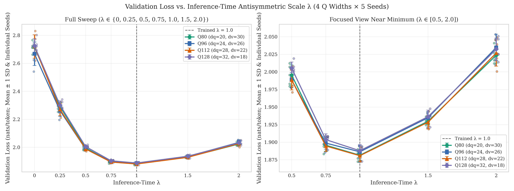
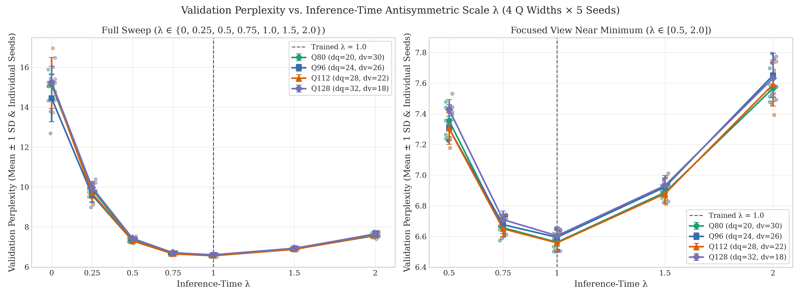
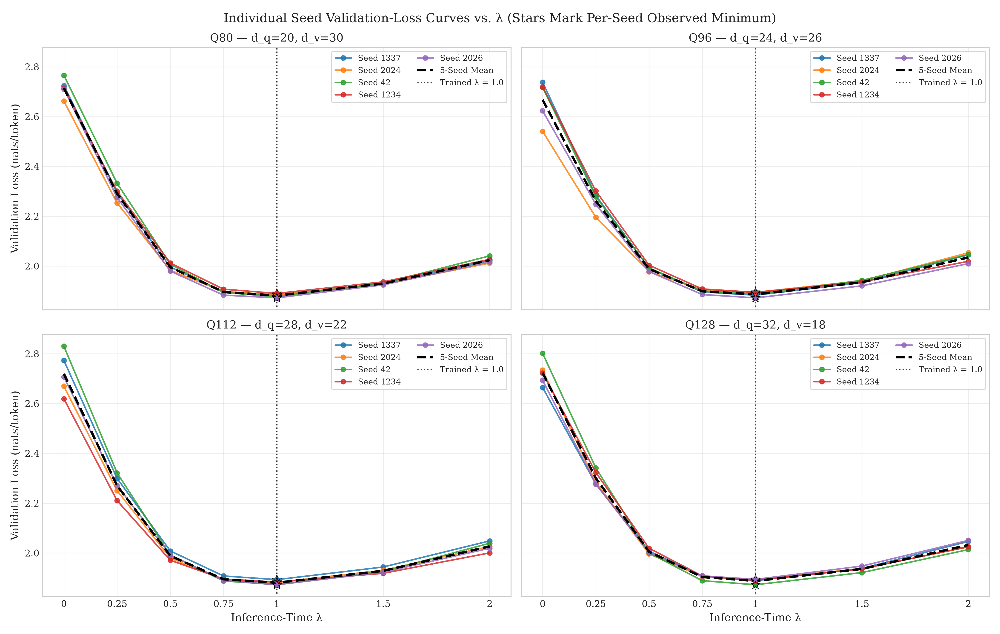
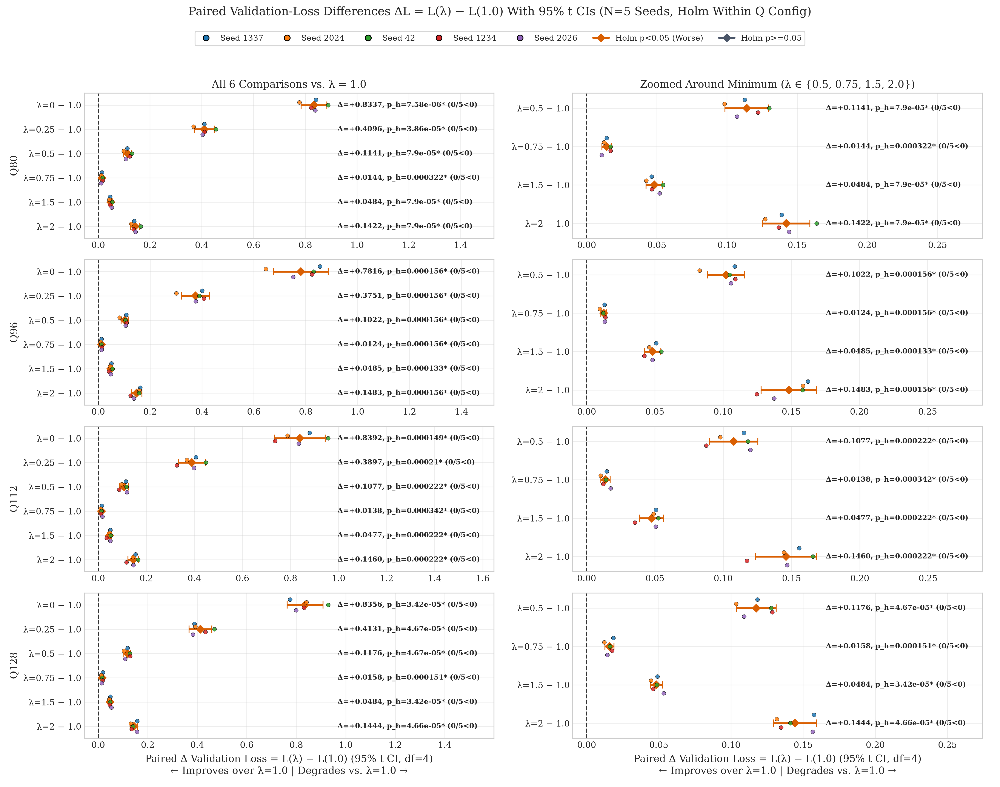
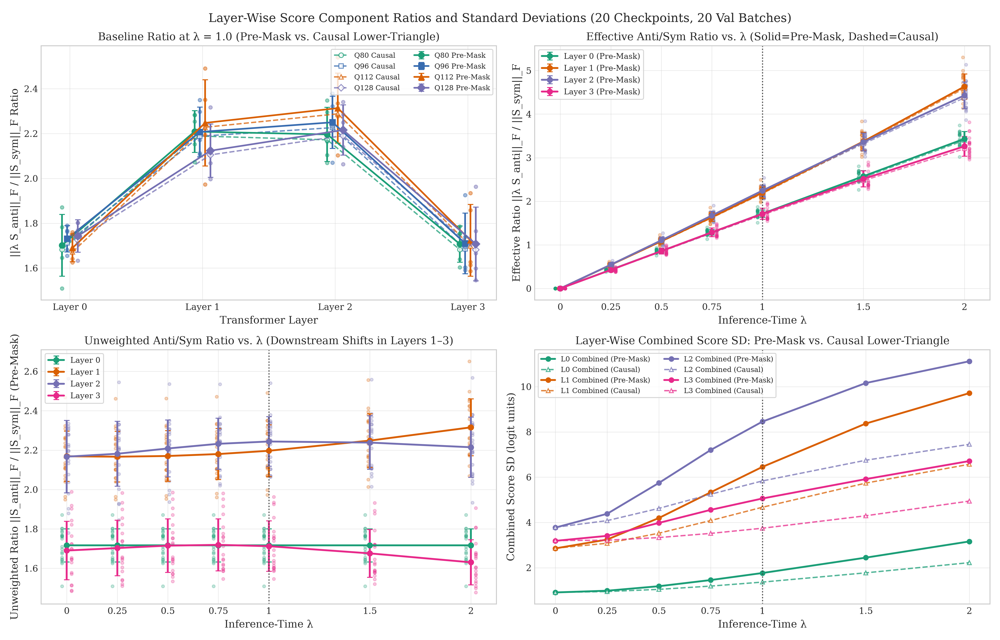
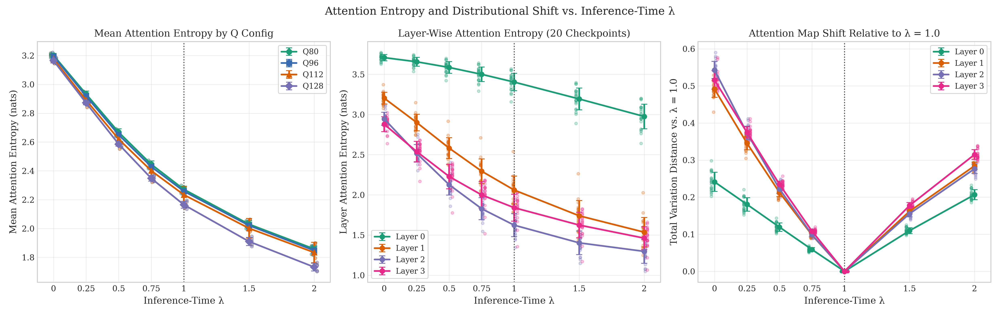

# Inference-Time Lambda Ablation of QR-Based Antisymmetric Shared-Q Attention

**Project:** Transformer Architecture Research (`Rsearch`)  
**Experiment Output Directory:** `outputs/qr_lambda_ablation/`  
**Source Checkpoints:** `outputs/qr_antisymmetric/{q80,q96,q112,q128}/seed_{1337,2024,42,1234,2026}/qr_antisymmetric/best.pt`  
**Compute Environment:** NVIDIA GeForce RTX 3050 6GB Laptop GPU (`cuda`, CUDA 12.4), PyTorch `2.6.0+cu124`, Python `3.13.14` (deterministic FP32)  
**Dataset & Validation Split:** Tiny Shakespeare (`data/tinyshakespeare.txt`, SHA256 `86c4e6aa9db7c042ec79f339dcb96d42b0075e16b8fc2e86bf0ca57e2dc565ed`, `vocab_size = 65`), fixed validation split (`validation_seed = 918273`, `20` batches × `32` × `128` = `81,920` next-token targets)  

---

## 1. Executive Summary

We perform a non-mutating, inference-time ablation of the fixed antisymmetric scaling factor $\lambda$ across all **20 trained QR Antisymmetric Shared-Q checkpoints** (`4` aggregate Q widths $\times$ `5` seeds) over **7 inference values** $\lambda \in \{0.0, 0.25, 0.5, 0.75, 1.0, 1.5, 2.0\}$, yielding **140 complete validation evaluations**.

Key empirical findings:
1. **Exact Baseline Reproduction at $\lambda = 1.0$:** Every one of the 20 checkpoints reproduced its stored `best_validation_loss` (and `summary.json` / `qr_diagnostics.csv` at step `3,000`) with **`0.00e+00`** absolute discrepancy, with zero weight modifications and zero gradients.
2. **Severe Inference-Time Dependence on the Antisymmetric Term:** Setting $\lambda = 0.0$ (removing $S_{\text{anti}}$ at inference without retraining) raises validation loss by **`+0.7816` to `+0.8392` nats** across configurations (**overall 20-checkpoint mean `+0.8226 ± 0.0685` nats**, increasing perplexity from **`6.58`** to **`15.01`**), far exceeding the `1.9720–1.9936` loss of Symmetric Shared-Q models trained from scratch. Thus, trained QR checkpoints strongly rely on their co-adapted antisymmetric term at inference.
3. **Strict Monotonic Improvement Toward $\lambda = 1.0$ and Degradation Beyond $\lambda = 1.0$:** For **20 / 20 individual checkpoints**, validation loss decreases strictly monotonically along $0.0 \to 0.25 \to 0.5 \to 0.75 \to 1.0$, reaches a **unique observed minimum at $\lambda = 1.0$**, and worsens strictly at $\lambda = 1.5$ (`+0.0477` to `+0.0485` nats) and $\lambda = 2.0$ (`+0.1422` to `+0.1483` nats).
4. **Statistical Robustness Within Scope:** Within every Q configuration (`N = 5` paired seeds, $m = 6$ comparisons vs. $\lambda = 1.0$ per family), all 24 comparisons show `0 / 5` seeds improving over $\lambda = 1.0$ (all 5 seeds worsen in every single test) and clear the within-config Holm-Bonferroni $\alpha = 0.05$ threshold ($p_{\text{holm}} \in [7.58 \times 10^{-6}, 3.42 \times 10^{-4}]$). However, with only $N = 5$ seeds, parametric $t$-test $p$-values and standardized effect sizes ($d_z$) should be interpreted cautiously (the distribution-free two-sided exact Wilcoxon floor for $N = 5$ is `0.0625`).
5. **Layer-Wise & Behavioral Mechanism:** Removing $\lambda$ ($\lambda = 1.0 \to 0.0$) collapses the effective antisymmetric logit signal and broadens attention distributions dramatically (mean attention entropy increases from **`2.232`** to **`3.185` nats**), while pushing $\lambda > 1.0$ over-sharpens attention (`1.818 nats` at $\lambda = 2.0$). **Layers 1 and 2** exhibit both the largest baseline antisymmetric-to-symmetric Frobenius ratios (`2.197` and `2.244` pre-mask; `2.178` and `2.219` causal post-mask) and the largest entropy expansion (`+1.144` and `+1.323` nats at $\lambda = 0$), while **Layers 2 and 3** accumulate the largest total variation (TV) distribution shifts (`0.543` at L2 for $\lambda=0$; `0.315` at L3 for $\lambda=2$) due to combined direct scaling and cascading residual-stream shifts from earlier layers.
6. **Inference-Time Dependence $\neq$ Training-Time Optimality:** These results prove strong *inference-time dependence* on the co-adapted $\lambda = 1.0$ operating point, *not* that $\lambda = 1.0$ would be optimal if trained from scratch with another fixed $\lambda$.

---

## 2. Mathematical Formulation & Architecture Preservation

For input hidden states $X \in \mathbb{R}^{B \times T \times d_{\text{model}}}$ (per head, $d_{\text{model}} = 128$, $n_{\text{heads}} = 4$, $n_{\text{layers}} = 4$, context $T = 128$), each trained `QRSharedQAntisymmetricAttention` layer computes three bias-free linear projections:

$$Q = X W_Q, \qquad R = X W_R, \qquad V = X W_V$$

From these projections, the unscaled symmetric and antisymmetric bilinear score components are:

$$S_{\text{sym}} = Q Q^T, \qquad S_{\text{anti}} = Q R^T - R Q^T$$

Notice that $S_{\text{sym}}^T = S_{\text{sym}}$ and $S_{\text{anti}}^T = -S_{\text{anti}}$ (with zero diagonal $(S_{\text{anti}})_{ii} = 0$), so $S_{\text{sym}}$ and $S_{\text{anti}}$ are orthogonal under the unmasked $T \times T$ Frobenius inner product ($\langle S_{\text{sym}}, S_{\text{anti}} \rangle_F = 0$).

During inference-time $\lambda$ ablation, pre-mask scaled attention logits are computed with a **fixed, non-learnable** inference parameter $\lambda \in \{0.0, 0.25, 0.5, 0.75, 1.0, 1.5, 2.0\}$:

$$S(\lambda) = \frac{Q Q^T + \lambda\left(Q R^T - R Q^T\right)}{\sqrt{d_q}} = \frac{S_{\text{sym}} + \lambda S_{\text{anti}}}{\sqrt{d_q}}$$

All models were originally trained at $\lambda = 1.0$. Crucially, our implementation in [`attention.py`](../../attention.py), [`model.py`](../../model.py), and [`evaluate.py`](../../evaluate.py):
- Passes `qr_lambda` cleanly as an optional forward-pass argument without modifying checkpoint weights, buffers, or the stored `lambda_param = 1.0` attribute.
- Multiplies **only** $S_{\text{anti}}$ by $\lambda$, leaving $S_{\text{sym}} = QQ^T$, the $\sqrt{d_q}$ denominator, $W_Q, W_R, W_V, W_O$, and all non-attention layers completely untouched.
- Applies the causal upper-triangular mask (`triu(diagonal=1) -> -inf`) **after** forming $S(\lambda)$, preserving the exact FP32 row softmax and downstream residual blocks.
- Runs under `model.eval()` (dropout disabled) and `@torch.inference_mode()` (no gradients or optimizer state).
- Takes the exact original execution code path when `qr_lambda is None`, and raises `ValueError` if `qr_lambda` is supplied to a non-QR architecture.

### Evaluated Model Configurations (All 758,656 Total Parameters)

| Q Config | Aggregate $Q$ ($4 d_q$) | $d_q$ | $d_r$ | $d_v$ | Attention Params / Layer | Total Params | Training Steps |
|---|---:|---:|---:|---:|---:|---:|---:|
| **`q80`** | 80 | 20 | 20 | 30 | 51,200 | 758,656 | 3,000 |
| **`q96`** | 96 | 24 | 24 | 26 | 51,200 | 758,656 | 3,000 |
| **`q112`** | 112 | 28 | 28 | 22 | 51,200 | 758,656 | 3,000 |
| **`q128`** | 128 | 32 | 32 | 18 | 51,200 | 758,656 | 3,000 |

---

## 3. Experimental Methodology & Checkpoint Verification

### 3.1 Evaluation Protocol
In [`qr_lambda_ablation.py`](../../qr_lambda_ablation.py):
1. Each of the 20 checkpoints under `outputs/qr_antisymmetric/<q_config>/seed_<seed>/qr_antisymmetric/best.pt` is loaded onto CPU (`weights_only=False`), checked against the dataset SHA256 (`86c4e6aa...`), vocabulary (`65` tokens), seed, model type, `lambda_param == 1.0`, and `best_step == 3000`, then moved to GPU (`cuda`) in deterministic FP32 mode (`torch.use_deterministic_algorithms(True)`, TF32 disabled).
2. A full parameter snapshot (`{name: param.detach().clone()}`) is recorded before evaluation.
3. Identical deterministic validation batches (`build_validation_batches(..., validation_seed=918273, batch_size=32, eval_batches=20)`) are evaluated across all 7 $\lambda$ values in `model.eval()` + `@torch.inference_mode()`.
4. After each $\lambda$ evaluation, automated assertions verify `not model.training`, `param.grad is None`, exact tensor equality (`torch.equal`) against the weight snapshot, and unchanged `lambda_param == 1.0`.
5. Following loss evaluation, pre-mask and causal post-mask score diagnostics and attention distribution diagnostics (relative to each checkpoint's own $\lambda = 1.0$ attention maps on the identical batches) are accumulated across all 20 batches and 4 layers.
6. Explicit `del` + `gc.collect()` + `torch.cuda.empty_cache()` release GPU tensors between checkpoints.

### 3.2 Critical Correctness Check Across All 20 Checkpoints ($\lambda = 1.0$)

Recorded in [`checkpoint_verification.json`](checkpoint_verification.json):
- **All 20 checkpoints** had `checkpoint_step = 3000`.
- **`max_reproduction_diff_vs_ckpt`:** `0.00e+00` across all 20 checkpoints.
- **`max_reproduction_diff_vs_summary`:** `0.00e+00` across all 20 checkpoints.
- **`max_default_vs_lambda1_diff` (`qr_lambda=None` vs `1.0`):** `0.00e+00` across all 20 checkpoints.
- **`diag_match_max_err_at_lambda1` (vs. step-3000 `qr_diagnostics.csv`):** `0.00e+00` across all 20 checkpoints.
- **`weights_unmodified`:** `true` across all 20 checkpoints.

Every checkpoint's $\lambda = 1.0$ baseline reproduces the original QR Antisymmetric experiment down to floating-point machine precision.

---

## 4. Main Results: Validation Loss & Perplexity vs. Lambda

### 4.1 Summary Across Q Configurations and Lambda (`N = 5` Seeds per Cell)

From [`lambda_ablation_summary.csv`](lambda_ablation_summary.csv):

| Q Config | $\lambda$ | Val Loss (Mean $\pm$ SD) | Range `[Min, Max]` | Perplexity (Mean $\pm$ SD) | $\Delta L = L(\lambda) - L(1.0)$ | $\Delta\text{PPL}$ vs. $1.0$ | Mean Entropy (nats) | Eff. Ratio ($\| \lambda A \|_F / \|S\|_F$) Pre / Causal |
|---|---:|:---:|:---:|:---:|:---:|:---:|---:|:---:|
| **Q80** | `0.00` | `2.7151 ± 0.0370` | `[2.6622, 2.7656]` | `15.11 ± 0.56` | `+0.8337 ± 0.0400` | `+8.55 ± 0.58` | `3.2018` | `0.000` / `0.000` |
| **Q80** | `0.25` | `2.2910 ± 0.0294` | `[2.2531, 2.3322]` | `9.89 ± 0.29` | `+0.4096 ± 0.0309` | `+3.33 ± 0.30` | `2.9330` | `0.480` / `0.475` |
| **Q80** | `0.50` | `1.9954 ± 0.0143` | `[1.9795, 2.0121]` | `7.36 ± 0.11` | `+0.1141 ± 0.0125` | `+0.79 ± 0.09` | `2.6679` | `0.966` / `0.956` |
| **Q80** | `0.75` | `1.8957 ± 0.0086` | `[1.8831, 1.9070]` | `6.66 ± 0.06` | `+0.0144 ± 0.0028` | `+0.10 ± 0.02` | `2.4454` | `1.459` / `1.443` |
| **Q80** | **`1.00`** | **`1.8814 ± 0.0069`** | `[1.8723, 1.8899]` | **`6.56 ± 0.05`** | **`+0.0000`** | **`+0.00`** | `2.2717` | `1.953` / `1.932` |
| **Q80** | `1.50` | `1.9297 ± 0.0046` | `[1.9243, 1.9364]` | `6.89 ± 0.03` | `+0.0484 ± 0.0048` | `+0.33 ± 0.03` | `2.0298` | `2.936` / `2.902` |
| **Q80** | `2.00` | `2.0236 ± 0.0111` | `[2.0119, 2.0408]` | `7.57 ± 0.08` | `+0.1422 ± 0.0136` | `+1.00 ± 0.10` | `1.8581` | `3.912` / `3.865` |
| **Q96** | `0.00` | `2.6679 ± 0.0838` | `[2.5410, 2.7378]` | `14.45 ± 1.18` | `+0.7816 ± 0.0849` | `+7.85 ± 1.18` | `3.1952` | `0.000` / `0.000` |
| **Q96** | `0.25` | `2.2614 ± 0.0415` | `[2.1957, 2.3017]` | `9.60 ± 0.39` | `+0.3751 ± 0.0430` | `+3.01 ± 0.40` | `2.9189` | `0.488` / `0.483` |
| **Q96** | `0.50` | `1.9885 ± 0.0109` | `[1.9774, 2.0032]` | `7.30 ± 0.08` | `+0.1022 ± 0.0110` | `+0.71 ± 0.08` | `2.6504` | `0.981` / `0.971` |
| **Q96** | `0.75` | `1.8987 ± 0.0087` | `[1.8855, 1.9080]` | `6.68 ± 0.06` | `+0.0124 ± 0.0016` | `+0.08 ± 0.01` | `2.4289` | `1.478` / `1.462` |
| **Q96** | **`1.00`** | **`1.8863 ± 0.0093`** | `[1.8722, 1.8945]` | **`6.59 ± 0.06`** | **`+0.0000`** | **`+0.00`** | `2.2586` | `1.975` / `1.953` |
| **Q96** | `1.50` | `1.9347 ± 0.0086` | `[1.9205, 1.9424]` | `6.92 ± 0.06` | `+0.0485 ± 0.0048` | `+0.33 ± 0.03` | `2.0210` | `2.964` / `2.930` |
| **Q96** | `2.00` | `2.0346 ± 0.0190` | `[2.0097, 2.0532]` | `7.65 ± 0.15` | `+0.1483 ± 0.0164` | `+1.06 ± 0.13` | `1.8478` | `3.945` / `3.899` |
| **Q112** | `0.00` | `2.7200 ± 0.0835` | `[2.6195, 2.8306]` | `15.22 ± 1.28` | `+0.8392 ± 0.0849` | `+8.66 ± 1.29` | `3.1774` | `0.000` / `0.000` |
| **Q112** | `0.25` | `2.2705 ± 0.0432` | `[2.2104, 2.3214]` | `9.69 ± 0.42` | `+0.3897 ± 0.0450` | `+3.13 ± 0.43` | `2.8914` | `0.495` / `0.490` |
| **Q112** | `0.50` | `1.9885 ± 0.0142` | `[1.9709, 2.0082]` | `7.30 ± 0.10` | `+0.1077 ± 0.0142` | `+0.75 ± 0.10` | `2.6200` | `0.993` / `0.983` |
| **Q112** | `0.75` | `1.8946 ± 0.0079` | `[1.8877, 1.9078]` | `6.65 ± 0.05` | `+0.0138 ± 0.0027` | `+0.09 ± 0.02` | `2.4010` | `1.493` / `1.477` |
| **Q112** | **`1.00`** | **`1.8808 ± 0.0084`** | `[1.8725, 1.8931]` | **`6.56 ± 0.06`** | **`+0.0000`** | **`+0.00`** | `2.2341` | `1.994` / `1.972` |
| **Q112** | `1.50` | `1.9284 ± 0.0097` | `[1.9186, 1.9438]` | `6.88 ± 0.07` | `+0.0477 ± 0.0070` | `+0.32 ± 0.05` | `2.0017` | `2.998` / `2.963` |
| **Q112** | `2.00` | `2.0268 ± 0.0186` | `[2.0005, 2.0487]` | `7.59 ± 0.14` | `+0.1460 ± 0.0181` | `+1.03 ± 0.14` | `1.8336` | `4.009` / `3.960` |
| **Q128** | `0.00` | `2.7235 ± 0.0516` | `[2.6646, 2.8020]` | `15.25 ± 0.80` | `+0.8356 ± 0.0586` | `+8.64 ± 0.84` | `3.1650` | `0.000` / `0.000` |
| **Q128** | `0.25` | `2.3009 ± 0.0299` | `[2.2767, 2.3418]` | `9.99 ± 0.30` | `+0.4131 ± 0.0372` | `+3.38 ± 0.35` | `2.8722` | `0.479` / `0.474` |
| **Q128** | `0.50` | `2.0054 ± 0.0086` | `[1.9966, 2.0190]` | `7.43 ± 0.06` | `+0.1176 ± 0.0111` | `+0.82 ± 0.08` | `2.5857` | `0.965` / `0.955` |
| **Q128** | `0.75` | `1.9036 ± 0.0083` | `[1.8888, 1.9084]` | `6.71 ± 0.06` | `+0.0158 ± 0.0025` | `+0.11 ± 0.02` | `2.3482` | `1.456` / `1.440` |
| **Q128** | **`1.00`** | **`1.8878 ± 0.0087`** | `[1.8727, 1.8941]` | **`6.61 ± 0.06`** | **`+0.0000`** | **`+0.00`** | `2.1648` | `1.948` / `1.926` |
| **Q128** | `1.50` | `1.9362 ± 0.0094` | `[1.9213, 1.9476]` | `6.93 ± 0.07` | `+0.0484 ± 0.0034` | `+0.33 ± 0.02` | `1.9100` | `2.921` / `2.887` |
| **Q128** | `2.00` | `2.0322 ± 0.0158` | `[2.0138, 2.0508]` | `7.63 ± 0.12` | `+0.1444 ± 0.0121` | `+1.03 ± 0.09` | `1.7323` | `3.889` / `3.841` |

**Overall 20-checkpoint means (`N = 20`):**
- $\lambda = 0.0$: Loss `2.7066 ± 0.0658`, PPL `15.01 ± 0.97`, $\Delta L = +0.8226 \pm 0.0685$, Entropy `3.1849`, TV `0.4479`, JSD `0.1697`
- $\lambda = 0.25$: Loss `2.2809 ± 0.0372`, PPL `9.79 ± 0.36`, $\Delta L = +0.3969 \pm 0.0395$, Entropy `2.9039`, TV `0.3184`, JSD `0.0903`
- $\lambda = 0.5$: Loss `1.9944 ± 0.0133`, PPL `7.35 ± 0.10`, $\Delta L = +0.1104 \pm 0.0128$, Entropy `2.6310`, TV `0.1971`, JSD `0.0368`
- $\lambda = 0.75$: Loss `1.8982 ± 0.0085`, PPL `6.67 ± 0.06`, $\Delta L = +0.0141 \pm 0.0026$, Entropy `2.4059`, TV `0.0910`, JSD `0.0083`
- $\lambda = 1.0$: Loss **`1.8840 ± 0.0083`**, PPL **`6.58 ± 0.05`**, $\Delta L = 0.0000$, Entropy `2.2323`, TV `0.0000`, JSD `0.0000`
- $\lambda = 1.5$: Loss `1.9323 ± 0.0083`, PPL `6.91 ± 0.06`, $\Delta L = +0.0482 \pm 0.0047$, Entropy `1.9906`, TV `0.1510`, JSD `0.0236`
- $\lambda = 2.0$: Loss `2.0293 ± 0.0157`, PPL `7.61 ± 0.12`, $\Delta L = +0.1452 \pm 0.0142$, Entropy `1.8179`, TV `0.2705`, JSD `0.0714`

### 4.2 Per-Checkpoint Seed-Level Validation Loss Across All 20 Checkpoints

From [`lambda_ablation_results.csv`](lambda_ablation_results.csv) (every checkpoint uses `best.pt` at step `3,000`):

| Q Config | Seed | $\lambda=0.0$ | $\lambda=0.25$ | $\lambda=0.5$ | $\lambda=0.75$ | **$\lambda=1.0$** | $\lambda=1.5$ | $\lambda=2.0$ | $\Delta L(0.0)$ | $\Delta L(2.0)$ |
|---|---:|---:|---:|---:|---:|---:|---:|---:|---:|---:|
| **Q80** | `1337` | `2.7242` | `2.2933` | `1.9956` | `1.8973` | **`1.8830`** | `1.9294` | `2.0219` | `+0.8413` | `+0.1390` |
| **Q80** | `2024` | `2.6622` | `2.2531` | `1.9830` | `1.8972` | **`1.8847`** | `1.9272` | `2.0119` | `+0.7774` | `+0.1272` |
| **Q80** | `42` | `2.7656` | `2.3322` | `2.0070` | `1.8940` | **`1.8769`** | `1.9313` | `2.0408` | `+0.8887` | `+0.1639` |
| **Q80** | `1234` | `2.7129` | `2.3005` | `2.0121` | `1.9070` | **`1.8899`** | `1.9364` | `2.0269` | `+0.8230` | `+0.1369` |
| **Q80** | `2026` | `2.7106` | `2.2759` | `1.9795` | `1.8831` | **`1.8723`** | `1.9243` | `2.0164` | `+0.8383` | `+0.1442` |
| **Q96** | `1337` | `2.7378` | `2.2837` | `1.9914` | `1.8961` | **`1.8829`** | `1.9338` | `2.0452` | `+0.8549` | `+0.1623` |
| **Q96** | `2024` | `2.5410` | `2.1957` | `1.9774` | `1.9042` | **`1.8945`** | `1.9404` | `2.0532` | `+0.6465` | `+0.1587` |
| **Q96** | `42` | `2.7182` | `2.2778` | `1.9924` | `1.8998` | **`1.8876`** | `1.9424` | `2.0459` | `+0.8306` | `+0.1584` |
| **Q96** | `1234` | `2.7191` | `2.3017` | `2.0032` | `1.9080` | **`1.8942`** | `1.9365` | `2.0189` | `+0.8249` | `+0.1248` |
| **Q96** | `2026` | `2.6235` | `2.2479` | `1.9780` | `1.8855` | **`1.8722`** | `1.9205` | `2.0097` | `+0.7513` | `+0.1376` |
| **Q112** | `1337` | `2.7733` | `2.2995` | `2.0082` | `1.9078` | **`1.8931`** | `1.9438` | `2.0487` | `+0.8802` | `+0.1556` |
| **Q112** | `2024` | `2.6697` | `2.2504` | `1.9795` | `1.8920` | **`1.8817`** | `1.9308` | `2.0262` | `+0.7880` | `+0.1445` |
| **Q112** | `42` | `2.8306` | `2.3214` | `1.9915` | `1.8877` | **`1.8734`** | `1.9259` | `2.0391` | `+0.9572` | `+0.1658` |
| **Q112** | `1234` | `2.6195` | `2.2104` | `1.9709` | `1.8955` | **`1.8832`** | `1.9186` | `2.0005` | `+0.7363` | `+0.1173` |
| **Q112** | `2026` | `2.7067` | `2.2708` | `1.9923` | `1.8900` | **`1.8725`** | `1.9231` | `2.0192` | `+0.8342` | `+0.1468` |
| **Q128** | `1337` | `2.6646` | `2.2776` | `2.0073` | `1.9075` | **`1.8890`** | `1.9381` | `2.0465` | `+0.7756` | `+0.1576` |
| **Q128** | `2024` | `2.7346` | `2.2849` | `1.9966` | `1.9052` | **`1.8929`** | `1.9375` | `2.0247` | `+0.8417` | `+0.1318` |
| **Q128** | `42` | `2.8020` | `2.3418` | `2.0006` | `1.8888` | **`1.8727`** | `1.9213` | `2.0138` | `+0.9293` | `+0.1411` |
| **Q128** | `1234` | `2.7224` | `2.3235` | `2.0190` | `1.9080` | **`1.8903`** | `1.9364` | `2.0252` | `+0.8320` | `+0.1348` |
| **Q128** | `2026` | `2.6937` | `2.2767` | `2.0033` | `1.9084` | **`1.8941`** | `1.9476` | `2.0508` | `+0.7995` | `+0.1567` |

Notice a notable pattern in cross-seed variance as $\lambda$ moves away from its trained operating point: seed-to-seed validation loss SD at $\lambda = 1.0$ is very tight (`0.0069–0.0093` nats), whereas at $\lambda = 0.0$ it expands `4–10×` (`0.0370–0.0838` nats), reflecting differing degrees to which individual random training trajectories relied on $S_{\text{anti}}$ vs. $S_{\text{sym}}$.

---

## 5. Paired Statistical Analysis Across the Five Seeds

### 5.1 Correction Family & Statistical Tests
Following Section 7 of the experimental specification, for each Q configuration (`q80`, `q96`, `q112`, `q128`) we test the **6 paired comparisons against $\lambda = 1.0$**:

$$\Delta L_i(\lambda) = L_i(\lambda) - L_i(1.0), \qquad i \in \{1337, 2024, 42, 1234, 2026\}$$

Negative $\Delta L$ indicates improvement over $\lambda = 1.0$; positive $\Delta L$ indicates degradation relative to $\lambda = 1.0$.

- **Correction family:** Step-down **Holm-Bonferroni correction** is applied across the **$m = 6$** comparisons (`{0.0, 0.25, 0.5, 0.75, 1.5, 2.0}` vs. `1.0`) **within each Q configuration** (e.g., `q80_6_lambdas_vs_1.0`, family size `6`). For sensitivity transparency, [`lambda_paired_comparisons.csv`](lambda_paired_comparisons.csv) also records a global 24-test Holm adjustment (`p_holm_global_24`).
- **Paired tests reported:** Two-sided paired Student $t$-test ($\text{df} = 4$), 95% $t$-confidence intervals ($t_{0.975,4} = 2.7764$), paired Cohen's $d_z = \bar{d} / s_d$, small-sample Hedges' $g_z \approx (1 - \frac{3}{4 \cdot \text{df} - 1}) d_z = 0.8 d_z$, and exact two-sided Wilcoxon signed-rank test.
- **Important small-$N$ caveat:** With $N = 5$ paired observations, the minimum possible two-sided exact Wilcoxon signed-rank $p$-value (even with 5/5 extreme differences of the same sign, $W = 0$) is $2 \times (1/2)^5 = \mathbf{0.0625}$. Furthermore, $s_d$ with $\text{df} = 4$ has wide sampling uncertainty, so large estimated $d_z$ values (`5.08–20.86`) should be viewed as descriptive consistency indicators alongside the exact `0 / 5` win counts rather than overinterpreted.

### 5.2 Complete Paired Comparison Table (`lambda_paired_comparisons.csv`)

| Q Config | Comparison | Mean $\Delta L$ | SD($\Delta L$) | 95% $t$-CI | $t$ (`df=4`) | $p_{\text{raw}}$ | **$p_{\text{holm}}$ (`m=6`)** | $p_{\text{holm,24}}$ | $d_z$ | $g_z$ | Wilcoxon $p$ | Seeds Improved |
|---|---|---:|---:|:---:|---:|---:|---:|---:|---:|---:|---:|:---:|
| **Q80** | `0.0` vs `1.0` | `+0.8337` | `0.0400` | `[+0.7841, +0.8834]` | `46.64` | `1.26e-06` | **`7.58e-06`** | `3.03e-05` | `20.86` | `16.69` | `0.0625` | `0 / 5` |
| **Q80** | `0.25` vs `1.0` | `+0.4096` | `0.0309` | `[+0.3713, +0.4480]` | `29.64` | `7.72e-06` | **`3.86e-05`** | `1.62e-04` | `13.26` | `10.60` | `0.0625` | `0 / 5` |
| **Q80** | `0.5` vs `1.0` | `+0.1141` | `0.0125` | `[+0.0986, +0.1296]` | `20.43` | `3.39e-05` | **`7.90e-05`** | `4.05e-04` | `9.14` | `7.31` | `0.0625` | `0 / 5` |
| **Q80** | `0.75` vs `1.0` | `+0.0144` | `0.0028` | `[+0.0109, +0.0178]` | `11.54` | `3.22e-04` | **`3.22e-04`** | `6.43e-04` | `5.16` | `4.13` | `0.0625` | `0 / 5` |
| **Q80** | `1.5` vs `1.0` | `+0.0484` | `0.0048` | `[+0.0424, +0.0543]` | `22.55` | `2.29e-05` | **`7.90e-05`** | `3.55e-04` | `10.09` | `8.07` | `0.0625` | `0 / 5` |
| **Q80** | `2.0` vs `1.0` | `+0.1422` | `0.0136` | `[+0.1254, +0.1591]` | `23.40` | `1.98e-05` | **`7.90e-05`** | `3.44e-04` | `10.47` | `8.37` | `0.0625` | `0 / 5` |
| **Q96** | `0.0` vs `1.0` | `+0.7816` | `0.0849` | `[+0.6763, +0.8870]` | `20.59` | `3.29e-05` | **`1.56e-04`** | `4.05e-04` | `9.21` | `7.37` | `0.0625` | `0 / 5` |
| **Q96** | `0.25` vs `1.0` | `+0.3751` | `0.0430` | `[+0.3217, +0.4285]` | `19.50` | `4.08e-05` | **`1.56e-04`** | `4.05e-04` | `8.72` | `6.98` | `0.0625` | `0 / 5` |
| **Q96** | `0.5` vs `1.0` | `+0.1022` | `0.0110` | `[+0.0886, +0.1158]` | `20.86` | `3.12e-05` | **`1.56e-04`** | `4.05e-04` | `9.33` | `7.46` | `0.0625` | `0 / 5` |
| **Q96** | `0.75` vs `1.0` | `+0.0124` | `0.0016` | `[+0.0104, +0.0145]` | `17.11` | `6.84e-05` | **`1.56e-04`** | `4.11e-04` | `7.65` | `6.12` | `0.0625` | `0 / 5` |
| **Q96** | `1.5` vs `1.0` | `+0.0485` | `0.0048` | `[+0.0425, +0.0544]` | `22.73` | `2.22e-05` | **`1.33e-04`** | `3.55e-04` | `10.16` | `8.13` | `0.0625` | `0 / 5` |
| **Q96** | `2.0` vs `1.0` | `+0.1483` | `0.0164` | `[+0.1280, +0.1687]` | `20.24` | `3.52e-05` | **`1.56e-04`** | `4.05e-04` | `9.05` | `7.24` | `0.0625` | `0 / 5` |
| **Q112** | `0.0` vs `1.0` | `+0.8392` | `0.0849` | `[+0.7337, +0.9446]` | `22.10` | `2.48e-05` | **`1.49e-04`** | `3.55e-04` | `9.88` | `7.91` | `0.0625` | `0 / 5` |
| **Q112** | `0.25` vs `1.0` | `+0.3897` | `0.0450` | `[+0.3338, +0.4456]` | `19.35` | `4.20e-05` | **`2.10e-04`** | `4.05e-04` | `8.66` | `6.92` | `0.0625` | `0 / 5` |
| **Q112** | `0.5` vs `1.0` | `+0.1077` | `0.0142` | `[+0.0900, +0.1254]` | `16.94` | `7.12e-05` | **`2.22e-04`** | `4.11e-04` | `7.57` | `6.06` | `0.0625` | `0 / 5` |
| **Q112** | `0.75` vs `1.0` | `+0.0138` | `0.0027` | `[+0.0105, +0.0172]` | `11.37` | `3.42e-04` | **`3.42e-04`** | `6.43e-04` | `5.08` | `4.07` | `0.0625` | `0 / 5` |
| **Q112** | `1.5` vs `1.0` | `+0.0477` | `0.0070` | `[+0.0390, +0.0563]` | `15.24` | `1.08e-04` | **`2.22e-04`** | `4.32e-04` | `6.82` | `5.45` | `0.0625` | `0 / 5` |
| **Q112** | `2.0` vs `1.0` | `+0.1460` | `0.0181` | `[+0.1235, +0.1685]` | `18.05` | `5.54e-05` | **`2.22e-04`** | `4.05e-04` | `8.07` | `6.46` | `0.0625` | `0 / 5` |
| **Q128** | `0.0` vs `1.0` | `+0.8356` | `0.0586` | `[+0.7629, +0.9084]` | `31.89` | `5.76e-06` | **`3.42e-05`** | `1.31e-04` | `14.26` | `11.41` | `0.0625` | `0 / 5` |
| **Q128** | `0.25` vs `1.0` | `+0.4131` | `0.0372` | `[+0.3670, +0.4592]` | `24.85` | `1.56e-05` | **`4.67e-05`** | `2.96e-04` | `11.12` | `8.89` | `0.0625` | `0 / 5` |
| **Q128** | `0.5` vs `1.0` | `+0.1176` | `0.0111` | `[+0.1037, +0.1314]` | `23.60` | `1.91e-05` | **`4.67e-05`** | `3.44e-04` | `10.55` | `8.44` | `0.0625` | `0 / 5` |
| **Q128** | `0.75` vs `1.0` | `+0.0158` | `0.0025` | `[+0.0127, +0.0189]` | `14.00` | `1.51e-04` | **`1.51e-04`** | `4.53e-04` | `6.26` | `5.01` | `0.0625` | `0 / 5` |
| **Q128** | `1.5` vs `1.0` | `+0.0484` | `0.0034` | `[+0.0442, +0.0526]` | `31.97` | `5.71e-06` | **`3.42e-05`** | `1.31e-04` | `14.30` | `11.44` | `0.0625` | `0 / 5` |
| **Q128** | `2.0` vs `1.0` | `+0.1444` | `0.0121` | `[+0.1294, +0.1594]` | `26.72` | `1.17e-05` | **`4.66e-05`** | `2.33e-04` | `11.95` | `9.56` | `0.0625` | `0 / 5` |

---

## 6. Attention Score & Behavior Diagnostics

### 6.1 Distinguishing Pre-Mask Full $T \times T$ vs. Post-Mask Causal Lower-Triangle ($j \le i$) Measurements

Both pre-mask and causal post-mask score diagnostics are recorded separately in [`lambda_layer_diagnostics.csv`](lambda_layer_diagnostics.csv):
- **Pre-mask (`T x T`):** Computes SD and Frobenius norm over all $128 \times 128$ pairs of $S_{\text{sym}}/\sqrt{d_q}$, raw $S_{\text{anti}}/\sqrt{d_q}$, effective $(\lambda S_{\text{anti}})/\sqrt{d_q}$, and $S(\lambda)$.
- **Post-mask Causal Lower-Triangle (`j <= i`):** Computes SD and Frobenius norm strictly over the $T(T+1)/2 = 8,256$ unmasked causal entries (without including masked $-\infty$ entries).

**Crucial interpretation warning:** The unmasked antisymmetric-to-symmetric Frobenius ratio $\| \lambda S_{\text{anti}} \|_F / \| S_{\text{sym}} \|_F$ is **not** the exact fraction of effective attention influence after causal masking and softmax, for three mathematical reasons:
1. **Causal masking removes the entire strictly upper triangle ($j > i$):** Softmax only sees $j \le i$.
2. **Diagonal asymmetry & causal mean skew:** $S_{\text{anti}}$ has zero diagonal (`0`), whereas $S_{\text{sym}}$ carries positive self-dot products ($q_i \cdot q_i > 0$). Furthermore, in the causal lower triangle ($j \le i$), trained layers learn a substantial non-zero positional/directional mean offset ($\mu_{\text{causal}} \neq 0$), so while the full $T \times T$ unmasked SD of $\lambda S_{\text{anti}}$ in Layer 2 at $\lambda=1.0$ is `7.895`, its causal lower-triangle SD is `4.640` (vs. `3.033` for $S_{\text{sym}}$) — meaning `eff_anti_causal_std / sym_causal_std` is `1.53×` even when the Frobenius ratio is `2.24×` (pre-mask) / `2.22×` (causal).
3. **Softmax row-shift invariance and saturation:** Adding a row-wise constant to logits cancels inside softmax, and extreme positive logits saturate probabilities nonlinearly.

### 6.2 Layer-Wise Score & Attention Behavior Summary (`20`-Checkpoint Means)

From [`lambda_layer_diagnostics.csv`](lambda_layer_diagnostics.csv) and [`lambda_attention_diagnostics.csv`](lambda_attention_diagnostics.csv) (detailed in [`lambda_analysis.json`](lambda_analysis.json)):

| Layer | $\lambda$ | Pre-Mask SD (`Sym` / `Raw Anti` / `Eff Anti` / `Comb`) | Post-Mask Causal SD (`Sym` / `Eff Anti` / `Comb`) | Pre-Mask Norm ($\|S\|_F$ / $\|\lambda A\|_F$) | Eff. Ratio Pre / Causal | Entropy (nats) | Max Prob | TV vs. $\lambda=1$ | JSD vs. $\lambda=1$ |
|---|---:|---|---|---|---:|---:|---:|---:|---:|
| **L0** | `0.00` | `0.906` / `1.512` / `0.000` / `0.906` | `0.910` / `0.000` / `0.910` | `108.5` / `0.0` | `0.000` / `0.000` | `3.709` | `0.067` | `0.241` | `0.050` |
| **L0** | `0.50` | `0.906` / `1.512` / `0.756` / `1.181` | `0.910` / `0.507` / `1.042` | `108.5` / `93.1` | `0.858` / `0.849` | `3.586` | `0.088` | `0.119` | `0.013` |
| **L0** | **`1.00`** | `0.906` / `1.512` / `1.512` / `1.764` | `0.910` / `1.013` / `1.362` | `108.5` / `186.2` | **`1.716`** / `1.698` | `3.404` | `0.115` | `0.000` | `0.000` |
| **L0** | `1.50` | `0.906` / `1.512` / `2.269` / `2.444` | `0.910` / `1.520` / `1.772` | `108.5` / `279.3` | `2.575` / `2.547` | `3.194` | `0.147` | `0.110` | `0.011` |
| **L0** | `2.00` | `0.906` / `1.512` / `3.025` / `3.158` | `0.910` / `2.026` / `2.222` | `108.5` / `372.4` | `3.433` / `3.396` | `2.976` | `0.181` | `0.207` | `0.038` |
| **L1** | `0.00` | `2.852` / `6.635` / `0.000` / `2.852` | `2.860` / `0.000` / `2.860` | `373.8` / `0.0` | `0.000` / `0.000` | `3.204` | `0.112` | `0.491` | `0.192` |
| **L1** | `0.50` | `2.728` / `6.374` / `3.187` / `4.196` | `2.735` / `1.953` / `3.523` | `359.2` / `388.8` | `1.085` / `1.076` | `2.582` | `0.234` | `0.213` | `0.041` |
| **L1** | **`1.00`** | `2.500` / `5.948` / `5.948` / `6.453` | `2.507` / `3.645` / `4.670` | `331.6` / `726.4` | **`2.197`** / `2.178` | `2.061` | `0.361` | `0.000` | `0.000` |
| **L1** | `1.50` | `2.196` / `5.384` / `8.075` / `8.369` | `2.201` / `4.961` / `5.738` | `293.7` / `987.8` | `3.373` / `3.343` | `1.740` | `0.444` | `0.162` | `0.026` |
| **L1** | `2.00` | `1.874` / `4.765` / `9.530` / `9.713` | `1.878` / `5.931` / `6.569` | `253.0` / `1168.2` | `4.631` / `4.590` | `1.536` | `0.501` | `0.284` | `0.077` |
| **L2** | `0.00` | `3.771` / `9.633` / `0.000` / `3.771` | `3.784` / `0.000` / `3.784` | `546.0` / `0.0` | `0.000` / `0.000` | `2.946` | `0.156` | **`0.543`** | `0.227` |
| **L2** | `0.50` | `3.521` / `9.072` / `4.536` / `5.745` | `3.534` / `2.645` / `4.621` | `503.9` / `555.5` | `1.104` / `1.093` | `2.127` | `0.331` | `0.222` | `0.044` |
| **L2** | **`1.00`** | `3.020` / `7.895` / `7.895` / `8.454` | `3.033` / `4.640` / `5.833` | `431.4` / `966.9` | **`2.244`** / `2.219` | `1.623` | `0.468` | `0.000` | `0.000` |
| **L2** | `1.50` | `2.501` / `6.564` / `9.846` / `10.160` | `2.513` / `5.892` / `6.748` | `359.8` / `1206.1` | `3.358` / `3.318` | `1.403` | `0.535` | `0.155` | `0.026` |
| **L2** | `2.00` | `2.093` / `5.461` / `10.922` / `11.121` | `2.105` / `6.786` / `7.451` | `302.7` / `1337.8` | `4.429` / `4.373` | `1.297` | `0.572` | `0.276` | `0.077` |
| **L3** | `0.00` | `3.185` / `6.899` / `0.000` / `3.185` | `3.199` / `0.000` / `3.199` | `508.8` / `0.0` | `0.000` / `0.000` | `2.880` | `0.192` | `0.516` | `0.209` |
| **L3** | `0.50` | `2.725` / `5.789` / `2.894` / `3.978` | `2.741` / `1.775` / `3.331` | `420.5` / `360.9` | `0.858` / `0.847` | `2.229` | `0.343` | `0.234` | `0.050` |
| **L3** | **`1.00`** | `2.201` / `4.550` / `4.550` / `5.057` | `2.219` / `2.886` / `3.743` | `331.3` / `568.3` | **`1.712`** / `1.687` | `1.841` | `0.442` | `0.000` | `0.000` |
| **L3** | `1.50` | `1.876` / `3.738` / `5.608` / `5.915` | `1.894` / `3.714` / `4.294` | `278.7` / `701.5` | `2.514` / `2.473` | `1.625` | `0.500` | `0.177` | `0.032` |
| **L3** | `2.00` | `1.692` / `3.247` / `6.494` / `6.712` | `1.710` / `4.502` / `4.943` | `249.1` / `813.2` | `3.261` / `3.205` | `1.462` | `0.542` | **`0.315`** | `0.095` |

Observe an instructive mechanistic asymmetry between Layer 0 and Layers 1–3:
- In **Layer 0**, the input `norm_x` depends only on the frozen embeddings and `attention_norm`, so `sym_score_std = 0.906` and `raw_anti_score_std = 1.512` remain completely **invariant** across $\lambda$.
- In **Layers 1–3**, however, altering $\lambda$ upstream changes the hidden residual stream entering those layers! Consequently, `sym_score_std` and `raw_anti_score_std` shift indirectly across $\lambda$ (for example, L3 `sym_score_std` rises from `2.201` at $\lambda = 1.0$ to `3.185` at $\lambda = 0.0$ and drops to `1.692` at $\lambda = 2.0$), amplifying distributional divergence (`TV` / `JSD`) in deeper layers.

---

## 7. Direct Answers to the Seven Research Questions

### 1. How much does validation loss increase when $\lambda$ is zero?
Removing the antisymmetric score term at inference ($\lambda = 0.0$) causes a large, immediate collapse in validation performance across every Q configuration and every seed:
- **Q80:** `+0.8337 ± 0.0400` nats (`1.8814 -> 2.7151`, PPL `6.56 -> 15.11`, `+8.55` PPL)
- **Q96:** `+0.7816 ± 0.0849` nats (`1.8863 -> 2.6679`, PPL `6.59 -> 14.45`, `+7.85` PPL)
- **Q112:** `+0.8392 ± 0.0849` nats (`1.8808 -> 2.7200`, PPL `6.56 -> 15.22`, `+8.66` PPL)
- **Q128:** `+0.8356 ± 0.0586` nats (`1.8878 -> 2.7235`, PPL `6.61 -> 15.25`, `+8.64` PPL)
- **Overall (`N = 20`):** `+0.8226 ± 0.0685` nats (range `[+0.6465, +0.9572]`).

This `~2.67–2.72` loss is **~`0.69–0.75` nats worse** than Symmetric Shared-Q models trained from scratch (`1.9720–1.9936`), showing that during training the QR weights co-adapted strongly to expect the directional selectivity provided by $S_{\text{anti}}$.

### 2. Does performance improve gradually as $\lambda$ approaches one?
**Yes — strictly monotonically in 20 / 20 checkpoints** along `0.0 -> 0.25 -> 0.5 -> 0.75 -> 1.0`, with rapidly diminishing marginal gains as $\lambda$ approaches `1.0` (mean adjacent step improvements across Q configs):
- `0.00 -> 0.25`: `-0.4241` (`Q80`), `-0.4065` (`Q96`), `-0.4495` (`Q112`), `-0.4225` (`Q128`) (`5/5` seeds improve per config)
- `0.25 -> 0.50`: `-0.2956` (`Q80`), `-0.2729` (`Q96`), `-0.2820` (`Q112`), `-0.2955` (`Q128`) (`5/5` improve)
- `0.50 -> 0.75`: `-0.0997` (`Q80`), `-0.0898` (`Q96`), `-0.0939` (`Q112`), `-0.1018` (`Q128`) (`5/5` improve)
- `0.75 -> 1.00`: `-0.0144` (`Q80`), `-0.0124` (`Q96`), `-0.0138` (`Q112`), `-0.0158` (`Q128`) (`5/5` improve)

Roughly half of the total $\lambda = 0 \to 1$ loss recovery occurs in the first quarter step (`0.0 -> 0.25`), and ~98.3% is recovered by $\lambda = 0.75$, leaving a small but universal ~`0.012–0.016` nats gain on the final `0.75 -> 1.0` step.

### 3. Is $\lambda = 1.0$ better than `0.25`, `0.5`, and `0.75`?
**Yes — unconditionally across all 60 paired checkpoint comparisons (`0 / 5` seeds improve over $\lambda = 1.0$ in every config and every $\lambda \in \{0.25, 0.5, 0.75\}$).** Even at $\lambda = 0.75$, every checkpoint still suffers a statistically consistent deficit (`+0.0124` to `+0.0158` nats, $p_{\text{holm}} \le 3.42 \times 10^{-4}$ within each Q-config family), though the magnitude at `0.75` (`0.0124–0.0158`) is small relative to `0.5` (`0.102–0.118`) and `0.25` (`0.375–0.413`).

### 4. Does increasing $\lambda$ beyond one improve or damage performance?
Increasing $\lambda$ above `1.0` consistently **damages** validation performance across **all 40 / 40 paired comparisons** (`0 / 5` seeds improve at $\lambda = 1.5$ or $\lambda = 2.0$ in any configuration):
- **At $\lambda = 1.5$:** `+0.0484` (`Q80`), `+0.0485` (`Q96`), `+0.0477` (`Q112`), `+0.0484` (`Q128`) nats (`p_holm <= 2.22e-04`), pushing loss from `~1.88–1.89` up to `~1.93–1.94`, worse than unconstrained Standard Attention baselines (`1.891–1.904`).
- **At $\lambda = 2.0$:** `+0.1422` (`Q80`), `+0.1483` (`Q96`), `+0.1460` (`Q112`), `+0.1444` (`Q128`) nats (`p_holm <= 2.22e-04`), pushing loss to `~2.02–2.03` (PPL `~7.57–7.65`).

Mechanistically, amplifying $\lambda > 1.0$ over-sharpens softmax distributions past their trained calibration point (mean entropy drops from `2.232 nats` at $\lambda = 1.0$ to `1.991` at `1.5` and `1.818` at `2.0`, while mean maximum attention probability rises from `0.346` to `0.406` and `0.449`).

### 5. Does the best observed $\lambda$ differ between Q configurations?
**No.** Across all four Q configurations (`Q80`, `Q96`, `Q112`, `Q128`), and for **20 / 20 individual checkpoints**, the minimum validation loss on the tested grid occurs identically at **`λ = 1.0`**. Comparing across Q widths at fixed $\lambda = 1.0$, `Q112` (`1.8808`) and `Q80` (`1.8814`) remain slightly lower than `Q96` (`1.8863`) and `Q128` (`1.8878`), and their $\lambda$-response shapes (`delta_loss` across $\lambda$) are remarkably uniform across Q widths (especially above $\lambda \ge 0.5$: at `1.5`, all four configs worsen by `+0.0477` to `+0.0485` nats).

### 6. Which transformer layers are most sensitive to $\lambda$?
Layer sensitivity depends on which aspect is measured, with a clear consensus that **Layer 0 is least sensitive** while **middle-to-upper Layers 1, 2, and 3 carry the dominant sensitivity**:
- **Score Ratio & Entropy Shift (Layers 1 and 2 most sensitive):**
  - Baseline effective antisymmetric-to-symmetric Frobenius ratio at $\lambda = 1.0$: **Layer 2 (`2.244` pre-mask / `2.219` causal)** and **Layer 1 (`2.197` / `2.178`)** exceed **Layer 0 (`1.716` / `1.698`)** and **Layer 3 (`1.712` / `1.687`)**.
  - Attention entropy jump at $\lambda = 0.0$ ($\Delta H_0 = H(0) - H(1)$): **Layer 2 (`+1.323 nats`)** and **Layer 1 (`+1.144 nats`)** exceed **Layer 3 (`+1.039 nats`)** and **Layer 0 (`+0.305 nats`)**. Conversely, at $\lambda = 2.0$, **Layer 1** has the largest over-sharpening entropy drop (`-0.524 nats`, span `1.668 nats`).
- **Distributional Divergence Relative to $\lambda = 1.0$ (Layers 2 and 3 peak):**
  - At $\lambda = 0.0$, Total Variation distance and JSD peak in **Layer 2** (`TV = 0.543`, `JSD = 0.227`), ahead of **Layer 3** (`0.516`, `0.209`) and **Layer 1** (`0.491`, `0.192`), with **Layer 0** lowest (`0.241`, `0.050`).
  - Averaged across all six non-unit $\lambda$ values (and especially at $\lambda = 2.0$), **Layer 3** exhibits the largest overall TV (`0.288` overall non-unit mean, `0.315` at $\lambda = 2.0$) followed closely by **Layer 2** (`0.278` mean) and **Layer 1** (`0.266` mean), because upper layers experience both direct logit scaling and compounding changes in residual-stream inputs `norm_x` propagated from earlier layers (e.g., Layer 3's `sym_score_std` shifts from `2.201` at $\lambda=1$ to `3.185` at $\lambda=0$ and `1.692` at $\lambda=2$, whereas Layer 0's `sym_score_std` change is identically `0.0`).

### 7. Does antisymmetric score magnitude correlate with validation performance?
We must separate **interventional sweep correlations** ($N = 140$) from **fixed-$\lambda$ cross-checkpoint observational correlations** ($N = 20$):
- **Across the manipulated $\lambda$ sweep ($N = 140$):** Effective antisymmetric magnitude correlates negatively with validation loss (`eff_anti_score_std`: Pearson $r = -0.754$, Spearman $\rho = -0.526$; `eff_ratio_anti_to_sym`: $r = -0.621$, $\rho = -0.529$), while attention entropy ($r = +0.776$) and TV distance from $\lambda = 1.0$ ($r = +0.894$, $\rho = +0.978$) correlate positively with validation loss. **However, this does not mean larger antisymmetry linearly lowers loss:** the true relationship is U-shaped with $\lambda$, dominated by the steep `+0.82` drop from $\lambda = 0 \to 1$ relative to the smaller `+0.15` rise from $\lambda = 1 \to 2$.
- **Across the 20 checkpoints at fixed baseline $\lambda = 1.0$ ($N = 20$):** Natural checkpoint-to-checkpoint variation in antisymmetric score magnitude does **not** significantly correlate with baseline validation loss at $\lambda = 1.0$:
  - `mean_eff_anti_score_std` vs. loss at $\lambda = 1.0$: $r = +0.177$ ($p = 0.454$), $\rho = +0.215$ ($p = 0.363$)
  - `mean_eff_ratio_anti_to_sym` vs. loss at $\lambda = 1.0$: $r = -0.139$ ($p = 0.558$), $\rho = -0.095$ ($p = 0.691$)
  - Neither does baseline antisymmetric magnitude significantly predict the $\lambda = 0$ degradation $\Delta L(0)$ across the 20 checkpoints (`mean_eff_anti_score_std` vs. $\Delta L(0)$: $r = -0.299$, $p = 0.201$; `mean_eff_ratio`: $r = -0.093$, $p = 0.696$).
  - (`mean_sym_score_std` at $\lambda = 1.0$ shows a modest positive rank correlation with $\lambda = 1.0$ loss, $\rho = +0.573, p = 0.0083$, partly confounded across Q widths; within single Q configs at $N = 5$, isolated raw correlations such as `q96` `eff_anti_score_std` vs. $\Delta L(0)$ $r = -0.913, p_{\text{raw}} = 0.031$ are uncorrected across dozens of sub-tests at $N = 5$ and cannot be treated as reliable findings.)

---

## 8. Scientific Interpretation, Limitations & Scope Boundaries

### 8.1 Inference-Time Dependence vs. Training-Time Benefit
Following Section 11 strictly:
- **What this experiment establishes (Inference-Time Dependence):** Already-trained QR Antisymmetric Shared-Q models depend heavily on their antisymmetric $QR^T - RQ^T$ component at inference time, operating cleanly at a sharp U-shaped basin centered on their training multiplier $\lambda = 1.0$. Ablating $\lambda \to 0.0$ leaves the model far worse (`2.67–2.72`) than a Symmetric Shared-Q model trained from scratch (`1.97–1.99`), because $W_Q, W_V, W_O$, FFN weights, and LayerNorm scales all co-adapted around the directional routing and logit scale of $\lambda = 1.0$.
- **What this experiment does NOT establish (Training-Time Optimality):** It does **not** prove that $\lambda = 1.0$ is the optimal training hyperparameter, nor does a bad loss at $\lambda = 0.0$ or $\lambda = 1.5$ imply what loss would result from training from scratch with fixed $\lambda = 0.5, 0.75$, or $1.5$ (where weights can rescale or compensate during optimization — noting that $S(\lambda)$ scales linearly with $R$ except for initialization and weight decay).
- **Correlation $\neq$ Causation:** Neither the U-shaped sweep correlation across $N = 140$ runs nor weak observational variation across checkpoints establishes that raw antisymmetric score norm causes better generalization.

### 8.2 Key Methodological Limitations
1. **Small Sample Size (`N = 5` seeds per Q config):** Parametric $t$-tests assume approximate normality of paired differences and have only `df = 4`, so `p_raw`, `p_holm`, and `cohens_dz` carry considerable small-sample variance (note the nonparametric exact Wilcoxon $p = 0.0625$ floor at $N = 5$).
2. **Discrete $\lambda$ Grid Around `1.0`:** Evaluating `{0.75, 1.0, 1.5}` leaves an asymmetric gap around `1.0`; while quadratic interpolation suggests any true inference minimum lies close to `1.0` (`~0.95–1.05`), finer grid points (`0.9, 0.95, 1.05, 1.1`) were not tested.
3. **Coupled Multi-Layer Intervention:** Changing $\lambda$ globally in all 4 layers simultaneously entangles direct layer-level logit perturbation with indirect cascading shifts in the hidden states feeding Layers 1–3.
4. **Single Dataset & Small Scale:** Validated on Tiny Shakespeare (`128`-token context, `758,656`-parameter 4-layer models).

---

## 9. Recommended Next Experiment

1. **Per-Layer Single-Layer Inference $\lambda$ Ablation (`QR` Layer Isolation):** Run a lightweight inference sweep changing $\lambda \in \{0.0, 2.0\}$ in **only one layer at a time** (keeping the other three layers fixed at $\lambda = 1.0$) across the 20 existing checkpoints. This directly separates each layer's true causal validation-loss sensitivity from cascading upstream residual-stream effects (predicting whether Layer 2 or Layer 3 drives more of the validation-loss collapse when downstream Layers 1–3 inputs are decoupled).
2. **Training-From-Scratch Fixed-$\lambda$ & Weight-Decay Interaction Study (Smaller Grid):** Train fresh QR checkpoints from scratch under fixed training multipliers (e.g., $\lambda_{\text{train}} \in \{0.0, 0.25, 0.5, 1.0, 2.0\}$ on `q80` and `q112`) and measure whether unconstrained gradient descent absorbs $\lambda_{\text{train}}$ into $\|W_R\|_F$ (modulo weight decay $\eta = 0.1$ and initial step-size asymmetry relative to $W_Q$) or shifts final validation loss and layer entropy calibration.

---

## 10. Reproduction & Preservation Verification

All new deliverables are isolated under `outputs/qr_lambda_ablation/`:
- Evaluation results: [`lambda_ablation_results.csv`](lambda_ablation_results.csv) (`140` rows $\times$ `40` columns)
- Configuration summary: [`lambda_ablation_summary.csv`](lambda_ablation_summary.csv) (`28` rows $\times$ `56` columns)
- Paired statistical comparisons: [`lambda_paired_comparisons.csv`](lambda_paired_comparisons.csv) (`24` rows $\times$ `36` columns)
- Layer score diagnostics (pre-mask & causal post-mask): [`lambda_layer_diagnostics.csv`](lambda_layer_diagnostics.csv) (`560` rows $\times$ `33` columns)
- Layer attention behavior diagnostics: [`lambda_attention_diagnostics.csv`](lambda_attention_diagnostics.csv) (`560` rows $\times$ `20` columns)
- Structured analysis output: [`lambda_analysis.json`](lambda_analysis.json) & [`checkpoint_verification.json`](checkpoint_verification.json)
- Figures: `outputs/qr_lambda_ablation/figures/fig1_val_loss_vs_lambda.png` through `fig6_paired_diff_vs_lambda1_ci.png`
- Reproducible script: [`reproduce_analysis.py`](reproduce_analysis.py) (re-generates stats/plots from CSVs, or re-runs all 140 evaluations with `--run-eval`)
- Unit tests (`test_qr_lambda_ablation.py`): verified `0.0` diff reproduction, weight invariance, exact $\lambda=0$ equivalence to `shared_q`, exact score formula in FP64, and Holm correction behavior (`13 / 13` QR tests and `161 / 161` full repository tests passing).

All prior checkpoints, training scripts, logs, and prior `outputs/*` experiment directories (`outputs/qr_antisymmetric/`, etc.) remain completely intact and unmodified.
