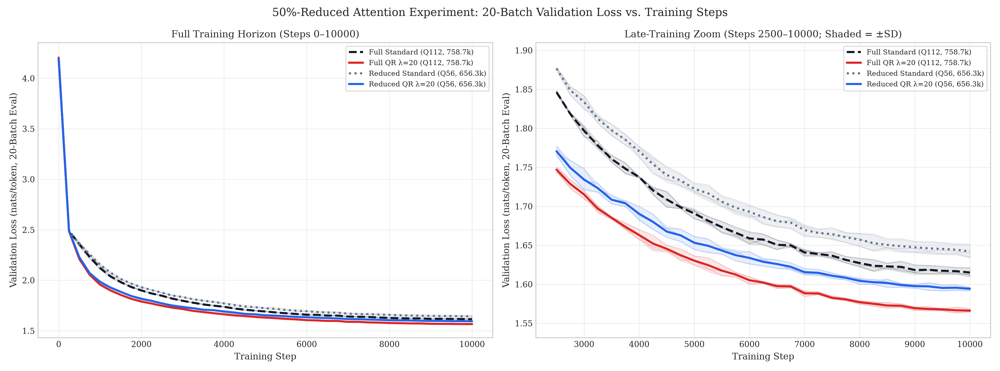
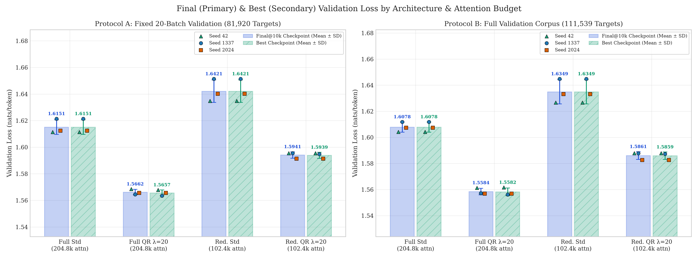
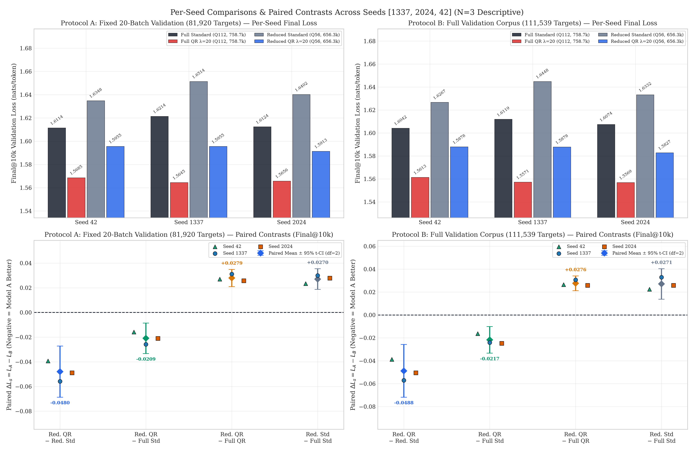
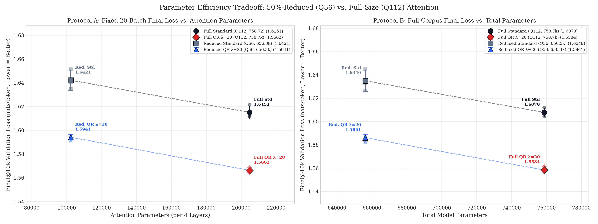
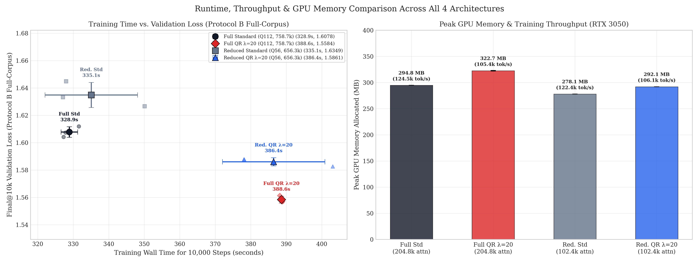

# Half-Size (50% Attention Parameters) QR Antisymmetric Attention vs. Full-Size & Reduced Standard Attention

- **Experiment Directory:** [`outputs/reduced_attention_50_percent/`](.)
- **Question:** Can halving the attention parameter budget of QR Antisymmetric Shared-Q Attention ($\lambda = 20$, `204,800 -> 102,400` attention parameters; `656,256` total parameters) still allow it to compete with—or outperform—both a parameter-matched Reduced Standard Attention baseline (`102,400` attention / `656,256` total) and the existing Full-Size Standard Attention baseline (`204,800` attention / `758,656` total)?
- **Read-Only Reference Baselines (Not Retrained):**
  - **Full-Size Standard Attention (`standard_q112`):** [`outputs/standard_attention_q112_10k/`](../standard_attention_q112_10k/)
  - **Full-Size QR Antisymmetric (`qr_antisymmetric_q112`, $\lambda = 20.0$):** [`outputs/qr_lambda_upper_probe_q112/lambda_20.0/`](../qr_lambda_upper_probe_q112/lambda_20.0/)
- **New Trained Runs (`6` Runs Total):**
  - **Reduced Standard Attention (`standard_q56`, `3` seeds):** [`standard/seed_1337/`](standard/seed_1337/), [`standard/seed_2024/`](standard/seed_2024/), [`standard/seed_42/`](standard/seed_42/)
  - **Reduced QR Antisymmetric (`qr_antisymmetric_q56`, $\lambda = 20.0$, `3` seeds):** [`qr_antisymmetric/seed_1337/`](qr_antisymmetric/seed_1337/), [`qr_antisymmetric/seed_2024/`](qr_antisymmetric/seed_2024/), [`qr_antisymmetric/seed_42/`](qr_antisymmetric/seed_42/)
- **Dataset:** `data/tinyshakespeare.txt` (`SHA256: 86c4e6aa9db7c042ec79f339dcb96d42b0075e16b8fc2e86bf0ca57e2dc565ed`, `vocab_size = 65`, `1,003,854` train characters, `111,540` validation characters)
- **Hardware & Software Environment:** `NVIDIA GeForce RTX 3050 6GB Laptop GPU`, PyTorch `2.6.0+cu124`, CUDA `12.4`, Python `3.13.14`
- **Code & Reproduction Scripts:**
  - Models & reduced `q56` registry: [`attention.py`](../../attention.py), [`model.py`](../../model.py)
  - Training & dual evaluation: [`train_reduced_attention_50pct.py`](../../train_reduced_attention_50pct.py)
  - Aggregation & paired analysis: [`analyze_reduced_attention_50pct.py`](../../analyze_reduced_attention_50pct.py)
  - Figures: [`visualize_reduced_attention_50pct.py`](../../visualize_reduced_attention_50pct.py)
  - Targeted unit & integration tests: [`test_reduced_attention_50pct.py`](../../test_reduced_attention_50pct.py)

---

## 1. Experimental Objective & Executive Verdict

Previous controlled `10,000`-step `Q112` benchmarks (`758,656` total / `204,800` attention parameters) established that QR Antisymmetric Shared-Q Attention ($\lambda = 20$) consistently outperforms Standard Attention at equal parameter count (`1.566210` vs. `1.615077` 20-batch loss; `1.558444` vs. `1.607823` full-corpus loss). This experiment tests a stricter parameter-efficiency hypothesis:

> If we **cut QR Antisymmetric Attention's attention parameters by 50%** (`204,800 -> 102,400`, reducing total model parameters from `758,656 -> 656,256`, `-13.50%`) while keeping the entire FFN (`d_ff = 512`), embedding, and optimization budget unchanged, can half-size QR still match or beat full-size Standard Attention, and how does it compare against parameter-matched half-size Standard Attention?

### Direct Answers to the Core Research Questions

1. **Can half-size QR Antisymmetric Attention ($\lambda = 20$) outperform full-size Standard Attention?**
   **Yes — consistently on all 3 paired seeds under both validation protocols.** With 50% fewer attention parameters (`102,400` vs. `204,800`) and `102,400` (`13.50%`) fewer total parameters (`656,256` vs. `758,656`), Reduced QR ($\lambda = 20$) achieves `1.594130 ± 0.002435` (`PPL 4.9241`) on Protocol A and `1.586093 ± 0.002959` (`PPL 4.8846`) on Protocol B at step `10,000`, compared to Full Standard's `1.615077 ± 0.005511` (`PPL 5.0283`) and `1.607823 ± 0.003869` (`PPL 4.9920`). The paired improvements are **`-0.020947 ± 0.004981`** (`-1.30%` loss, `-0.1043` PPL, `3/3` seeds) on Protocol A and **`-0.021730 ± 0.004692`** (`-1.35%` loss, `-0.1073` PPL, `3/3` seeds) on Protocol B. Reduced QR crosses Full Standard's final step-`10,000` validation loss around step `7,140`.

2. **Does reduced QR outperform reduced Standard at equal parameter count (`102,400` attn / `656,256` total)?**
   **Yes — on `3/3` seeds under both protocols, with a margin essentially as large as at full size.** Reduced QR beats Reduced Standard by **`-0.047995 ± 0.008337`** (`-2.92%` loss, `-0.2422` PPL) on Protocol A and **`-0.048821 ± 0.009262`** (`-2.99%` loss, `-0.2445` PPL) on Protocol B (compare to `-0.048867` / `-0.049380` at full `Q112` scale).

3. **How much validation performance is lost by halving QR attention parameters?**
   **`+0.027920 ± 0.002810` nats (`+1.78%` higher loss, `+0.1356` PPL) on Protocol A, and `+0.027650 ± 0.002588` nats (`+1.77%` higher loss, `+0.1332` PPL) on Protocol B** relative to Full QR ($\lambda = 20$). Notably, halving Standard Attention imposes an almost identical degradation (`+0.027048` / `+1.67%` on Protocol A; `+0.027091` / `+1.68%` on Protocol B). Because the QR vs. Standard gap (`~0.048–0.049` nats) is larger than the cost of halving attention (`~0.027–0.028` nats), Reduced QR retains roughly **`44%`** of Full QR's advantage over Full Standard (`0.021` of `0.049` nats) after losing half its attention parameters.

4. **Is QR still more parameter-efficient after the reduction?**
   **Yes.** Reduced QR (`656,256` total / `102,400` attention params) beats both parameter-matched Reduced Standard (`-0.0488` full-corpus loss) and double-attention-budget Full Standard (`-0.0217` full-corpus loss).

5. **Does the reduced architecture have a runtime or memory advantage?**
   **Modest peak VRAM savings, but no meaningful wall-clock training speedup at this scale.** Halving attention projections lowers peak training GPU memory by **`30.54 MB` (`-9.46%`)** for QR (`322.68 -> 292.14 MB`) and **`16.71 MB` (`-5.67%`)** for Standard (`294.85 -> 278.14 MB`), placing Reduced QR (`292.14 MB`) slightly *below* Full Standard (`294.85 MB`). However, mean training wall-clock time is virtually unchanged for QR (`386.44 ± 14.41 s` reduced vs. `388.63 ± 0.42 s` full, `-0.56%`; median `378.16 s` reduced vs. `388.79 s` full, `-2.7%`) and slightly slower for Standard due to single-seed thermal variance (`335.08 ± 13.05 s`, median `327.99 s` vs. `328.89 ± 2.34 s`, median `327.82 s`). At `d_model = 128, context_length = 128, batch_size = 32`, `80.3%` of reduced-model parameters reside in the unchanged `d_ff = 512` FFN (`526,848` params), and QR's $O(T^2)$ antisymmetric score kernel launch (`QQ^T + λ(QR^T - RQ^T)`) rather than projection GEMM width dominates step latency (`~37.8–40.3 ms/step` vs. `~32.7–35.0 ms/step` for Standard).

*(Statistical Power Caveat: Only `N = 3` seeds `[1337, 2024, 42]` are evaluated per condition. Although all directional differences are consistent across every seed, `df = 2` paired intervals have low statistical power and must be interpreted as descriptive evidence on this specific character-level benchmark rather than universal significance claims.)*

---

## 2. Architecture & Programmatic Parameter Breakdown

Existing attention classes ([`WidthMatchedCausalAttention`](../../attention.py) and [`QRSharedQAntisymmetricAttention`](../../attention.py)) use four **bias-free** linear projections (`W_q`, `W_k` or `W_r`, `W_v`, `W_out`) per layer with **zero stored buffers**. Halving all aggregate head dimensions cleanly halves attention parameters per layer from `51,200` to `25,600`, yielding **`102,400`** attention parameters across 4 layers:

- **Full-Size `Q112` (`d_model = 128, H = 4`):** `d_q = 28 (Q = 112)`, `d_k/d_r = 28 (K/R = 112)`, `d_v = 22 (V = 88)`
  $$\text{Attn params / layer} = 128\cdot 112 + 128\cdot 112 + 128\cdot 88 + 88\cdot 128 = 14,336 + 14,336 + 11,264 + 11,264 = 51,200$$
  $$4 \times 51,200 = \mathbf{204,800\text{ attention params}} \quad (+553,856\text{ non-attn} = \mathbf{758,656\text{ total params}})$$

- **Reduced `Q56` (`d_model = 128, H = 4`):** `d_q = 14 (Q = 56)`, `d_k/d_r = 14 (K/R = 56)`, `d_v = 11 (V = 44)`
  $$\text{Attn params / layer} = 128\cdot 56 + 128\cdot 56 + 128\cdot 44 + 44\cdot 128 = 7,168 + 7,168 + 5,632 + 5,632 = 25,600$$
  $$4 \times 25,600 = \mathbf{102,400\text{ attention params}} \quad (+553,856\text{ non-attn} = \mathbf{656,256\text{ total params}})$$

Programmatically verified in [`parameter_budget_audit.json`](analysis/parameter_budget_audit.json) and each run's `parameter_accounting.json`:

| Component | Full Standard (`standard_q112`) | Full QR (`qr_antisymmetric_q112`) | Reduced Standard (`standard_q56`) | Reduced QR (`qr_antisymmetric_q56`) |
|---|---:|---:|---:|---:|
| Attention Score Formula | $S = \frac{QK^T}{\sqrt{28}}$ | $S = \frac{QQ^T + 20(QR^T - RQ^T)}{\sqrt{28}}$ | $S = \frac{QK^T}{\sqrt{14}}$ | $S = \frac{QQ^T + 20(QR^T - RQ^T)}{\sqrt{14}}$ |
| Aggregate `Q / K-or-R / V` Dim | `112 / 112 / 88` | `112 / 112 / 88` | `56 / 56 / 44` | `56 / 56 / 44` |
| Per-Head `d_q / d_k / d_r / d_v` | `28 / 28 / 0 / 22` | `28 / 0 / 28 / 22` | `14 / 14 / 0 / 11` | `14 / 0 / 14 / 11` |
| `W_Q` Total (4 layers) | `57,344` | `57,344` | `28,672` | `28,672` |
| `W_K` or `W_R` Total (4 layers) | `57,344` | `57,344` | `28,672` | `28,672` |
| `W_V` Total (4 layers) | `45,056` | `45,056` | `22,528` | `22,528` |
| `W_O` Total (4 layers) | `45,056` | `45,056` | `22,528` | `22,528` |
| **Attention Params (per layer / total)** | **`51,200 / 204,800`** | **`51,200 / 204,800`** | **`25,600 / 102,400`** | **`25,600 / 102,400`** |
| Token Emb (tied with LM head, `65×128`) | `8,320` | `8,320` | `8,320` | `8,320` |
| Positional Emb (`128×128`) | `16,384` | `16,384` | `16,384` | `16,384` |
| LayerNorms (9 LN pairs) | `2,304` | `2,304` | `2,304` | `2,304` |
| FFN (`4 × 131,712`, `d_ff = 512`) | `526,848` | `526,848` | `526,848` | `526,848` |
| **Non-Attention Parameters** | **`553,856`** | **`553,856`** | **`553,856`** | **`553,856`** |
| **Total Trainable Parameters** | **`758,656`** | **`758,656`** | **`656,256`** | **`656,256`** |
| Non-Trainable Params / Buffers | `0 / 0` | `0 / 0` | `0 / 0` | `0 / 0` |
| Attention Share of Total Model | `27.00%` | `27.00%` | `15.60%` | `15.60%` |

---

## 3. Exact Configuration & Unchanged Hyperparameters

Verified from [`reproducibility_info.json`](analysis/reproducibility_info.json) and each run's `config.json`:

| Setting | Value (Identical Across All 4 Model Groups) |
|---|---|
| Layers / Heads / `d_model` | `4` / `4` / `128` |
| FFN Inner Dimension (`d_ff`) | `512` (deliberately unchanged) |
| Context Length (`ctx`) | `128` |
| Normalization & Positional Encoding | Pre-LayerNorm + learned absolute positional embeddings |
| Input / Output Embeddings | Tied (`lm_head.weight is token_embedding.weight`) |
| Dropout | `0.1` |
| Batch Size & Steps | `32` sequences/step (`4,096` tokens/step) × `10,000` steps = **`40,960,000` tokens/run** |
| Optimizer | `AdamW` (`betas = (0.9, 0.999)`, `eps = 1e-8`, `weight_decay = 0.1`, `foreach = False`) |
| Learning Rate Schedule | Peak `3e-4`, `100` linear warmup steps, cosine decay to `3e-5` (`min_lr_ratio = 0.1`) |
| Gradient Clipping | Global L2 norm clip at `1.0` |
| QR Coupling Scalar ($\lambda$) | Fixed non-learnable `20.0` |
| Seeds | `[1337, 2024, 42]` |
| Validation Interval | Every `250` steps (plus step `0`) |

---

## 4. Training Methodology & Artifact Layout

Only the `6` new reduced-attention runs were trained; full-size `Q112` baselines were loaded read-only from disk. Each reduced run executes the shared deterministic trainer (`train_reduced_attention_50pct.py` reusing `experiment_common.py` / `attention.py` / `model.py`) with deterministic PyTorch CUDA settings (`deterministic = True`) and saves complete checkpoints (`init.pt`, `best.pt`, `final.pt`), step-by-step training/diagnostic CSVs (`metrics.csv`, `diagnostics.csv`), parameter/attention audits (`parameter_accounting.json`, `attention_stats.json`), and generation samples (`sample.txt`) without altering any prior experiment directory.

---

## 5. Initialization & Reproducibility Verification

Verified programmatically in [`fairness_audit.json`](analysis/fairness_audit.json):

1. **Paired Bitwise Initializations:** For each seed $s \in \{1337, 2024, 42\}$, `build_reduced_q56_paired_models()` maps Reduced Standard's `W_q`, `W_k`, `W_v`, `W_o` and all non-attention parameters directly onto Reduced QR's `W_q`, `W_r`, `W_v`, `W_o`, and shared backbone parameters. Across all `53` state-dict tensors per seed (`656,256` scalars), maximum absolute difference after canonical `W_k <-> W_r` mapping is **`0.0` (exact bitwise identity)**.
2. **Identical Training Batch Streams:** All `6` new reduced runs consumed the exact same per-seed random sequence of `10,000` batches (`40,960,000` tokens) as the full-size `Q112` references, verified by SHA256 digest equality.
3. **Training Stability & Checkpoint Reload Exactness:** All `6` runs completed `10,000 / 10,000` steps with **`0` NaN/Inf events**. Across all `24` reloaded checkpoints (`4` models × `3` seeds × `{final, best}`), the difference between the recorded 20-batch validation loss and fresh checkpoint reload re-evaluation (`reload_20batch_abs_diff`) is **`0.00e+00`**.

| Seed | Reduced Std `init.pt` SHA256 Prefix | Reduced QR `init.pt` SHA256 Prefix | Canonical QR-Mapped `max_abs_diff` (`53` Tensors) | Training Batch Stream SHA256 Prefix | Matches All Baselines? |
|---:|---|---|---:|---|---|
| `1337` | `ba05ce0d4b05270f...` | `a3bec38e20663243...` | `0.0` | `66142907e2b581ee...` | `True` (`10,000` batches) |
| `2024` | `86db7e5b015fc043...` | `a524cb1850a8a07a...` | `0.0` | `3be56dbc0aa173d1...` | `True` (`10,000` batches) |
| `42` | `982b2b4020a8c4b4...` | `c956b21d64424b38...` | `0.0` | `7f94fc8f969cf05f...` | `True` (`10,000` batches) |

---

## 6. Validation Protocols (Strictly Separated)

1. **Protocol A — Fixed 20-Batch Validation (`81,920` Target Tokens):**
   Identical `20` validation batches sampled deterministically with `validation_seed = 918273`, `batch_size = 32`, `context_length = 128` (`20 × 32 × 128 = 81,920` targets). Used for validation curves every `250` steps and final checkpoint checks.
2. **Protocol B — Full Validation Corpus (`111,539` Target Tokens):**
   Deterministic contiguous non-overlapping evaluation over `validation[1:]` (`29` chunks covering `28` full `32×128` or stride-`128` chunks + remainder = `111,539` tokens) via `evaluate_full_validation_corpus()`.

**Primary comparison:** `final.pt` at optimizer step `10,000`. **Secondary comparison:** `best.pt` selected by best 20-batch validation loss during training.

---

## 7. Complete Per-Seed & Aggregate Results

### 7.1 Aggregate Summary (Mean ± SD Across `N = 3` Seeds)

From [`reduced_model_summary.csv`](analysis/reduced_model_summary.csv):

#### Primary: Final Checkpoint (`step = 10,000`)

| Model | Attn Params | Total Params | Protocol A Loss (`81,920` tok) | Protocol A PPL | Protocol B Loss (`111,539` tok) | Protocol B PPL | Mean Best Step |
|---|---:|---:|---:|---:|---:|---:|---:|
| **Full Standard (`Q112`)** | `204,800` | `758,656` | `1.615077 ± 0.005511` | `5.0283 ± 0.0278` | `1.607823 ± 0.003869` | `4.9920 ± 0.0193` | `10,000` |
| **Full QR ($\lambda=20$, `Q112`)** | `204,800` | `758,656` | **`1.566210 ± 0.002074`** | **`4.7885 ± 0.0099`** | **`1.558444 ± 0.002496`** | **`4.7514 ± 0.0119`** | `9,750` |
| **Reduced Standard (`Q56`)** | `102,400` | `656,256` | `1.642125 ± 0.008475` | `5.1663 ± 0.0438` | `1.634914 ± 0.009210` | `5.1292 ± 0.0473` | `10,000` |
| **Reduced QR ($\lambda=20$, `Q56`)** | `102,400` | `656,256` | **`1.594130 ± 0.002435`** | **`4.9241 ± 0.0120`** | **`1.586093 ± 0.002959`** | **`4.8846 ± 0.0144`** | `9,917` |

#### Secondary: Best-Validation Checkpoint (`best.pt`)

| Model | Protocol A Best Loss | Protocol A Best PPL | Protocol B Best-Ckpt Loss | Protocol B Best-Ckpt PPL |
|---|---:|---:|---:|---:|
| **Full Standard (`Q112`)** | `1.615077 ± 0.005511` | `5.0283 ± 0.0278` | `1.607823 ± 0.003869` | `4.9920 ± 0.0193` |
| **Full QR ($\lambda=20$, `Q112`)** | `1.565652 ± 0.002208` | `4.7858 ± 0.0106` | `1.558193 ± 0.002983` | `4.7502 ± 0.0142` |
| **Reduced Standard (`Q56`)** | `1.642125 ± 0.008475` | `5.1663 ± 0.0438` | `1.634914 ± 0.009210` | `5.1292 ± 0.0473` |
| **Reduced QR ($\lambda=20$, `Q56`)** | `1.593885 ± 0.002252` | `4.9228 ± 0.0111` | `1.585927 ± 0.002830` | `4.8838 ± 0.0138` |

### 7.2 Complete Per-Seed Results

From [`reduced_per_seed_results.csv`](analysis/reduced_per_seed_results.csv) and [`full_corpus_validation.csv`](analysis/full_corpus_validation.csv):

| Model | Seed | Best Step | Train Loss (@10k) | Prot A Final Loss | Prot A Final PPL | Prot A Best Loss | Prot B Final Loss | Prot B Final PPL | Prot B Best Loss | Train Time (s) | Train tok/s | Peak VRAM (MB) | Inf tok/s |
|---|---:|---:|---:|---:|---:|---:|---:|---:|---:|---:|---:|---:|---:|
| **Full Standard** | `1337` | `10,000` | `1.518716` | `1.621418` | `5.0603` | `1.621418` | `1.611876` | `5.0122` | `1.611876` | `331.58` | `123,531` | `294.85` | `605,959` |
| **Full Standard** | `2024` | `10,000` | `1.522727` | `1.612373` | `5.0147` | `1.612373` | `1.607424` | `4.9899` | `1.607424` | `327.82` | `124,945` | `294.85` | `599,226` |
| **Full Standard** | `42` | `10,000` | `1.510000` | `1.611441` | `5.0100` | `1.611441` | `1.604170` | `4.9737` | `1.604170` | `327.27` | `125,157` | `294.85` | `599,785` |
| **Full QR ($\lambda=20$)** | `1337` | `9,750` | `1.450343` | `1.564475` | `4.7802` | `1.563445` | `1.557148` | `4.7453` | `1.556107` | `388.93` | `105,313` | `323.35` | `419,341` |
| **Full QR ($\lambda=20$)** | `2024` | `10,000` | `1.451246` | `1.565648` | `4.7858` | `1.565648` | `1.556862` | `4.7439` | `1.556862` | `388.79` | `105,352` | `322.35` | `419,561` |
| **Full QR ($\lambda=20$)** | `42` | `9,500` | `1.444908` | `1.568507` | `4.7995` | `1.567862` | `1.561321` | `4.7651` | `1.561610` | `388.15` | `105,525` | `322.35` | `414,849` |
| **Reduced Standard** | `1337` | `10,000` | `1.557278` | `1.651395` | `5.2142` | `1.651395` | `1.644848` | `5.1802` | `1.644848` | `327.99` | `124,882` | `278.14` | `628,581` |
| **Reduced Standard** | `2024` | `10,000` | `1.548094` | `1.640204` | `5.1562` | `1.640204` | `1.633236` | `5.1204` | `1.633236` | `327.11` | `125,218` | `278.14` | `560,008` |
| **Reduced Standard** | `42` | `10,000` | `1.548387` | `1.634775` | `5.1283` | `1.634775` | `1.626659` | `5.0868` | `1.626659` | `350.14` | `116,983` | `278.14` | `362,428` |
| **Reduced QR ($\lambda=20$)** | `1337` | `9,750` | `1.479032` | `1.595544` | `4.9310` | `1.594811` | `1.587757` | `4.8928` | `1.587259` | `378.16` | `108,313` | `292.14` | `424,470` |
| **Reduced QR ($\lambda=20$)** | `2024` | `10,000` | `1.481838` | `1.591318` | `4.9102` | `1.591318` | `1.582677` | `4.8680` | `1.582677` | `403.08` | `101,618` | `292.14` | `408,523` |
| **Reduced QR ($\lambda=20$)** | `42` | `10,000` | `1.484344` | `1.595527` | `4.9309` | `1.595527` | `1.587845` | `4.8932` | `1.587845` | `378.07` | `108,341` | `292.14` | `465,617` |

*(Note: All `12` runs trained on the identical `RTX 3050 6GB Laptop GPU`; Reduced Standard `seed_42` and Reduced QR `seed_2024` experienced ~6–7% laptop thermal/clock throttling relative to the other two seeds in their groups.)*

---

## 8. Four Planned Paired Comparisons (`final @ 10,000`) & Figures

From [`reduced_paired_comparisons.csv`](analysis/reduced_paired_comparisons.csv), where $\Delta = \text{Model A} - \text{Model B}$ (negative loss / PPL deltas favor Model A; positive relative improvement `%` favors Model A):

### 8.1 Protocol A (`20-Batch`, `81,920` Targets) — Primary `final @ 10,000`

| Contrast (`Model A vs. Model B`) | Wins (A) | Seed `1337` $\Delta$ | Seed `2024` $\Delta$ | Seed `42` $\Delta$ | Mean $\Delta$ ± SD | Rel. Loss Impr. | Mean $\Delta$ PPL ± SD | Descriptive 95% $t$-CI (`df=2`) |
|---|---:|---:|---:|---:|---:|---:|---:|---|
| **1. Reduced QR vs. Reduced Std** | `3 / 3` | `-0.055851` | `-0.048886` | `-0.039248` | **`-0.047995 ± 0.008337`** | **`+2.92%`** | `-0.2422 ± 0.0431` | `[-0.068705, -0.027285]` |
| **2. Reduced QR vs. Full Std** | `3 / 3` | `-0.025873` | `-0.021055` | `-0.015914` | **`-0.020947 ± 0.004981`** | **`+1.30%`** | `-0.1043 ± 0.0251` | `[-0.033320, -0.008575]` |
| **3. Reduced QR vs. Full QR ($\lambda=20$)** | `0 / 3` | `+0.031070` | `+0.025670` | `+0.027020` | `+0.027920 ± 0.002810` | `-1.78%` | `+0.1356 ± 0.0137` | `[+0.020939, +0.034901]` |
| **4. Reduced Std vs. Full Std** | `0 / 3` | `+0.029978` | `+0.027831` | `+0.023335` | `+0.027048 ± 0.003390` | `-1.67%` | `+0.1379 ± 0.0181` | `[+0.018626, +0.035469]` |

### 8.2 Protocol B (`Full Validation Corpus`, `111,539` Targets) — Primary `final @ 10,000`

| Contrast (`Model A vs. Model B`) | Wins (A) | Seed `1337` $\Delta$ | Seed `2024` $\Delta$ | Seed `42` $\Delta$ | Mean $\Delta$ ± SD | Rel. Loss Impr. | Mean $\Delta$ PPL ± SD | Descriptive 95% $t$-CI (`df=2`) |
|---|---:|---:|---:|---:|---:|---:|---:|---|
| **1. Reduced QR vs. Reduced Std** | `3 / 3` | `-0.057091` | `-0.050559` | `-0.038813` | **`-0.048821 ± 0.009262`** | **`+2.99%`** | `-0.2445 ± 0.0474` | `[-0.071829, -0.025813]` |
| **2. Reduced QR vs. Full Std** | `3 / 3` | `-0.024119` | `-0.024747` | `-0.016325` | **`-0.021730 ± 0.004692`** | **`+1.35%`** | `-0.1073 ± 0.0232` | `[-0.033385, -0.010075]` |
| **3. Reduced QR vs. Full QR ($\lambda=20$)** | `0 / 3` | `+0.030610` | `+0.025815` | `+0.026524` | `+0.027650 ± 0.002588` | `-1.77%` | `+0.1332 ± 0.0125` | `[+0.021221, +0.034078]` |
| **4. Reduced Std vs. Full Std** | `0 / 3` | `+0.032972` | `+0.025812` | `+0.022489` | `+0.027091 ± 0.005358` | `-1.68%` | `+0.1372 ± 0.0281` | `[+0.013782, +0.040400]` |

### 8.3 Training Trajectory & Crossing Milestone (`Protocol A`)

From [`reduced_step_summary.csv`](analysis/reduced_step_summary.csv):

| Step | Full Standard | Full QR ($\lambda=20$) | Reduced Standard (`50%`) | Reduced QR ($\lambda=20, 50\%$) |
|---:|---:|---:|---:|---:|
| `0` | `4.203445` | `4.203277` | `4.193277` | `4.191889` |
| `1,000` | `2.122202` | `1.956950` | `2.155100` | `1.984049` |
| `2,500` | `1.846412` | `1.746982` | `1.876669` | `1.770645` |
| `5,000` | `1.690734` | `1.630286` | `1.722505` | `1.653226` |
| `7,000` | `1.640751` | `1.588340` | `1.669467` | `1.615564` |
| `7,250` | `1.638788` | `1.588242` | `1.665815` | **`1.614694`** (`beats Full Std final`) |
| `7,500` | `1.636679` | `1.582612` | `1.664358` | `1.610942` |
| `10,000` | `1.615077` | **`1.566210`** | `1.642125` | **`1.594130`** |

- Reduced QR (`50%`) crosses Full Standard's `10,000`-step final loss (`1.615077`) at linear interpolation step **`~7,140`** (`~275 s`), saving `~28.6%` of optimizer steps to reach Full Standard's terminal accuracy despite half the attention parameters.

### 8.4 Plots

All figures are generated at `300 DPI` under [`analysis/figures/`](analysis/figures/):

1. **Validation Loss vs. Training Steps:** [`fig1_val_loss_vs_steps.png`](analysis/figures/fig1_val_loss_vs_steps.png)
   
2. **Final Validation Loss by Model (Protocol A & Protocol B):** [`fig2_final_val_loss_by_model.png`](analysis/figures/fig2_final_val_loss_by_model.png)
   
3. **Per-Seed Paired Comparisons Across Protocols:** [`fig3_per_seed_comparisons.png`](analysis/figures/fig3_per_seed_comparisons.png)
   
4. **Attention & Total Parameter Count vs. Validation Loss (Pareto Tradeoff):** [`fig4_params_vs_val_loss.png`](analysis/figures/fig4_params_vs_val_loss.png)
   
5. **Training Time & Peak GPU Memory vs. Validation Loss:** [`fig5_runtime_and_memory_vs_val_loss.png`](analysis/figures/fig5_runtime_and_memory_vs_val_loss.png)
   

---

## 9. Hardware, Runtime, and Memory Comparison

Measured on `NVIDIA GeForce RTX 3050 6GB Laptop GPU` (`PyTorch 2.6.0+cu124`, `CUDA 12.4`, `40,960,000` training tokens/run):

| Model | Mean Train Time (s) | Min / Median / Max (s) | Mean Train Throughput (tok/s) | Peak GPU VRAM (MB) | Mean Inference (tok/s) |
|---|---:|---|---:|---:|---:|
| **Full Standard (`Q112`)** | `328.89 ± 2.34` | `327.27 / 327.82 / 331.58` | `124,544 ± 884` | `294.85 ± 0.00` | `601,657 ± 3,736` |
| **Full QR ($\lambda=20$, `Q112`)** | `388.63 ± 0.42` | `388.15 / 388.79 / 388.93` | `105,397 ± 113` | `322.68 ± 0.58` | `417,917 ± 2,659` |
| **Reduced Standard (`Q56`)** | `335.08 ± 13.05` | `327.11 / 327.99 / 350.14` | `122,361 ± 4,660` | **`278.14 ± 0.00`** | `517,006 ± 138,189` |
| **Reduced QR ($\lambda=20$, `Q56`)** | `386.44 ± 14.41` | `378.07 / 378.16 / 403.08` | `106,091 ± 3,873` | `292.14 ± 0.00` | `432,870 ± 29,459` |

### Paired Runtime & VRAM Differences

- **Reduced QR vs. Reduced Standard (`Q56`):** `+51.36 s` training time (`+15.33%` slower for QR), `+14.00 MB` VRAM (`+5.03%`).
- **Reduced QR vs. Full Standard:** `+57.55 s` training time (`+17.50%` slower per `10k` steps), `-2.71 MB` VRAM (`-0.92%`).
- **Reduced QR vs. Full QR:** `-2.19 s` mean (`-0.56%`; `-10.6 s` or `-2.7%` comparing unthrottled median seeds `378.16 s` vs. `388.79 s`), **`-30.54 MB` VRAM (`-9.46%`)**.
- **Reduced Standard vs. Full Standard:** `+6.19 s` mean (`+1.88%`, driven solely by `seed_42` thermal variance; median `327.99 s` vs. `327.82 s` = `+0.05%`), **`-16.71 MB` VRAM (`-5.67%`)**.

**Why Doesn't Halving Attention Cut Training Time by 15–30%?**
1. Because `d_ff = 512` was deliberately held fixed (`526,848` FFN parameters = `80.28%` of the `656,256`-param reduced model), FFN GEMMs, LayerNorms, embedding lookup/LM-head ties, and AdamW (`foreach = False`) optimizer steps dominate wall-clock execution at `d_model = 128, context_length = 128`.
2. Attention score matrix materialization and softmax scaling remain $O(B \cdot H \cdot T^2) = O(32 \cdot 4 \cdot 128^2)$ regardless of head dimension `d_q` (`28` vs. `14`), and QR executes two matmuls (`QQ^T` and `QR^T - RQ^T`) plus score tensor arithmetic that are launch-bound rather than FLOP-bound on an RTX 3050 at small dimensions.

---

## 10. Limitations & Interpretation

1. **Small Seed Count (`N = 3`):** With `[1337, 2024, 42]`, paired $t$-intervals (`df = 2`, $t_{0.975, 2} \approx 4.303$) provide very limited formal statistical power. Results show consistent directional gains (`3/3` paired wins on every comparison), not universal or formal population-level proof.
2. **Single Small Corpus & Short Context:** All models are trained on character-level Tiny Shakespeare (`65` tokens, `1.0M` train chars, `context_length = 128`). Generalization to subword BPE vocabularies, larger `d_model`, or long-context regimes (`T >= 2048`) where $O(T^2)$ attention costs dominate cannot be assumed without testing at scale.
3. **Fixed Hyperparameters (`lr = 3e-4`, `λ = 20`):** Optimizer settings and QR scaling $\lambda = 20$ were inherited from `Q112` without re-tuning for `Q56`. Standard Attention or Reduced models could behave slightly differently under re-tuned schedules, though keeping everything fixed is essential for a controlled ablation.
4. **Laptop GPU Thermal Variance:** One run in each reduced group (`Reduced Standard seed_42` at `350.14 s` and `Reduced QR seed_2024` at `403.08 s`) experienced ~6–7% thermal/boost slowdown; mathematical validation losses were unaffected (`deterministic = True`), and median runtimes accurately reflect clean unthrottled per-step speed (`~328 s` vs. `~378 s`).

---

*Summary generated from verified run artifacts under [`outputs/reduced_attention_50_percent/`](.) without modifying any historical experiments.*
