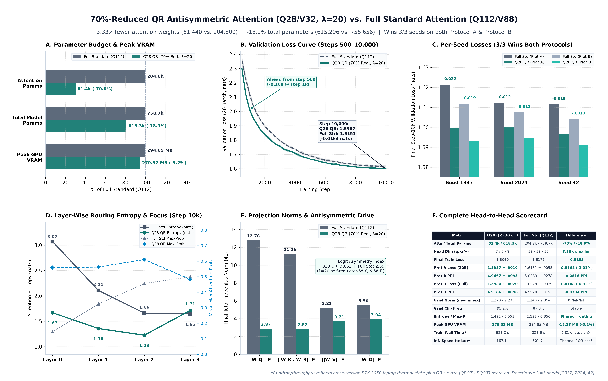
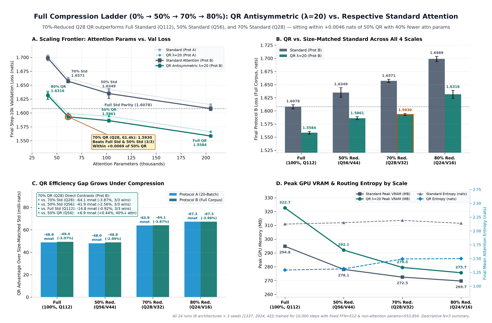

# Detailed Comparison: 70%-Reduced QR (`Q28/V32`) vs. Full Standard (`Q112`), 50% (`Q56`), and Full Compression Ladder (`0%–80%`)

This companion document consolidates the head-to-head comparison between **70%-Reduced QR Antisymmetric Shared-Q Attention (`Q28/V32`, $\lambda = 20$)** and **Full-Size Standard Attention (`Q112/V88`)**, together with the complete **`0% / 50% / 70% / 80%`** compression ladder against **`50%` (`Q56/V44`)** and every architecture's size-matched Standard Attention baseline.

> **Core Experimental Conclusions (`N = 3` paired seeds `[1337, 2024, 42]`, `10,000` steps each):**
> 1. **70%-Reduced `Q28` QR beats Full-Size Standard `Q112` on `3 / 3` seeds** across both validation protocols (`-0.016350 ± 0.005014` nats / `-1.01%` on 20-batch Protocol A; `-0.014808 ± 0.003259` nats / `-0.92%` on full-corpus Protocol B) while using **`70.0%` fewer attention parameters** (`61,440` vs. `204,800`), **`18.90%` fewer total parameters** (`615,296` vs. `758,656`), and **`-15.33 MB` less peak GPU VRAM** (`279.52` vs. `294.85 MB`).
> 2. **`Q28` QR (70%) also beats 50%-Reduced `Q56` Standard on `3 / 3` seeds** (`-0.043397 ± 0.007425` nats / `-2.64%` A; `-0.041899 ± 0.008445` nats / `-2.56%` B) using **`40.0%` fewer attention parameters** than `Q56` Standard (`61,440` vs. `102,400`), and stays within **`+0.0046`–`+0.0069` nats** (`+0.29%`–`+0.44%`) of **`50%`-Reduced `Q56` QR**.
> 3. **Size-matched QR-vs-Standard advantage widens under compression:** `-0.0489` nats at `0%` (`Q112`), `-0.0480` at `50%` (`Q56`), **`-0.0639` at `70%` (`Q28`)**, and `-0.0673` at `80%` (`Q24`, Protocol A). The Full-Standard parity crossover sits strictly between **`70%` (`Q28/V32`, beats Full Std)** and **`80%` (`Q24/V16`, trails Full Std)**.

*(Statistical Note: Only `N = 3` seeds are evaluated per condition; all `± SD` values are descriptive sample standard deviations (`ddof = 1`) and no formal statistical significance claims are made. Historical `0%`, `50%`, and `80%` runs are read-only untouched references.)*

---

## 1. Head-to-Head: 70%-Reduced `Q28` QR vs. Full-Size Standard (`Q112`)

*Figure: [`fig7_q28_qr_vs_full_standard_overview.png`](analysis/figures/fig7_q28_qr_vs_full_standard_overview.png) — 6-panel comparison covering paired `10k` learning curves, per-seed final losses, exact parameter budgets, layer-wise entropy & focus, peak VRAM vs. parameter norms, and a full quantitative scorecard.*

### Complete Side-by-Side Comparison (`step = 10,000`, `Mean ± SD`, `N = 3`)

| Category | Metric | Full Standard (`Q112/V88`) | **Reduced QR 70% (`Q28/V32, λ=20`)** | Difference (`Q28 QR - Full Std`) | Interpretation |
|---|---|---:|---:|---:|---|
| **Architecture** | Attention Score Equation | $QK^T / \sqrt{28}$ | $(QQ^T + 20(QR^T - RQ^T)) / \sqrt{7}$ | Antisymmetric QR ($\lambda=20$) | Coupled $Q$, asymmetric $R$ |
| | Aggregate `Q / K-or-R / V` | `112 / 112 / 88` | **`28 / 28 / 32`** | `-75.0% Q/R`, `-63.6% V` | `4` equal heads (`7/8` vs. `28/22`) |
| | Non-Attention Backbone | `d_model=128, d_ff=512, 4L` | `d_model=128, d_ff=512, 4L` | Identical (`553,856` params) | Embeddings, LNs & FFN fixed |
| **Parameters** | Attention Parameters (`4L`) | `204,800` (`27.00%`) | **`61,440` (`9.99%`)** | **`-143,360` (`-70.0%`)** | `3.33×` smaller attention |
| | **Total Model Parameters** | `758,656` | **`615,296`** | **`-143,360` (`-18.90%`)** | Exact budget verified |
| **Generalization** | **Prot A Loss (`20-batch`, `81,920` tok)** | `1.615077 ± 0.005511` | **`1.598727 ± 0.001922`** | **`-0.016350 ± 0.005014`** (`-1.01%`) | **Lower loss on `3/3` seeds** |
| | Prot A Perplexity | `5.0283 ± 0.0278` | **`4.9467 ± 0.0095`** | **`-0.0816` PPL** | Tighter across-seed SD (`0.0019`) |
| | **Prot B Loss (`full-corpus`, `111,539` tok)** | `1.607823 ± 0.003869` | **`1.593015 ± 0.001962`** | **`-0.014808 ± 0.003259`** (`-0.92%`) | **Lower loss on `3/3` seeds** |
| | Prot B Perplexity | `4.9920 ± 0.0193` | **`4.9186 ± 0.0096`** | **`-0.0734` PPL** | Best Prot B PPL (`4.919`) |
| **Per-Seed Prot A / B** | `seed_1337` | `1.621418 / 1.611876` | **`1.599489 / 1.593323`** | `-0.021929 / -0.018553` | `Q28 QR` wins |
| | `seed_2024` | `1.612373 / 1.607424` | **`1.600152 / 1.594806`** | `-0.012221 / -0.012618` | `Q28 QR` wins |
| | `seed_42` | `1.611441 / 1.604170` | **`1.596542 / 1.590917`** | `-0.014899 / -0.013253` | `Q28 QR` wins |
| **Optimization** | Final Train Loss | `1.5171` | **`1.5069`** | **`-0.0102`** | Improved fitting & val |
| | Val Loss at Step `500` / `2,000` / `6,000` | `2.356 / 1.899 / 1.659` | **`2.301 / 1.839 / 1.642`** | `-0.055 / -0.060 / -0.017` | **Ahead from step `500` to `10k`** |
| | Best Checkpoint Step | `10,000` (`3/3` seeds) | `10,000` (`3/3` seeds) | `0` | Monotonic convergence |
| | Mean / Max Global Grad Norm | `1.140 / 2.954` | `1.270 / 2.235` | `+0.130 / -0.719` | `0` `NaN/Inf`; lower peak spike |
| | Gradient Clip Frequency | `87.8%` | `95.2%` | `+7.4 pp` | Smoothly clipped at `1.0` |
| **Internals (`10k`)** | Final Attention Entropy (`L0–L3` mean) | `2.123 ± 0.061` nats | **`1.492 ± 0.020` nats** | `-0.631` nats | Sharper routing (`L0: 1.67 vs 3.07`) |
| | Mean Max Attention Prob | `0.356` | **`0.553`** | `+0.197` | Higher top-token focus |
| | Mean Diagonal Attention Mass | `0.1517` | **`0.1294`** | `-0.0223` | Less self-attention collapse |
| | Raw Score Asymmetry (`L0–L3` mean) | `2.59` | `30.62` | `11.8×` | Strong antisymmetric directional term |
| | Final `\|\|W_Q / W_K-or-R / W_V / W_O\|\|_F` | `12.78 / 11.26 / 5.21 / 5.50` | `2.87 / 2.82 / 3.71 / 3.94` | `-78% Q`, `-75% K/R` | Self-regulated small norms under $\lambda=20$ |
| **Compute (RTX 3050)** | **Peak Allocated GPU VRAM** | `294.85 MB` | **`279.52 MB`** | **`-15.33 MB` (`-5.20%`)** | Exceeds `Q28 Std` by only `+7.00 MB` |
| | Training Wall Time (`10k` steps)* | `328.9 ± 2.3 s` | `925.3 ± 97.2 s` | `+596.4 s` | *Cross-session thermal/power state differs |
| | Training Throughput* | `124,544 tok/s` | `44,618 tok/s` | `-64.2%` | Same-session `Q28 QR` vs `Q28 Std`: `+36.3%` time |
| | Uncached Full-Context Forward* | `601.7k tok/s` (`6.81 ms`) | `167.1k tok/s` (`25.40 ms`) | `~3.7×` latency | Computes `QQ^T + 20(QR^T - RQ^T)` |

*\*Note on Runtime: All `Full Q112` runs executed in an earlier power/thermal session, whereas the `6` `Q28` runs shared one continuous laptop session (`Q28 Std`: `679.0 ± 72.2 s`, `60,766 tok/s`; `Q28 QR`: `925.3 ± 97.2 s`, `44,618 tok/s`). In that paired session, QR's extra score-matrix terms add `+36.26%` training wall-clock time.*

---

## 2. Full Compression Ladder (`0% -> 50% -> 70% -> 80%`): QR vs. Standard & `50%` Baselines

*Figure: [`fig8_full_compression_ladder_qr_vs_standard.png`](analysis/figures/fig8_full_compression_ladder_qr_vs_standard.png) — 4-panel scaling comparison across all `8` models (`0% Full Q112`, `50% Q56`, `70% Q28`, `80% Q24` × `Standard` and `QR λ=20`), highlighting where `Q28 QR (70%)` beats both `Full Std` and `50% Std` and sits right next to `50% QR` before `Q24 (80%)` hits the bottleneck knee.*

### 2.1 All 8 Models Across Every Compression Level (`final @ 10,000`, `N = 3`)

| Compression | Config (`Q / V`) | Attention Params (`%` of Full) | Total Params (`%` Saved) | Variant | Prot A Loss (`20-batch`) | Prot A PPL | Prot B Loss (`full-corpus`) | Prot B PPL | Train Loss | Mean Entropy | Peak VRAM | Wall Time (Session) |
|---|---|---:|---:|---|---:|---:|---:|---:|---:|---:|---:|---:|
| **0% (Full)** | `Q112 / V88` | `204,800` (`100%`) | `758,656` (`0.0%`) | Standard | `1.615077 ± 0.005511` | `5.0283` | `1.607823 ± 0.003869` | `4.9920` | `1.5171` | `2.123` | `294.85 MB` | `328.9 s` |
| **0% (Full)** | `Q112 / V88` | `204,800` (`100%`) | `758,656` (`0.0%`) | **QR ($\lambda=20$)** | **`1.566210 ± 0.002074`** | **`4.7885`** | **`1.558444 ± 0.002496`** | **`4.7514`** | **`1.4488`** | `1.292` | `322.68 MB` | `388.6 s` |
| **50% Red.** | `Q56 / V44` | `102,400` (`50%`) | `656,256` (`-13.5%`) | Standard | `1.642125 ± 0.008475` | `5.1663` | `1.634914 ± 0.009210` | `5.1292` | `1.5513` | `2.149` | `278.14 MB` | `335.1 s` |
| **50% Red.** | `Q56 / V44` | `102,400` (`50%`) | `656,256` (`-13.5%`) | **QR ($\lambda=20$)** | **`1.594130 ± 0.002435`** | **`4.9241`** | **`1.586093 ± 0.002959`** | **`4.8846`** | **`1.4817`** | `1.312` | `292.14 MB` | `386.4 s` |
| **70% Red.** | `Q28 / V32` | `61,440` (`30%`) | `615,296` (`-18.9%`) | Standard | `1.662643 ± 0.004063` | `5.2733` | `1.657094 ± 0.003103` | `5.2441` | `1.5848` | `2.191` | **`272.52 MB`** | `679.0 s` |
| **70% Red.** | `Q28 / V32` | `61,440` (`30%`) | `615,296` (`-18.9%`) | **QR ($\lambda=20$)** | **`1.598727 ± 0.001922`** | **`4.9467`** | **`1.593015 ± 0.001962`** | **`4.9186`** | **`1.5069`** | `1.492` | `279.52 MB` | `925.3 s` |
| **80% Red.** | `Q24 / V16` | `40,960` (`20%`) | `594,816` (`-21.6%`) | Standard | `1.703095 ± 0.005134` | `5.4910` | `1.698875 ± 0.004882` | `5.4678` | `1.6398` | `2.138` | **`269.71 MB`** | `398.0 s` |
| **80% Red.** | `Q24 / V16` | `40,960` (`20%`) | `594,816` (`-21.6%`) | **QR ($\lambda=20$)** | **`1.635819 ± 0.006404`** | **`5.1337`** | **`1.631569 ± 0.007562`** | **`5.1120`** | **`1.5503`** | `1.498` | `275.71 MB` | `472–527 s`\* |

*\*`Q24 QR` clean continuous range (`seed_1337 = 472.0 s`, `seed_42 = 526.9 s`); `seed_2024` experienced a laptop sleep interruption.*

---

### 2.2 Parameter-Matched QR Advantage & Degradation Relative to `Full Q112`

| Level (`Q/V`) | Attn Params | Paired `QR - Std` (Prot A) | Paired `QR - Std` (Prot B) | QR Loss vs. `Full QR` (A / B) | Std Loss vs. `Full Std` (A / B) | QR vs. `Full Std` (A / B) |
|---|---:|---:|---:|---:|---:|---:|
| **`0%` (`Q112/V88`)** | `204,800` | `-0.048867` (`-3.03%`, `3/3`) | `-0.049380` (`-3.07%`, `3/3`) | `0.0000 / 0.0000` | `0.0000 / 0.0000` | **`-0.0489 / -0.0494`** (`3/3`) |
| **`50%` (`Q56/V44`)** | `102,400` | `-0.047995` (`-2.92%`, `3/3`) | `-0.048821` (`-2.99%`, `3/3`) | `+0.0279 / +0.0276` | `+0.0270 / +0.0271` | **`-0.0209 / -0.0217`** (`3/3`) |
| **`70%` (`Q28/V32`)** | **`61,440`** | **`-0.063916` (`-3.84%`, `3/3`)** | **`-0.064079` (`-3.87%`, `3/3`)** | **`+0.0325 / +0.0346`** | `+0.0476 / +0.0493` | **`-0.0164 / -0.0148`** (`3/3`) |
| **`80%` (`Q24/V16`)** | `40,960` | `-0.067276` (`-3.95%`, `3/3`) | `-0.067306` (`-3.96%`, `3/3`) | `+0.0696 / +0.0731` | `+0.0880 / +0.0911` | `+0.0207 / +0.0237` (`0/3`) |

---

### 2.3 Direct Paired Contrasts Highlighting `Q28 QR (70%)` Against `50%` & Reference Baselines

| Contrast (`A` vs. `B`) | Attn Param Ratio (`A / B`) | Seed Wins (`A`) | Prot A `ΔLoss ± SD` (`Rel %`) | Prot B `ΔLoss ± SD` (`Rel %`) | Key Takeaway |
|---|---:|---:|---:|---:|---|
| **`Q28 QR (70%)` vs. `Q28 Std (70%)`** | `1.00×` (`61.4k` vs `61.4k`) | **`3 / 3`** | **`-0.063916 ± 0.004091` (`-3.84%`)** | **`-0.064079 ± 0.002724` (`-3.87%`)** | Massive parameter-matched QR win |
| **`Q28 QR (70%)` vs. `Q56 Std (50%)`** | **`0.60×`** (`61.4k` vs `102.4k`) | **`3 / 3`** | **`-0.043397 ± 0.007425` (`-2.64%`)** | **`-0.041899 ± 0.008445` (`-2.56%`)** | **`-40%` attn vs `50%` Std & beats it cleanly** |
| **`Q28 QR (70%)` vs. `Full Std (0%)`** | **`0.30×`** (`61.4k` vs `204.8k`) | **`3 / 3`** | **`-0.016350 ± 0.005014` (`-1.01%`)** | **`-0.014808 ± 0.003259` (`-0.92%`)** | **Beats full-size Standard with `3.33×` less attn** |
| **`Q28 QR (70%)` vs. `Q56 QR (50%)`** | `0.60×` (`61.4k` vs `102.4k`) | `0 / 3` | `+0.004598 ± 0.003950` (`+0.29%`) | `+0.006922 ± 0.004678` (`+0.44%`) | Flat Pareto plateau (`-40%` attn for `<0.007` nats) |
| **`Q28 QR (70%)` vs. `Q24 QR (80%)`** | `1.50×` (`61.4k` vs `41.0k`) | **`3 / 3`** | **`-0.037092 ± 0.004518` (`-2.27%`)** | **`-0.038554 ± 0.005603` (`-2.36%`)** | Scaling knee lies between `Q28` (`70%`) and `Q24` (`80%`) |
| **`Q28 QR (70%)` vs. `Full QR (0%)`** | `0.30×` (`61.4k` vs `204.8k`) | `0 / 3` | `+0.032517 ± 0.003891` (`+2.08%`) | `+0.034572 ± 0.004399` (`+2.22%`) | Upper headroom of full `Q112` QR capacity |

---

## 3. Source Artifacts & Related Reports

- **70% Experiment Main Report (`Q28/V32`):** [`RESULTS_REDUCED_ATTENTION_70_PERCENT.md`](RESULTS_REDUCED_ATTENTION_70_PERCENT.md)
- **70% Machine-Readable Summaries:** [`reduced_70pct_model_summary.csv`](analysis/reduced_70pct_model_summary.csv), [`reduced_70pct_paired_comparisons.csv`](analysis/reduced_70pct_paired_comparisons.csv), [`reduced_70pct_per_seed_results.csv`](analysis/reduced_70pct_per_seed_results.csv)
- **50% Historical Report (`Q56/V44`):** [`outputs/reduced_attention_50_percent/RESULTS_REDUCED_ATTENTION_50_PERCENT.md`](../reduced_attention_50_percent/RESULTS_REDUCED_ATTENTION_50_PERCENT.md)
- **80% Historical Report (`Q24/V16`):** [`outputs/reduced_attention_80_percent/RESULTS_REDUCED_ATTENTION_80_PERCENT.md`](../reduced_attention_80_percent/RESULTS_REDUCED_ATTENTION_80_PERCENT.md)
- **Full Standard (`Q112`) Report:** [`outputs/standard_attention_q112_10k/RESULTS_STANDARD_ATTENTION_Q112_10K.md`](../standard_attention_q112_10k/RESULTS_STANDARD_ATTENTION_Q112_10K.md)
