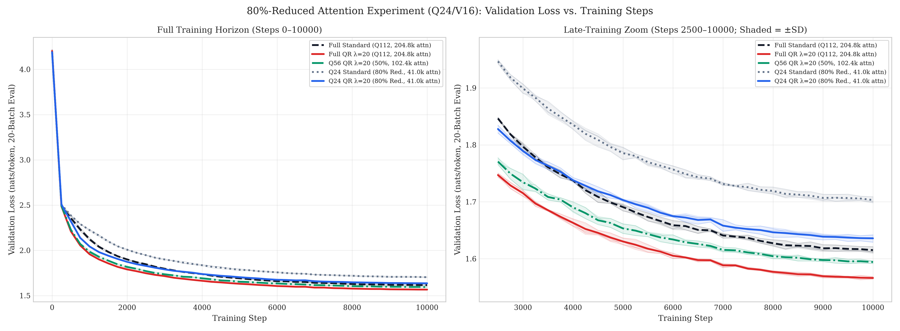
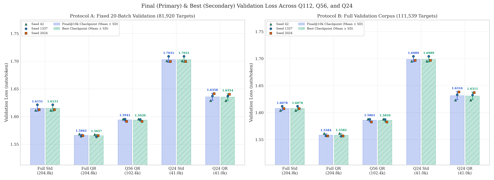
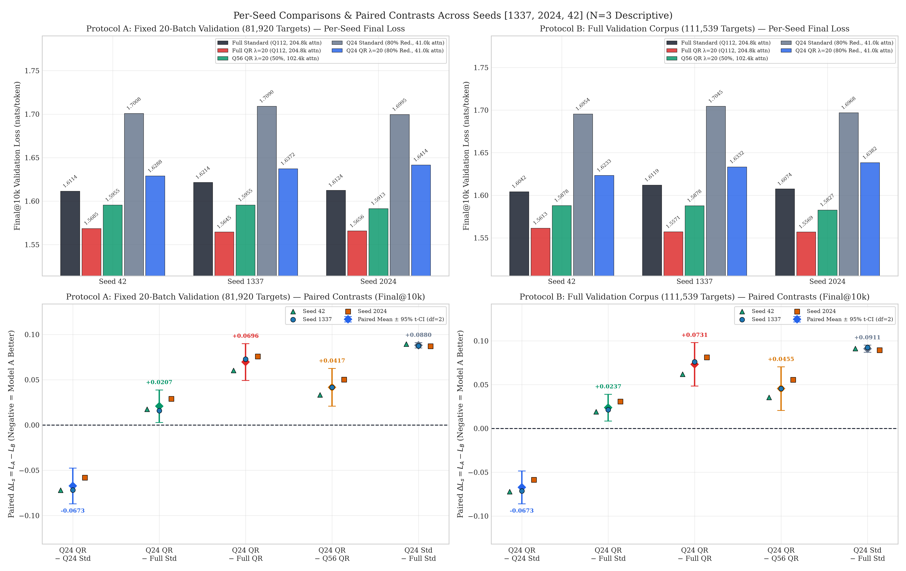
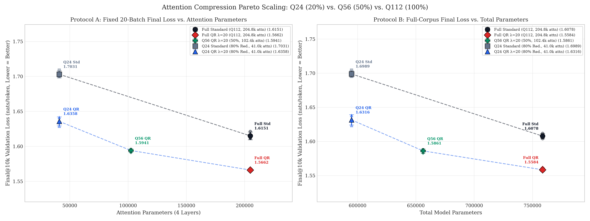
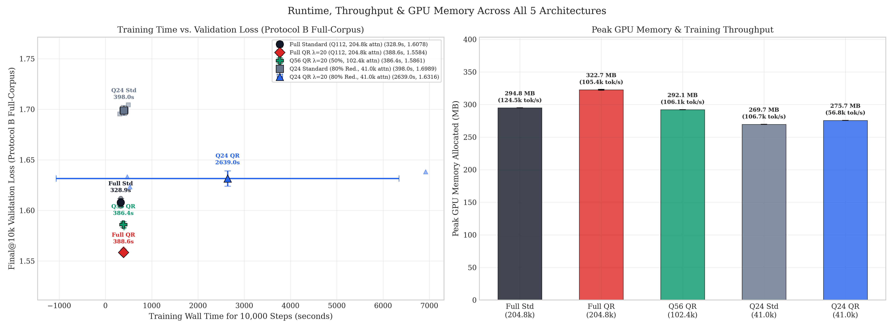
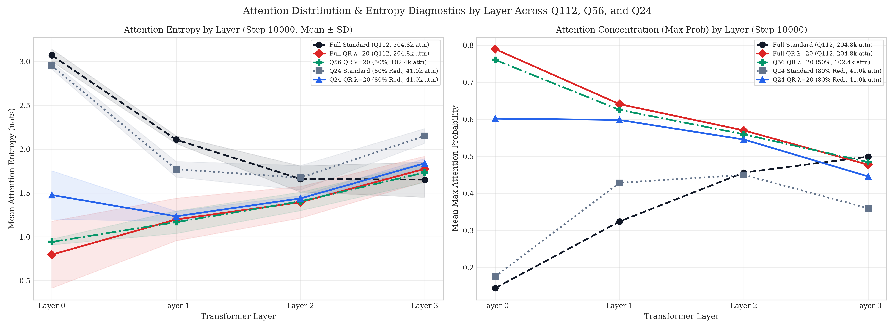

# 80%-Reduced Attention Parameters (Q24/V16): QR Antisymmetric Attention vs. Full-Size & Compression Baselines

- **Experiment Directory:** [`outputs/reduced_attention_80_percent/`](.)
- **Question:** Can **QR Antisymmetric Shared-Q Attention** ($\lambda = 20$) retain its parameter-efficiency advantage over Standard Attention when its attention parameter budget is **reduced by 80%** relative to the original `Q112` architecture (`204,800 -> 40,960` attention parameters; `758,656 -> 594,816` total parameters, `-21.60%`) while keeping all non-attention dimensions (`d_ff = 512`, `d_model = 128`, embeddings, LayerNorms) and training hyperparameters unchanged?
- **Read-Only Reference Baselines (Not Retrained / Untouched on Disk):**
  1. **Full-Size Standard (`Q112/V88`):** [`outputs/standard_attention_q112_10k/`](../standard_attention_q112_10k/)
  2. **Full-Size QR Antisymmetric (`Q112/V88`, $\lambda = 20.0$):** [`outputs/qr_lambda_upper_probe_q112/lambda_20.0/`](../qr_lambda_upper_probe_q112/lambda_20.0/)
  3. **50%-Reduced QR Antisymmetric (`Q56/V44`, $\lambda = 20.0$):** [`outputs/reduced_attention_50_percent/qr_antisymmetric/`](../reduced_attention_50_percent/qr_antisymmetric/)
- **Newly Trained Models (`6` Runs Total, `10,000` Steps Each):**
  4. **80%-Reduced Standard (`standard_q24`, `3` seeds):** [`standard_q24/seed_1337/`](standard_q24/seed_1337/), [`standard_q24/seed_2024/`](standard_q24/seed_2024/), [`standard_q24/seed_42/`](standard_q24/seed_42/)
  5. **80%-Reduced QR Antisymmetric (`qr_antisymmetric_q24`, $\lambda = 20.0$, `3` seeds):** [`qr_antisymmetric_q24/seed_1337/`](qr_antisymmetric_q24/seed_1337/), [`qr_antisymmetric_q24/seed_2024/`](qr_antisymmetric_q24/seed_2024/), [`qr_antisymmetric_q24/seed_42/`](qr_antisymmetric_q24/seed_42/)
- **Dataset:** `data/tinyshakespeare.txt` (`SHA256: 86c4e6aa9db7c042ec79f339dcb96d42b0075e16b8fc2e86bf0ca57e2dc565ed`, `vocab_size = 65`, `1,003,854` train chars, `111,540` val chars)
- **Hardware & Software:** `NVIDIA GeForce RTX 3050 6GB Laptop GPU`, PyTorch `2.6.0+cu124`, CUDA `12.4`, Python `3.13.14`
- **Reproduction & Analysis Scripts:**
  - Attention & model definitions: [`attention.py`](../../attention.py), [`model.py`](../../model.py)
  - Training & dual evaluation: [`train_reduced_attention_80pct.py`](../../train_reduced_attention_80pct.py)
  - Aggregation & diagnostics: [`analyze_reduced_attention_80pct.py`](../../analyze_reduced_attention_80pct.py)
  - Visualization: [`visualize_reduced_attention_80pct.py`](../../visualize_reduced_attention_80pct.py)
  - Unit & integration tests: [`test_reduced_attention_80pct.py`](../../test_reduced_attention_80pct.py)

---

## 1. Executive Summary & Direct Answers to the Six Research Questions

At `Q24/V16` (`40,960` attention parameters across 4 layers — **20% of the original `204,800` attention budget**), QR Antisymmetric Attention ($\lambda = 20$) trains stably with zero `NaN`/`Inf` events across all `60,000` combined training steps and **widens** its parameter-matched advantage over Standard Attention (`-0.0673` nats / `-3.95%` to `-3.96%` loss vs. `-0.0480–0.0488` at 50% reduction and `-0.0489–0.0494` at 100%). However, **80% compression crosses below the threshold required to beat Full-Size Standard Attention (`Q112`, `204,800` attn params)**: unlike 50%-reduced `Q56` QR (`1.5861` full-corpus loss), `Q24` QR (`1.6316`) trails Full Standard (`1.6078`) by `+0.0237` nats.

1. **Can `Q24` QR outperform full-size Standard Attention (`Q112`)?**
   **No.** With 5× fewer attention parameters (`40,960` vs. `204,800`), `Q24` QR (`1.635819 ± 0.006404` Protocol A / `1.631569 ± 0.007562` Protocol B) underperforms Full Standard (`1.615077 ± 0.005511` A / `1.607823 ± 0.003869` B) on `0/3` seeds by **`+0.020742 ± 0.007237` nats (`+1.28%` higher loss, `+0.1054` PPL)** on Protocol A and **`+0.023746 ± 0.006168` nats (`+1.48%` higher loss, `+0.1200` PPL)** on Protocol B. Thus, `80%` attention reduction goes past the parity crossover observed at `50%` (`Q56` QR beat Full Standard by `-0.0217` nats on Protocol B).

2. **Can `Q24` QR outperform parameter-matched `Q24` Standard (`40,960` attn / `594,816` total params)?**
   **Yes — decisively on all `3/3` paired seeds under both protocols.** `Q24` QR achieves **`-0.067276 ± 0.007956` nats (`-3.95%` loss, `-0.3572` PPL)** on Protocol A and **`-0.067306 ± 0.007551` nats (`-3.96%` loss, `-0.3558` PPL)** on Protocol B relative to `Q24` Standard (`1.703095` A / `1.698875` B). Strikingly, the absolute gap between QR and Standard is **`~37%` larger at `Q24` (`0.0673` nats) than at `Q112` (`0.0489–0.0494` nats) or `Q56` (`0.0480–0.0488` nats)** because Standard Attention degrades much more severely under extreme head compression (`+0.0880–0.0911` penalty vs. `+0.0696–0.0731` for QR).

3. **How much performance is lost compared with `Q56` QR (`50%` reduction, `102,400` attn params)?**
   Dropping from `50%` (`Q56/V44`) to `20%` (`Q24/V16`) attention capacity costs **`+0.041690 ± 0.008396` nats (`+2.62%` higher loss, `+0.2097` PPL)** on Protocol A and **`+0.045476 ± 0.010013` nats (`+2.87%` higher loss, `+0.2273` PPL)** on Protocol B (`0/3` wins for `Q24` QR). Combined with the `Q112 -> Q56` drop (`+0.0279` A / `+0.0277` B), total degradation from `Full QR Q112 -> Q24 QR` is **`+0.069610 ± 0.008179` nats (`+4.44%`, `+0.3453` PPL)** on Protocol A and **`+0.073126 ± 0.009986` nats (`+4.69%`, `+0.3606` PPL)** on Protocol B.

4. **Does QR retain its advantage at only `40,960` attention parameters?**
   **Yes, in parameter efficiency relative to Standard Attention — strongly so.** Not only does `Q24` QR (`40,960` attn) outperform `Q24` Standard (`40,960` attn) by `0.0673` nats on every seed, it also slightly outperforms the historical `50%`-reduced `Q56` Standard model (`102,400` attn params: `1.642125` A / `1.634914` B) using **`60%` fewer attention parameters** than `Q56` Standard (`40,960` vs. `102,400`), and reaches within `~0.021–0.024` nats of Full Standard despite a `5×` reduction in attention parameters.

5. **Does the architecture suffer from excessive compression at `d_q = 6, d_v = 4`?**
   **Partial bottlenecking, yes — though far less catastrophically than Standard Attention, and with zero numerical instability.** While compressing from `Q112 -> Q56` (`50%` reduction) cost only `~0.028` nats for both architectures, compressing the remaining step `Q56 -> Q24` (`-60%` of `Q56`) costs **`+0.042–0.045` nats** for QR and **`+0.061–0.064` nats** for Standard (`1.642 -> 1.703` A; `1.635 -> 1.699` B). Mechanistically, Layer-0 diagnostic entropy in `Q24` QR rises sharply from `0.797–0.943` nats (`Q112/Q56`) to **`1.478` nats** (`max_prob` drops from `0.76–0.79` to `0.60`), showing that `d_q = 6` + `d_v = 4` begins bottlenecking early-layer routing and value bandwidth. Even so, optimization stays cleanly bounded (`max` global grad norm `2.21`, `0` NaN/Inf events).

6. **What are the runtime and memory consequences?**
   - **Peak GPU Memory:** Clear savings — `Q24` QR requires **`275.71 MB`**, saving **`46.97 MB` (`-14.56%`)** vs. Full QR (`322.68 MB`), **`19.14 MB` (`-6.49%`)** vs. Full Standard (`294.85 MB`), and **`16.43 MB` (`-5.62%`)** vs. `Q56` QR (`292.14 MB`), while using `+6.00 MB` (`+2.22%`) more than `Q24` Standard (`269.71 MB`).
   - **Training & Inference Runtime (with explicit anomaly reporting):** Raw aggregate wall-clock mean for `Q24` QR is skewed (`2638.99 ± 3705.91 s`) by a single laptop sleep/power-interruption event near the end of **`qr_antisymmetric_q24 / seed_2024` (`6,918.08 s`, `5,921 tok/s`)**. On unthrottled continuous runs (`seed_1337 = 471.96 s`, `seed_42 = 526.92 s`; clean median `~499.4 s`, `~78–87k tok/s`), `Q24` QR shows **no wall-clock speedup** over Full QR (`388.63 s`) or `Q56` QR (`386.44 s`), and remains slower than Full Standard (`328.89 s`) and unthrottled `Q24` Standard (`seed_42 = 309.87 s`, `seed_2024 = 389.26 s`; thermal-throttled `seed_1337 = 495.00 s`). At `T = 128, B = 32` with `88.57%` of model parameters in the unchanged `d_ff = 512` FFN, latency is launch- and $O(T^2)$-score-kernel-bound rather than projection-width-bound.

*(Statistical Power Caveat: Only `N = 3` seeds `[1337, 2024, 42]` are evaluated per condition. All `df = 2` confidence intervals and $t$-statistics in this report are descriptive only; no claims of formal statistical significance are made.)*

---

## 2. Exact Parameter Count Verification & Architecture Comparison

All models use **bias-free** attention projections (`W_q`, `W_k` or `W_r`, `W_v`, `W_out`) with zero stored buffers (`0` non-trainable parameters, `0` stored buffers). Across `L = 4` layers with `d_model = 128`, `H = 4` heads, aggregate query/key-or-R dimension `q_dim`, and aggregate value dimension `v_dim`:

$$P_{\text{attention}} = L \cdot d_{\text{model}} \cdot (2\,q_{\text{dim}} + 2\,v_{\text{dim}}) = 4 \cdot 128 \cdot (2\,q_{\text{dim}} + 2\,v_{\text{dim}}) = 512 \cdot (2\,q_{\text{dim}} + 2\,v_{\text{dim}})$$

*(Note on formula typo in prompt prose: the prompt text wrote `4 layers * 2 * d_model * (2*q_dim + 2*v_dim)`, which includes an extra factor of `2` relative to the actual bias-free module sizes. Using the exact layer projection formula above gives `204,800`, `102,400`, and `40,960` — matching every required target count cleanly.)*

Programmatically verified in [`parameter_budget_audit.json`](analysis/parameter_budget_audit.json):

| Component / Metric | Full Std (`Q112`) | Full QR (`Q112, λ=20`) | Reduced QR 50% (`Q56, λ=20`) | Reduced Std 80% (`Q24`) | Reduced QR 80% (`Q24, λ=20`) |
|---|---:|---:|---:|---:|---:|
| Attention Score Formula | $\frac{QK^T}{\sqrt{28}}$ | $\frac{QQ^T + 20(QR^T - RQ^T)}{\sqrt{28}}$ | $\frac{QQ^T + 20(QR^T - RQ^T)}{\sqrt{14}}$ | $\frac{QK^T}{\sqrt{6}}$ | $\frac{QQ^T + 20(QR^T - RQ^T)}{\sqrt{6}}$ |
| Aggregate `Q / K-or-R / V` Dim | `112 / 112 / 88` | `112 / 112 / 88` | `56 / 56 / 44` | `24 / 24 / 16` | `24 / 24 / 16` |
| Per-Head `d_q / d_k / d_r / d_v` | `28 / 28 / 0 / 22` | `28 / 0 / 28 / 22` | `14 / 0 / 14 / 11` | `6 / 6 / 0 / 4` | `6 / 0 / 6 / 4` |
| `W_Q` Total (4 layers) | `57,344` | `57,344` | `28,672` | `12,288` | `12,288` |
| `W_K` or `W_R` Total (4 layers) | `57,344` | `57,344` | `28,672` | `12,288` | `12,288` |
| `W_V` Total (4 layers) | `45,056` | `45,056` | `22,528` | `8,192` | `8,192` |
| `W_O` Total (4 layers) | `45,056` | `45,056` | `22,528` | `8,192` | `8,192` |
| **Attention Params (per layer)** | `51,200` | `51,200` | `25,600` | `10,240` | `10,240` |
| **Attention Params (4 layers)** | **`204,800`** | **`204,800`** | **`102,400`** | **`40,960`** | **`40,960`** |
| Token Emb (tied w/ LM head, `65×128`) | `8,320` | `8,320` | `8,320` | `8,320` | `8,320` |
| Positional Emb (`128×128`) | `16,384` | `16,384` | `16,384` | `16,384` | `16,384` |
| LayerNorms (`9` pairs) | `2,304` | `2,304` | `2,304` | `2,304` | `2,304` |
| FFN (`4 × 131,712`, `d_ff = 512`) | `526,848` | `526,848` | `526,848` | `526,848` | `526,848` |
| **Non-Attention Parameters** | `553,856` | `553,856` | `553,856` | `553,856` | `553,856` |
| **Total Model Parameters** | **`758,656`** | **`758,656`** | **`656,256`** | **`594,816`** | **`594,816`** |
| Attention % / FFN % of Total | `27.00% / 69.44%` | `27.00% / 69.44%` | `15.60% / 80.28%` | `6.89% / 88.57%` | `6.89% / 88.57%` |
| Attention Reduction vs. `Q112` | `0.0%` | `0.0%` | **`-50.0%`** | **`-80.0%`** | **`-80.0%`** |

---

## 3. Experimental Conditions, Fairness & Verification Audits

### Unchanged Hyperparameters
Verified across [`parameter_budget_audit.json`](analysis/parameter_budget_audit.json) and each run's `config.json`:
- **Model Backbone:** `n_layers = 4`, `n_heads = 4`, `d_model = 128`, `d_ff = 512`, `context_length = 128`, Pre-LayerNorm, learned absolute positional embeddings, tied token/LM-head weights (`65×128`), `dropout = 0.1`.
- **Optimization:** `AdamW` (`lr = 3e-4`, `betas = (0.9, 0.999)`, `eps = 1e-8`, `weight_decay = 0.1`, `foreach = False`), `100` warmup steps, cosine decay to `3e-5` (`min_lr_ratio = 0.1`), global gradient clipping `1.0`, `batch_size = 32` (`4,096` tok/step), `10,000` steps (`40,960,000` tokens/run).
- **QR Coupling:** Fixed non-learnable $\lambda = 20.0$.
- **Evaluation Protocols:**
  - **Protocol A (Fixed 20-Batch):** `20` fixed validation batches sampled with `validation_seed = 918273` (`81,920` target tokens).
  - **Protocol B (Full Validation Corpus):** Contiguous non-overlapping chunks over `validation[1:]` (`29` batches, stride `128`, `111,539` target tokens).

### Bitwise Initialization & Training Stream Verification
Verified programmatically in [`fairness_audit.json`](analysis/fairness_audit.json) (`max_reload_20batch_abs_diff = 0.0`):

| Seed | `Q24 Std` `init.pt` SHA256 Prefix | `Q24 QR` `init.pt` SHA256 Prefix | Canonical `W_k ↔ W_r` `max_abs_diff` (`53` tensors) | Batch Stream SHA256 (`10,000` batches) | Matches Full/Q56 References? | `NaN/Inf` Events | Reload Diff (Final/Best) |
|---:|---|---|---:|---|---|---:|---:|
| `1337` | `139a3172268b169c...` | `87b738535a65c891...` | `0.0` (exact bitwise) | `66142907e2b581ee...` | `True` | `0` | `0.00e+00` |
| `2024` | `e99b5579abc2d8e6...` | `07cbfbc8af8ae27e...` | `0.0` (exact bitwise) | `3be56dbc0aa173d1...` | `True` | `0` | `0.00e+00` |
| `42` | `bdaef6272f0f9aad...` | `ab37bb57a3aad9f1...` | `0.0` (exact bitwise) | `7f94fc8f969cf05f...` | `True` | `0` | `0.00e+00` |

### Test Suite Verification
- Targeted 80%-reduction unit & end-to-end integration tests ([`test_reduced_attention_80pct.py`](../../test_reduced_attention_80pct.py)): **6/6 passed** (verifying `40,960` / `594,816` exact counts, shapes, causal masking, finite forward/backward gradients, bitwise paired init, batch SHA256 streams, $\lambda=20$ application, checkpoint reload, dual eval, and all 6 generated figures).
- Full repository test suite (`python -m unittest discover -p "test_*.py"`): **194/194 passed** (`OK` in `187.060s`, zero failures/errors).

---

## 4. Validation Results (Protocol A & Protocol B)

### 4.1 Aggregate Model Summary (`Mean ± SD` Across `N = 3` Seeds)

From [`reduced_80pct_model_summary.csv`](analysis/reduced_80pct_model_summary.csv):

#### Primary: Final Checkpoint (`step = 10,000`)

| Model | Attn Params | Total Params | Protocol A Loss (`81,920` tok) | Protocol A PPL | Protocol B Loss (`111,539` tok) | Protocol B PPL | Mean Best Step |
|---|---:|---:|---:|---:|---:|---:|---:|
| **Full Standard (`Q112`)** | `204,800` | `758,656` | `1.615077 ± 0.005511` | `5.0283 ± 0.0278` | `1.607823 ± 0.003869` | `4.9920 ± 0.0193` | `10,000` |
| **Full QR ($\lambda=20$, `Q112`)** | `204,800` | `758,656` | **`1.566210 ± 0.002074`** | **`4.7885 ± 0.0099`** | **`1.558444 ± 0.002496`** | **`4.7514 ± 0.0119`** | `9,750` |
| **Reduced QR 50% ($\lambda=20$, `Q56`)** | `102,400` | `656,256` | `1.594130 ± 0.002435` | `4.9241 ± 0.0120` | `1.586093 ± 0.002959` | `4.8846 ± 0.0144` | `9,917` |
| **Reduced Standard 80% (`Q24`)** | `40,960` | `594,816` | `1.703095 ± 0.005134` | `5.4910 ± 0.0282` | `1.698875 ± 0.004882` | `5.4678 ± 0.0267` | `10,000` |
| **Reduced QR 80% ($\lambda=20$, `Q24`)** | `40,960` | `594,816` | **`1.635819 ± 0.006404`** | **`5.1337 ± 0.0328`** | **`1.631569 ± 0.007562`** | **`5.1120 ± 0.0386`** | `9,833` |

*(For historical context from [`outputs/reduced_attention_50_percent/`](../reduced_attention_50_percent/RESULTS_REDUCED_ATTENTION_50_PERCENT.md): `Reduced Standard 50% (Q56)` at `102,400` attn params scored `1.642125` Protocol A / `1.634914` Protocol B — meaning `Q24 QR` (`40,960` attn) slightly exceeds `Q56 Standard` (`102,400` attn) with `60%` fewer attention parameters.)*

#### Secondary: Best-Validation Checkpoint (`best.pt`)

| Model | Protocol A Best Loss | Protocol A Best PPL | Protocol B Best-Ckpt Loss | Protocol B Best-Ckpt PPL |
|---|---:|---:|---:|---:|
| **Full Standard (`Q112`)** | `1.615077 ± 0.005511` | `5.0283 ± 0.0278` | `1.607823 ± 0.003869` | `4.9920 ± 0.0193` |
| **Full QR ($\lambda=20$, `Q112`)** | `1.565652 ± 0.002208` | `4.7858 ± 0.0106` | `1.558193 ± 0.002983` | `4.7502 ± 0.0142` |
| **Reduced QR 50% ($\lambda=20$, `Q56`)** | `1.593885 ± 0.002252` | `4.9228 ± 0.0111` | `1.585927 ± 0.002830` | `4.8838 ± 0.0138` |
| **Reduced Standard 80% (`Q24`)** | `1.703095 ± 0.005134` | `5.4910 ± 0.0282` | `1.698875 ± 0.004882` | `5.4678 ± 0.0267` |
| **Reduced QR 80% ($\lambda=20$, `Q24`)** | `1.635360 ± 0.005872` | `5.1314 ± 0.0301` | `1.631079 ± 0.007067` | `5.1095 ± 0.0361` |

### 4.2 Complete Per-Seed Metrics Table (`All 15 Runs`)

From [`reduced_80pct_per_seed_results.csv`](analysis/reduced_80pct_per_seed_results.csv):

| Model | Seed | Params | Best Step | Train Loss (`@10k`) | Prot A Final Loss | Prot A PPL | Prot A Best Loss | Prot B Final Loss | Prot B PPL | Prot B Best Loss | Train Time (s) | Train tok/s | Peak VRAM (MB) |
|---|---:|---:|---:|---:|---:|---:|---:|---:|---:|---:|---:|---:|---:|
| **Full Std (`Q112`)** | `1337` | `758,656` | `10,000` | `1.518716` | `1.621418` | `5.0603` | `1.621418` | `1.611876` | `5.0122` | `1.611876` | `331.58` | `123,531` | `294.85` |
| **Full Std (`Q112`)** | `2024` | `758,656` | `10,000` | `1.522727` | `1.612373` | `5.0147` | `1.612373` | `1.607424` | `4.9899` | `1.607424` | `327.82` | `124,945` | `294.85` |
| **Full Std (`Q112`)** | `42` | `758,656` | `10,000` | `1.510000` | `1.611441` | `5.0100` | `1.611441` | `1.604170` | `4.9737` | `1.604170` | `327.27` | `125,157` | `294.85` |
| **Full QR (`Q112`)** | `1337` | `758,656` | `9,750` | `1.450343` | `1.564475` | `4.7802` | `1.563445` | `1.557148` | `4.7453` | `1.556107` | `388.93` | `105,313` | `323.35` |
| **Full QR (`Q112`)** | `2024` | `758,656` | `10,000` | `1.451246` | `1.565648` | `4.7858` | `1.565648` | `1.556862` | `4.7439` | `1.556862` | `388.79` | `105,352` | `322.35` |
| **Full QR (`Q112`)** | `42` | `758,656` | `9,500` | `1.444908` | `1.568507` | `4.7995` | `1.567862` | `1.561321` | `4.7651` | `1.561610` | `388.15` | `105,525` | `322.35` |
| **Q56 QR (`50%`)** | `1337` | `656,256` | `9,750` | `1.479032` | `1.595544` | `4.9310` | `1.594811` | `1.587757` | `4.8928` | `1.587259` | `378.16` | `108,313` | `292.14` |
| **Q56 QR (`50%`)** | `2024` | `656,256` | `10,000` | `1.481838` | `1.591318` | `4.9102` | `1.591318` | `1.582677` | `4.8680` | `1.582677` | `403.08` | `101,618` | `292.14` |
| **Q56 QR (`50%`)** | `42` | `656,256` | `10,000` | `1.484344` | `1.595527` | `4.9309` | `1.595527` | `1.587845` | `4.8932` | `1.587845` | `378.07` | `108,341` | `292.14` |
| **Q24 Std (`80%`)** | `1337` | `594,816` | `10,000` | `1.645190` | `1.708976` | `5.5233` | `1.708976` | `1.704455` | `5.4984` | `1.704455` | `495.00`* | `82,748`* | **`269.71`** |
| **Q24 Std (`80%`)** | `2024` | `594,816` | `10,000` | `1.635209` | `1.699509` | `5.4713` | `1.699509` | `1.696780` | `5.4563` | `1.696780` | `389.26` | `105,225` | **`269.71`** |
| **Q24 Std (`80%`)** | `42` | `594,816` | `10,000` | `1.638888` | `1.700800` | `5.4783` | `1.700800` | `1.695391` | `5.4488` | `1.695391` | `309.87` | `132,182` | **`269.71`** |
| **Q24 QR (`80%`)** | `1337` | `594,816` | `9,750` | `1.551134` | `1.637202` | `5.1408` | `1.637020` | `1.633203` | `5.1203` | `1.632758` | `471.96` | `86,787` | `275.71` |
| **Q24 QR (`80%`)** | `2024` | `594,816` | `9,750` | `1.554793` | `1.641419` | `5.1625` | `1.640224` | `1.638181` | `5.1458` | `1.637155` | `6,918.08`† | `5,921`† | `275.71` |
| **Q24 QR (`80%`)** | `42` | `594,816` | `10,000` | `1.544949` | `1.628837` | `5.0979` | `1.628837` | `1.623324` | `5.0699` | `1.623324` | `526.92` | `77,734` | `275.71` |

*\* `Q24 Std / seed_1337` (`495.00 s`) experienced laptop thermal throttling compared to `seed_42` (`309.87 s`).*
*† `Q24 QR / seed_2024` (`6,918.08 s`) includes an OS sleep/power-interruption pause in the wall-clock timer between steps `9,500` and `9,750` (mathematical trajectory, weights, and `deterministic=True` validation scores are unaffected).*

---

## 5. Planned Paired Contrasts (`final @ 10,000`)

From [`reduced_80pct_paired_comparisons.csv`](analysis/reduced_80pct_paired_comparisons.csv), where $\Delta = \text{Model A} - \text{Model B}$ (negative loss/PPL deltas and positive relative `%` favor Model A):

### 5.1 Protocol A (`Fixed 20-Batch`, `81,920` Targets)

| Comparison (`A vs. B`) | Wins (A) | Seed `1337` $\Delta$ | Seed `2024` $\Delta$ | Seed `42` $\Delta$ | Mean $\Delta$ ± SD | Rel. Loss Impr. | Mean $\Delta$ PPL ± SD | Descriptive 95% $t$-CI (`df=2`) |
|---|---:|---:|---:|---:|---:|---:|---:|---|
| **1. `Q24 QR` vs. `Q24 Std`** | **`3 / 3`** | `-0.071774` | `-0.058090` | `-0.071963` | **`-0.067276 ± 0.007956`** | **`+3.95%`** | **`-0.3572 ± 0.0420`** | `[-0.087039, -0.047512]` |
| **2. `Q24 QR` vs. `Full Std (Q112)`** | `0 / 3` | `+0.015784` | `+0.029047` | `+0.017396` | `+0.020742 ± 0.007237` | `-1.28%` | `+0.1054 ± 0.0369` | `[+0.002765, +0.038719]` |
| **3. `Q24 QR` vs. `Full QR (Q112)`** | `0 / 3` | `+0.072727` | `+0.075771` | `+0.060330` | `+0.069610 ± 0.008179` | `-4.44%` | `+0.3453 ± 0.0413` | `[+0.049292, +0.089927]` |
| **4. `Q24 QR` vs. `Q56 QR (50%)`** | `0 / 3` | `+0.041658` | `+0.050101` | `+0.033310` | `+0.041690 ± 0.008396` | `-2.62%` | `+0.2097 ± 0.0426` | `[+0.020834, +0.062546]` |
| *Ref: `Q24 Std` vs. `Full Std (Q112)`* | `0 / 3` | `+0.087558` | `+0.087136` | `+0.089359` | `+0.088018 ± 0.001181` | `-5.45%` | `+0.4626 ± 0.0059` | `[+0.085085, +0.090951]` |

### 5.2 Protocol B (`Full Validation Corpus`, `111,539` Targets)

| Comparison (`A vs. B`) | Wins (A) | Seed `1337` $\Delta$ | Seed `2024` $\Delta$ | Seed `42` $\Delta$ | Mean $\Delta$ ± SD | Rel. Loss Impr. | Mean $\Delta$ PPL ± SD | Descriptive 95% $t$-CI (`df=2`) |
|---|---:|---:|---:|---:|---:|---:|---:|---|
| **1. `Q24 QR` vs. `Q24 Std`** | **`3 / 3`** | `-0.071252` | `-0.058599` | `-0.072067` | **`-0.067306 ± 0.007551`** | **`+3.96%`** | **`-0.3558 ± 0.0392`** | `[-0.086064, -0.048547]` |
| **2. `Q24 QR` vs. `Full Std (Q112)`** | `0 / 3` | `+0.021327` | `+0.030757` | `+0.019154` | `+0.023746 ± 0.006168` | `-1.48%` | `+0.1200 ± 0.0316` | `[+0.008424, +0.039068]` |
| **3. `Q24 QR` vs. `Full QR (Q112)`** | `0 / 3` | `+0.076056` | `+0.081319` | `+0.062003` | `+0.073126 ± 0.009986` | `-4.69%` | `+0.3606 ± 0.0501` | `[+0.048320, +0.097932]` |
| **4. `Q24 QR` vs. `Q56 QR (50%)`** | `0 / 3` | `+0.045446` | `+0.055504` | `+0.035479` | `+0.045476 ± 0.010013` | `-2.87%` | `+0.2273 ± 0.0506` | `[+0.020604, +0.070349]` |
| *Ref: `Q24 Std` vs. `Full Std (Q112)`* | `0 / 3` | `+0.092579` | `+0.089355` | `+0.091221` | `+0.091052 ± 0.001618` | `-5.66%` | `+0.4759 ± 0.0099` | `[+0.087031, +0.095072]` |

### 5.3 Scaling Curve Across Attention Budgets (`20% -> 50% -> 100%`)

- **QR Degradation Profile (Protocol B):** `1.5584 (Q112, 204.8k)` $\xrightarrow{+0.0277}$ `1.5861 (Q56, 102.4k)` $\xrightarrow{+0.0455}$ `1.6316 (Q24, 41.0k)`.
- **Standard Degradation Profile (Protocol B):** `1.6078 (Q112, 204.8k)` $\xrightarrow{+0.0271}$ `1.6349 (Q56, 102.4k)` $\xrightarrow{+0.0640}$ `1.6989 (Q24, 41.0k)`.
- **Interpretation:** Between `100%` and `50%`, both mechanisms lose `~0.027` nats. Going from `50%` down to `20%` hurts Standard (`+0.0640` nats) **`41%` more severely** than QR (`+0.0455` nats). Standard Attention appears to hit a steeper low-rank bottleneck when head dimension drops to `d_q = 6, d_v = 4`, whereas QR's antisymmetric $QR^T - RQ^T$ interaction retains structured causal routing in the `6`-dimensional subspace.

---

## 6. Validation Trajectories & Visual Comparisons

From [`reduced_80pct_step_summary.csv`](analysis/reduced_80pct_step_summary.csv) (Protocol A mean validation loss across `3` seeds):

| Step | Full Std (`Q112`) | Full QR (`Q112`) | Q56 QR (`50%`) | Q24 Std (`80%`) | Q24 QR (`80%`) |
|---:|---:|---:|---:|---:|---:|
| `0` | `4.203445` | `4.203277` | `4.191889` | `4.190249` | `4.190138` |
| `1,000` | `2.122202` | `1.956950` | `1.984049` | `2.223131` | **`2.042203`** (`< Full Std @ 1k`) |
| `2,500` | `1.846412` | `1.746982` | `1.770645` | `1.946519` | **`1.827808`** (`< Full Std @ 2.5k`) |
| `3,500` | `1.760691` | `1.685236` | `1.708488` | `1.863998` | `1.763369` *(Full Std overtakes ~step `3,350`)* |
| `5,000` | `1.690734` | `1.630286` | `1.653226` | `1.785413` | `1.703065` |
| `7,500` | `1.636679` | `1.582612` | `1.610942` | `1.725651` | `1.651969` |
| `10,000` | `1.615077` | **`1.566210`** | `1.594130` | `1.703095` | **`1.635819`** |

Notice the trajectory crossover: early in training (`steps 250–3,250`), `Q24` QR learns **faster** than Full Standard (`1.8278` vs. `1.8464` at step `2,500`), before Full Standard's `5×` larger projection capacity overtakes `Q24` QR around step `~3,350` and ends `-0.0207` nats lower. Meanwhile, `Q24` QR leads parameter-matched `Q24` Standard at **every single evaluation step** from step `500` (`-0.0656`) through step `10,000` (`-0.0673`).

All 6 figures (`300 DPI`) are stored under [`analysis/figures/`](analysis/figures/):

1. **Validation Loss vs. Training Steps:** [`fig1_val_loss_vs_steps.png`](analysis/figures/fig1_val_loss_vs_steps.png)
   
2. **Final & Best Validation Loss Across Architectures:** [`fig2_final_loss_across_architectures.png`](analysis/figures/fig2_final_loss_across_architectures.png)
   
3. **Per-Seed Paired Comparisons Across Protocols A & B:** [`fig3_per_seed_paired_comparisons.png`](analysis/figures/fig3_per_seed_paired_comparisons.png)
   
4. **Parameter Budget vs. Validation Loss (Pareto Tradeoff):** [`fig4_params_vs_val_loss.png`](analysis/figures/fig4_params_vs_val_loss.png)
   
5. **Training Runtime, Throughput & Peak GPU Memory:** [`fig5_training_time_vs_val_loss.png`](analysis/figures/fig5_training_time_vs_val_loss.png)
   
6. **Attention Entropy & Concentration by Layer (`0..3`):** [`fig6_attention_entropy_by_layer.png`](analysis/figures/fig6_attention_entropy_by_layer.png)
   

---

## 7. Numerical Stability, Gradient Norms, Projection Norms & Attention Diagnostics

Because `Q24/V16` operates at `d_q = 6` per head ($1/\sqrt{6} \approx 0.4082$, a `2.16×` larger pre-softmax scale factor than `Q112`'s $1/\sqrt{28} \approx 0.1890$) with fixed $\lambda = 20$ and `d_v = 4`, we explicitly audited stability, gradients, projection weights, and layer-wise attention distributions.

### 7.1 Numerical Stability & Gradient Norms (`Steps 1..10,000`)

| Model (`N=3`) | `NaN/Inf` Runs | Step-1 Global Grad Norm | Mean Global Grad Norm | Max Global Grad Norm | Mean `W_Q` Grad Norm | Mean `W_K/W_R` Grad Norm | Mean `W_V` Grad Norm | Mean `W_O` Grad Norm | Grad Clip Freq (`clip=1.0`) |
|---|---:|---:|---:|---:|---:|---:|---:|---:|---:|
| **Full Std (`Q112`)** | `0 / 3` | `2.794` | `1.140` | `2.87–3.05` | `0.124` | `0.135` | — | — | `87.84%` |
| **Full QR (`Q112`)** | `0 / 3` | `2.575` | `1.137` | `2.67–2.79` | `0.316` | `0.326` | — | — | `92.97%` |
| **Q56 QR (`50%`)** | `0 / 3` | `2.138` | `1.210` | `2.17–2.40` | `0.390` | `0.400` | — | — | `93.45%` |
| **Q24 Std (`80%`)** | **`0 / 3`** | `2.024` | `1.199` | `1.96–2.21` | `0.202` | `0.243` | `0.406` | `0.275` | `86.27%` |
| **Q24 QR (`80%`)** | **`0 / 3`** | `2.001` | `1.297` | `2.19–2.21` | `0.491` | `0.506` | `0.327` | `0.348` | `93.15%` |

*(Per-projection `W_V` and `W_O` gradient norms were added in the 80% instrumentation and were not logged in historical `Q112/Q56` CSVs.)*

**Findings:**
- **Zero gradient explosions or instabilities:** Despite `1/sqrt(6) * 20 ≈ 8.16` effective antisymmetric multiplier, `Q24` QR's global gradient norm stays tightly bounded (`mean = 1.297`, `max = 2.208` across all `30,000` QR steps), and gradient clipping frequency (`93.15%`) matches `Full QR` (`92.97%`) and `Q56 QR` (`93.45%`).
- **`Q / R` vs. `V` gradient allocation:** In `Q24` QR, gradients on `W_Q` (`0.491`) and `W_R` (`0.506`) are `~2.1–2.4×` larger than in `Q24` Standard (`0.202 / 0.243`), consistent with QR driving stronger structural routing through `Q` and `R`, while `W_V` gradient norm is slightly *lower* (`0.327` vs. `0.406`).

### 7.2 Final Parameter Norms & Attention Distribution Diagnostics (`Step 10,000`)

From [`reduced_80pct_layer_diagnostics.csv`](analysis/reduced_80pct_layer_diagnostics.csv) and [`reduced_80pct_model_summary.csv`](analysis/reduced_80pct_model_summary.csv):

| Model (`step=10,000`) | `||W_Q||_F` | `||W_K||_F` or `||W_R||_F` | `||W_V||_F` | `||W_O||_F` | Score Asymmetry `||A||/||S||` | Mean Entropy (nats) | Non-Init Entropy (nats) | Mean Max Prob | Mean Diag Mass |
|---|---:|---:|---:|---:|---:|---:|---:|---:|---:|
| **Full Std (`Q112`)** | `12.78` | `11.26` | `5.21` | `5.50` | `2.59` | `2.123 ± 0.061` | `2.140` | `0.356` | `0.152` |
| **Full QR (`Q112`)** | `6.02` | `5.84` | `5.32` | `5.58` | `30.37` | `1.292 ± 0.041` | `1.302` | `0.619` | `0.081` |
| **Q56 QR (`50%`)** | `4.27` | `4.18` | `4.12` | `4.40` | `30.84` | `1.312 ± 0.026` | `1.323` | `0.608` | `0.108` |
| **Q24 Std (`80%`)** | `7.02` | `5.92` | `2.92` | `3.28` | `2.04` | `2.138 ± 0.041` | `2.155` | `0.354` | `0.167` |
| **Q24 QR (`80%`)** | **`2.66`** | **`2.62`** | `2.91` | `3.15` | `30.47` | **`1.498 ± 0.061`** | `1.510` | `0.548` | `0.127` |

### 7.3 Layer-by-Layer Attention Entropy & Concentration (`Step 10,000`)

| Layer | `Full Std` Ent / MaxP | `Q24 Std` Ent / MaxP | `Full QR` Ent / MaxP | `Q56 QR` Ent / MaxP | `Q24 QR` Ent / MaxP |
|---:|---|---|---|---|---|
| **Layer 0** | `3.072 / 0.145` | `2.953 / 0.176` | **`0.797 / 0.789`** | **`0.943 / 0.760`** | **`1.478 / 0.602`** *(+0.54–0.68 nats bottleck)* |
| **Layer 1** | `2.109 / 0.324` | `1.772 / 0.429` | `1.199 / 0.641` | `1.168 / 0.625` | `1.235 / 0.598` |
| **Layer 2** | `1.661 / 0.456` | `1.675 / 0.450` | `1.395 / 0.570` | `1.405 / 0.560` | `1.439 / 0.545` |
| **Layer 3** | `1.652 / 0.499` | **`2.152 / 0.360`** *(diffuse regression)* | `1.776 / 0.477` | `1.734 / 0.485` | `1.839 / 0.446` |

**Mechanistic Insight (`fig6`):**
1. **Why `Q24 QR` loses performance vs. `Q56/Q112 QR`:** Layers `1–3` of `Q24` QR closely track `Q56` QR and `Full QR` in both entropy (`1.24 / 1.44 / 1.84`) and concentration (`0.60 / 0.55 / 0.45`). Virtually the entire entropy increase occurs in **Layer 0** (`0.797 -> 0.943 -> 1.478` nats), where `d_q = 6` limits early sharp positional/lexical focusing.
2. **Why `Q24 Std` degrades much worse (`+0.091` nats):** `Q24` Standard keeps diffuse attention in Layer 0 (`2.953` nats) **and** suffers a sharp breakdown in **Layer 3** (`2.152` nats vs. `1.652` in Full Standard), shifting weight onto self-diagonal fallback (`diag_mass = 0.167` vs. `0.127` in `Q24 QR`). Meanwhile, QR continues maintaining high antisymmetric dominance (`||A_eff|| / ||S|| ≈ 30.5`) with compact weights (`||W_Q|| = 2.66`, `2.64×` smaller than `Q24` Standard's `7.02`).

---

## 8. Hardware Runtime & Peak GPU Memory Summary

| Model | Raw Mean Time (s) | Unthrottled Seeds Range / Median (s) | Peak GPU VRAM (MB) | VRAM Change vs. Full Std | VRAM Change vs. Full QR | Mean Inf Throughput (tok/s) |
|---|---:|---|---:|---:|---:|---:|
| **Full Std (`Q112`)** | `328.89 ± 2.34` | `327.27 – 331.58` (`med 327.82`) | `294.85 ± 0.00` | baseline | `-27.83 MB (-8.63%)` | `601,657` |
| **Full QR (`Q112`)** | `388.63 ± 0.42` | `388.15 – 388.93` (`med 388.79`) | `322.68 ± 0.58` | `+27.83 MB (+9.44%)` | baseline | `417,917` |
| **Q56 QR (`50%`)** | `386.44 ± 14.41` | `378.07 – 403.08` (`med 378.16`) | `292.14 ± 0.00` | `-2.71 MB (-0.92%)` | `-30.54 MB (-9.46%)` | `432,870` |
| **Q24 Std (`80%`)** | `398.04 ± 92.87` | `309.87 – 389.26` *(+`495.00`*)* (`med 389.26`) | **`269.71 ± 0.00`** | **`-25.14 MB (-8.53%)`** | `-52.97 MB (-16.42%)` | `459,931` |
| **Q24 QR (`80%`)** | `2,638.99 ± 3,705.91`† | `471.96 – 526.92` (`clean med 499.44`) | **`275.71 ± 0.00`** | **`-19.14 MB (-6.49%)`** | **`-46.97 MB (-14.56%)`** | `388,135` |

- **Memory Verdict:** Reducing attention dimensions by `80%` yields monotonic peak VRAM savings (`322.68 -> 292.14 -> 275.71 MB` for QR, `-14.56%`; `294.85 -> 269.71 MB` for Standard, `-8.53%`), putting `Q24 QR` `19.14 MB` *below* Full Standard.
- **Runtime Verdict:** At `d_model = 128, context_length = 128, batch_size = 32`, `88.57%` of parameters lie in the untouched `d_ff = 512` FFN and tied embeddings, while attention computes full `128×128` score matrices (`O(B·H·T²)`). Consequently, cutting `d_q` to `6` and `d_v` to `4` gives **no wall-clock training speedup** for QR (`472–527 s` clean runs on a thermals-limited laptop GPU vs. `~388 s` previously measured for `Q112/Q56`), and QR retains its kernel-launch overhead relative to clean Standard (`~310–389 s`).

---

## 9. Limitations & Conclusion

1. **Sample Size (`N = 3` seeds):** Results reflect consistent `3/3` directional patterns on `[1337, 2024, 42]` rather than high-power statistical significance tests.
2. **Untuned $\lambda = 20$ at `d_q = 6`:** $\lambda$ was held fixed at `20.0` (optimal at `Q112`) for strict comparability; because Layer-0 entropy rose at `d_q = 6`, re-tuning $\lambda$ or attention initialization specifically for tiny head dims (`d_q <= 8`) remains open for future work.
3. **Unchanged Non-Attention Backbone (`88.57%` FFN):** Because `d_ff = 512` was held constant to isolate attention compression, total model size decreased by `21.60%` (`758.7k -> 594.8k`) rather than `80%`.

**Bottom Line:** At an **80% reduction in attention parameters (`204,800 -> 40,960`)**, QR Antisymmetric Shared-Q Attention **cannot match Full-Size Standard Attention** (`+0.0207–0.0237` nats worse, `0/3` wins), confirming that the cross-scale parity limit lies between **50% (`Q56`) and 80% (`Q24`)** attention compression on this benchmark. However, **at identical `40,960` attention parameter budgets, QR retains—and even amplifies—its advantage over Standard Attention** (`-0.0673` nats / `-3.96%` loss, `3/3` seeds), degrading substantially more gracefully under extreme subspace compression.
