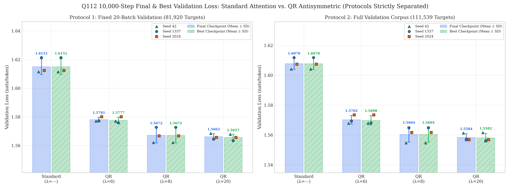
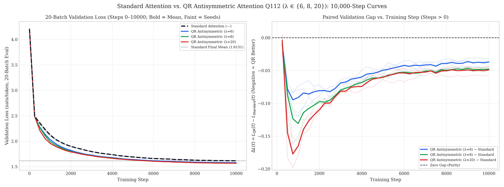

# Standard Attention Q112 — 10,000-Step Controlled Benchmark Results

- **Experiment:** Controlled 10,000-Step Benchmark — Standard Attention (`standard_q112`) vs. QR-Based Antisymmetric Shared-Q Attention (`qr_antisymmetric_q112`, $\lambda \in \{6.0, 8.0, 20.0\}$)
- **Directory:** [outputs/standard_attention_q112_10k/](.)
- **Read-Only QR Reference Checkpoints:**
  - $\lambda = 6.0$ across seeds `[1337, 2024, 42]` from [outputs/qr_lambda_extended_q112/](../qr_lambda_extended_q112/)
  - $\lambda \in \{8.0, 20.0\}$ across seeds `[1337, 2024, 42]` from [outputs/qr_lambda_upper_probe_q112/](../qr_lambda_upper_probe_q112/)
  - Historical `3,000`-step Standard Attention Q112 baseline (`outputs/qr_antisymmetric/q112/`, noted with schedule caveat)
- **Architecture (`Q112`):** `4` layers, `d_model=128`, `4` heads, `d_ff=512`, `ctx=128`, `dropout=0.1`, Pre-LayerNorm, learned positional embeddings, tied token/LM-head weights, bias-free attention projections, **`758,656` total parameters** (`204,800` attention / `553,856` non-attention / `0` stored buffers)
- **Dataset:** `data/tinyshakespeare.txt` (`SHA256: 86c4e6aa9db7c042ec79f339dcb96d42b0075e16b8fc2e86bf0ca57e2dc565ed`, `vocab_size=65`, `1,003,854` train / `111,540` validation characters)
- **Strict Protocol Separation (Never Blended):**
  - **Protocol 1 (`20-batch`, training curve & milestone protocol):** Fixed `20` random validation batches (`validation_seed=918273`, `batch_size=32`, `context_length=128`, **`81,920` target tokens**). Directly comparable to all `extended_q112` and `upper_probe_q112` trajectories.
  - **Protocol 2 (`full-corpus`, checkpoint comparison protocol):** Deterministic contiguous non-overlapping evaluation over `validation[1:]` (`29` batches covering `28` full chunks + remainder = **`111,539` target tokens**), evaluated identically across all `12` runs $\times$ `2` checkpoints (`final.pt` & `best.pt`).
- **Hardware & Runtime Environment:** `NVIDIA GeForce RTX 3050 6GB Laptop GPU`, PyTorch `2.6.0+cu124`, CUDA `12.4`, Python `3.13.14`
- **Reproduce Tables, JSON Analysis & All 9 Figures:**
  ```bash
  python outputs/standard_attention_q112_10k/reproduce_analysis.py
  ```

---

## 1. Executive Summary & Benchmark Verdict

We trained **3 independent Standard Attention Q112 models from scratch** for `10,000` optimizer steps across seeds `[1337, 2024, 42]` on Tiny Shakespeare under the exact `Q112` parameter budget (`758,656` parameters), exact AdamW + cosine hyperparameters (`lr=3e-4`, `weight_decay=0.1`, `warmup=100`, cosine decay to `3e-5`, `grad_clip=1.0`, `dropout=0.1`), **bitwise-matched per-seed initializations** (`W_Q->W_Q`, `W_R->W_K`, `W_V->W_V`, `W_O->W_O`), and **identical per-seed training batch streams** (`40,960,000` tokens/run) as the preserved `10,000`-step QR Antisymmetric Shared-Q references ($\lambda \in \{6.0, 8.0, 20.0\}$).

1. **QR Antisymmetric Shared-Q Genuinely and Consistently Outperforms Standard Attention (`12 / 12` Paired Wins Across All Seeds, Protocols & Checkpoints):**
   - **Protocol 1 (`20-batch`, `81,920` targets, `final @ 10,000`):**
     - Standard Attention: **`1.615077 ± 0.005511`** (`PPL 5.0283 ± 0.0278`)
     - QR ($\lambda=6$): `1.578118 ± 0.001679` (`PPL 4.8458`), paired $\Delta = -0.036959 \pm 0.006343$ (`-2.29%` loss, `-0.1825` PPL)
     - QR ($\lambda=8$): `1.567193 ± 0.005323` (`PPL 4.7932`), paired $\Delta = -0.047884 \pm 0.001995$ (`-2.96%` loss, `-0.2351` PPL)
     - QR ($\lambda=20$): **`1.566210 ± 0.002074`** (`PPL 4.7885`), paired $\Delta = \mathbf{-0.048867 \pm 0.007246}$ (`-3.03%` loss, `-0.2399` PPL)
   - **Protocol 2 (`full-corpus`, `111,539` targets, `final @ 10,000`):**
     - Standard Attention: **`1.607823 ± 0.003869`** (`PPL 4.9920 ± 0.0193`)
     - QR ($\lambda=6$): `1.570225 ± 0.002886` (`PPL 4.8077`), paired $\Delta = -0.037598 \pm 0.004417$ (`-2.34%` loss, `-0.1842` PPL)
     - QR ($\lambda=8$): `1.560389 ± 0.005153` (`PPL 4.7607`), paired $\Delta = -0.047434 \pm 0.001869$ (`-2.95%` loss, `-0.2312` PPL)
     - QR ($\lambda=20$): **`1.558444 ± 0.002496`** (`PPL 4.7514`), paired $\Delta = \mathbf{-0.049380 \pm 0.006027}$ (`-3.07%` loss, `-0.2405` PPL)
   - Every paired margin is `1.85×–2.48×` larger than the pre-registered practical threshold (`0.02` nats), and all six `df = 2` descriptive 95% $t$-intervals lie strictly below zero.
2. **Standard Attention Does NOT Close the Gap With Longer Training:**
   Within the `10,000`-step schedule, Standard Attention drops by `-0.181751` nats from step `3,000` (`1.796828`) to step `10,000` (`1.615077`), but its rate of improvement decelerates smoothly (`0.0530 -> 0.0216 -> 0.0086 -> 0.0032` nats per 1k steps) without overtaking even step-`8,000` QR. Instead of closing, the QR advantage stabilizes at a persistent **`0.037–0.049` nats** (`-0.0370 / -0.0479 / -0.0489`) from step `6,000` to `10,000`.
3. **Sample-Efficiency & Time-to-Loss Advantage Favor QR Despite Lower Per-Step Speed:**
   - Standard Attention trains faster per step (`328.89 ± 2.34 s` mean, `327.82 s` median; `124,544 tok/s`), uses `294.85 MB` peak GPU VRAM (`-24.6 to -27.8 MB` vs. QR), and achieves faster batched full-context inference (`601,657 vs. 404,163–418,963 tok/s`).
   - However, QR reaches Standard Attention's `10,000`-step final validation loss (`1.615077`) at interpolated steps **`6,138` ($\lambda=6$), `5,652` ($\lambda=8$), and `5,621` ($\lambda=20$)** — saving **`38.6%–43.8%` of training steps** and reaching equivalent validation quality in **`~218–239 s` median wall-clock time** (**`~27%–33%` less wall-clock time** than Standard's `328.9 s`).
4. **Mechanistic Finding — Standard Attention Organically Grows Asymmetry Yet Stays Higher-Entropy in Layer 0:**
   By step `10,000`, unconstrained $QK^T/\sqrt{28}$ grows substantial score asymmetry (`ratio_anti_to_sym` rises from `0.9270 -> 2.4232`, `score_asymmetry = 2.5900`) and inflates $\|W_K\|_F$ (`4.783 -> 11.262`, `+135%`) and $\|W_Q\|_F$ (`4.792 -> 12.778`, `+167%`) to match QR's combined causal logit spread (`4.3314` vs. `4.3075–4.7432`). Yet Standard Attention exhibits an **opposite cross-layer entropy profile**: its Layer `0` remains diffuse (`3.0717` nats, `max_prob = 0.1445`) vs. QR's sharp early positional/token routing (`1.4640 -> 0.7975` nats, `max_prob = 0.6297 -> 0.7894`), and its final training loss stalls `+0.055–0.068` nats worse (`1.517148 vs. 1.461808 / 1.455344 / 1.448833`).

---

## 2. Controlled Protocol, Q112 Budget & Fairness Verification

### 2.1 Programmatic Q112 Parameter Contract (`758,656` Parameters)

Verified before and after training via [`verify_standard_q112_model_contract`](../../train_standard_attention_q112_10k.py#L210-L325), [`WidthMatchedCausalAttention`](../../attention.py#L564-L624), [`QRSharedQAntisymmetricAttention`](../../attention.py#L627-L775), and [`parameter_budget_audit.json`](parameter_budget_audit.json):

| Component | Standard Q112 (`standard_q112`) | QR Antisymmetric Q112 (`qr_antisymmetric_q112`) | Details |
|---|---:|---:|---|
| Attention formulation | $S = \frac{QK^T}{\sqrt{28}}$ | $S = \frac{QQ^T + \lambda(QR^T - RQ^T)}{\sqrt{28}}$ | Fixed non-learnable $\lambda \in \{6, 8, 20\}$ for QR; none for Standard |
| Head dimensions (`H=4`) | `d_q=28, d_k=28, d_r=0, d_v=22` | `d_q=28, d_r=28, d_k=0, d_v=22` | Aggregate `Q=112`, `K/R=112`, `V=88` per layer |
| `W_Q` / (`W_K` or `W_R`) / `W_V` / `W_O` | `57,344 / 57,344 / 45,056 / 45,056` | `57,344 / 57,344 / 45,056 / 45,056` | Bias-free linear projections (`51,200` params/layer) |
| **Total attention params (`4` layers)** | **`204,800`** | **`204,800`** | Exact byte-for-byte count & shape match |
| Token emb (tied LM head) + Pos emb | `8,320 + 16,384 = 24,704` | `8,320 + 16,384 = 24,704` | `65×128` tied (`lm_head is token_embedding`) + `128×128` |
| LayerNorms + FFN (`d_ff=512`) | `2,304 + 526,848 = 529,152` | `2,304 + 526,848 = 529,152` | `9` LayerNorm pairs (`2,304`) + `4×131,712` MLPs |
| **Non-attention parameters** | **`553,856`** | **`553,856`** | Identical Pre-LN backbone |
| **Total trainable params / buffers** | **`758,656` / `0`** | **`758,656` / `0`** | `0` non-trainable params, `0` stored buffers |

### 2.2 Bitwise Initialization, Training Stream & Evaluation Audit

From [`fairness_audit.json`](fairness_audit.json), [`reproducibility_info.json`](reproducibility_info.json), and [`build_standard_q112_from_qr_init`](../../train_standard_attention_q112_10k.py#L405-L482):

- **Shared initialization rule:** For each seed $s \in \{1337, 2024, 42\}$, every projection `W_Q`, `W_V`, `W_O`, token/position embedding, LayerNorm, and FFN weight was copied **bitwise (`max_abs_diff = 0.0` across `53 / 53` tensors)** from the exact seeded QR initial checkpoint (`init.pt` for $\lambda \in \{6, 8, 20\}$), mapping QR's `W_R` directly onto Standard's `W_K`.
- **Training stream & reload exactness:** All `3` Standard runs completed all `10,000` steps (`40,960,000` tokens/run) with **`0` NaN/Inf events**, consuming the exact same per-seed batch sequence as QR references (`SHA256` match = `True` on `3/3` seeds). Across all `24` reloaded checkpoints (`12` runs $\times$ `{best, final}` in [`full_corpus_validation.csv`](full_corpus_validation.csv)), `reload_20batch_abs_diff = 0.0`.

| Seed | Standard `init.pt` `SHA256` Prefix | QR-Mapped (`W_K -> W_R`) `SHA256` Prefix | Diff vs. QR `{6, 8, 20}` (`53` Tensors) | Training Batch Stream `SHA256` Prefix | Stream Match? |
|---:|---|---|---:|---|---|
| `1337` | `13ec8669d609b491...` | `cb70c0386062ab0b...` | `0.0` | `66142907e2b581ee...` | `True` (`all refs`) |
| `2024` | `71a235d305d30543...` | `bf4a238bd2ec3b0c...` | `0.0` | `3be56dbc0aa173d1...` | `True` (`all refs`) |
| `42` | `ca8c8c4bb78677f2...` | `4ec2586f4b4f2bfa...` | `0.0` | `7f94fc8f969cf05f...` | `True` (`all refs`) |

---

## 3. Primary Validation Results (Strictly Separated Protocols)

### 3.1 Protocol 1 — Fixed 20-Batch Validation (`81,920` Target Tokens)

From [`standard_attention_comparison.csv`](standard_attention_comparison.csv), [`standard_attention_results.csv`](standard_attention_results.csv), and [`standard_attention_summary.csv`](standard_attention_summary.csv):

#### Final Checkpoints (`step = 10,000`)

| Model | Seed `1337` | Seed `2024` | Seed `42` | Mean Loss ± SD | Mean PPL (`arith. ± SD`) | Mean $\Delta$ vs. Std (`mean ± SD`) | Descriptive 95% $t$-CI (`df=2`) | Paired $t$ / `p` (`desc.`) |
|---|---:|---:|---:|---:|---:|---:|---:|---:|
| **Standard Attention** | `1.621418` | `1.612373` | `1.611441` | `1.615077 ± 0.005511` | `5.0283 ± 0.0278` | `—` | `—` | `—` |
| **QR ($\lambda=6$)** | `1.577232` | `1.580055` | `1.577069` | `1.578118 ± 0.001679` | `4.8458 ± 0.0081` | `-0.036959 ± 0.006343` | `[-0.052715, -0.021202]` | `-10.092 / 0.00968` |
| **QR ($\lambda=8$)** | `1.572717` | `1.566762` | **`1.562098`** | `1.567193 ± 0.005323` | `4.7932 ± 0.0255` | `-0.047884 ± 0.001995` | `[-0.052841, -0.042927]` | `-41.564 / 0.00058` |
| **QR ($\lambda=20$)** | **`1.564475`** | **`1.565648`** | `1.568507` | **`1.566210 ± 0.002074`** | **`4.7885 ± 0.0099`** | **`-0.048867 ± 0.007246`** | `[-0.066868, -0.030867]` | `-11.681 / 0.00725` |

#### Best-Validation Checkpoints (`best.pt`)

| Model | Seed `1337` (Step) | Seed `2024` (Step) | Seed `42` (Step) | Mean Best Loss ± SD | Mean Best PPL | Mean $\Delta$ vs. Std (`mean ± SD`) | Descriptive 95% $t$-CI (`df=2`) |
|---|---:|---:|---:|---:|---:|---:|---:|
| **Standard Attention** | `1.621418` (`10,000`) | `1.612373` (`10,000`) | `1.611441` (`10,000`) | `1.615077 ± 0.005511` | `5.0283 ± 0.0278` | `—` | `—` |
| **QR ($\lambda=6$)** | `1.575872` (`9,750`) | `1.580055` (`10,000`) | `1.577069` (`10,000`) | `1.577665 ± 0.002154` | `4.8436 ± 0.0104` | `-0.037412 ± 0.007119` | `[-0.055095, -0.019729]` |
| **QR ($\lambda=8$)** | `1.572717` (`10,000`) | `1.566762` (`10,000`) | **`1.562098`** (`10,000`) | `1.567193 ± 0.005323` | `4.7932 ± 0.0255` | `-0.047884 ± 0.001995` | `[-0.052841, -0.042927]` |
| **QR ($\lambda=20$)** | **`1.563445`** (`9,750`) | **`1.565648`** (`10,000`) | `1.567862` (`9,500`) | **`1.565652 ± 0.002208`** | **`4.7858 ± 0.0106`** | **`-0.049425 ± 0.007567`** | `[-0.068223, -0.030627]` |

- **Per-seed paired deltas (`final @ 10,000`, `20-batch`):**
  - `QR(λ=6) - Std`: `1337: -0.044186`, `2024: -0.032318`, `42: -0.034372`
  - `QR(λ=8) - Std`: `1337: -0.048700`, `2024: -0.045610`, `42: -0.049343`
  - `QR(λ=20) - Std`: `1337: -0.056943`, `2024: -0.046724`, `42: -0.042934`

### 3.2 Protocol 2 — Full-Corpus Validation (`111,539` Target Tokens)

From [`full_corpus_validation.csv`](full_corpus_validation.csv) and [`standard_attention_comparison.csv`](standard_attention_comparison.csv). *(Note: Protocol 2 covers the entire `validation[1:]` split once deterministically, yielding losses `~0.0073` nats lower overall than the `20-batch` sample; both protocols produce identical group rankings and essentially identical pairwise gaps.)*

#### Final Checkpoints (`step = 10,000`)

| Model | Seed `1337` | Seed `2024` | Seed `42` | Mean Loss ± SD | Mean PPL (`arith. ± SD`) | Mean $\Delta$ vs. Std (`mean ± SD`) | Descriptive 95% $t$-CI (`df=2`) | Paired $t$ / `p` (`desc.`) |
|---|---:|---:|---:|---:|---:|---:|---:|---:|
| **Standard Attention** | `1.611876` | `1.607424` | `1.604170` | `1.607823 ± 0.003869` | `4.9920 ± 0.0193` | `—` | `—` | `—` |
| **QR ($\lambda=6$)** | `1.569357` | `1.573446` | `1.567873` | `1.570225 ± 0.002886` | `4.8077 ± 0.0139` | `-0.037598 ± 0.004417` | `[-0.048570, -0.026626]` | `-14.744 / 0.00457` |
| **QR ($\lambda=8$)** | `1.564786` | `1.561663` | **`1.554718`** | `1.560389 ± 0.005153` | `4.7607 ± 0.0245` | `-0.047434 ± 0.001869` | `[-0.052077, -0.042791]` | `-43.956 / 0.00052` |
| **QR ($\lambda=20$)** | **`1.557148`** | **`1.556862`** | `1.561321` | **`1.558444 ± 0.002496`** | **`4.7514 ± 0.0119`** | **`-0.049380 ± 0.006027`** | `[-0.064353, -0.034407]` | `-14.190 / 0.00493` |

#### Best-Validation Checkpoints (`best.pt`)

| Model | Seed `1337` (Step) | Seed `2024` (Step) | Seed `42` (Step) | Mean Best Loss ± SD | Mean Best PPL | Mean $\Delta$ vs. Std (`mean ± SD`) | Descriptive 95% $t$-CI (`df=2`) |
|---|---:|---:|---:|---:|---:|---:|---:|
| **Standard Attention** | `1.611876` (`10,000`) | `1.607424` (`10,000`) | `1.604170` (`10,000`) | `1.607823 ± 0.003869` | `4.9920 ± 0.0193` | `—` | `—` |
| **QR ($\lambda=6$)** | `1.568079` (`9,750`) | `1.573446` (`10,000`) | `1.567873` (`10,000`) | `1.569799 ± 0.003160` | `4.8057 ± 0.0152` | `-0.038024 ± 0.005132` | `[-0.050773, -0.025275]` |
| **QR ($\lambda=8$)** | `1.564786` (`10,000`) | `1.561663` (`10,000`) | **`1.554718`** (`10,000`) | `1.560389 ± 0.005153` | `4.7607 ± 0.0245` | `-0.047434 ± 0.001869` | `[-0.052077, -0.042791]` |
| **QR ($\lambda=20$)** | **`1.556107`** (`9,750`) | **`1.556862`** (`10,000`) | `1.561610` (`9,500`) | **`1.558193 ± 0.002983`** | **`4.7502 ± 0.0142`** | **`-0.049630 ± 0.006653`** | `[-0.066158, -0.033103]` |

*(Note on `QR λ=20, seed=42`: `best.pt` was selected at step `9,500` by `20-batch` validation (`1.567862 vs. 1.568507`), while on `full-corpus`, step `10,000` (`1.561321`) scored `0.000288` nats lower than step `9,500` (`1.561610`).)*

- **Full-corpus per-seed deltas (`final @ 10,000`):**
  - `QR(λ=6) - Std`: `1337: -0.042519`, `2024: -0.033978`, `42: -0.036297`
  - `QR(λ=8) - Std`: `1337: -0.047090`, `2024: -0.045761`, `42: -0.049452`
  - `QR(λ=20) - Std`: `1337: -0.054729`, `2024: -0.050562`, `42: -0.042849`


- **Statistical caveat:** With $N = 3$ seeds (`df = 2`, $t_{0.975,2} = 4.3027$), the confidence intervals and two-sided paired $t$-tests in `analyze_standard_attention_q112_10k.py` are **descriptive small-sample summaries** alongside exact per-seed values, even though every comparison passes `p < 0.01` and exceeds the `0.02`-nat practical significance threshold on every individual seed.

---

## 4. Training Trajectory, Convergence Dynamics & Research Answers

### 4.1 Validation & Training Loss Trajectory (`20-Batch` Protocol)

From [`standard_attention_step_summary.csv`](standard_attention_step_summary.csv) and [`standard_attention_analysis.json`](standard_attention_analysis.json):

| Step | Standard Val (Train) | QR $\lambda=6$ Val ($\Delta$ vs. Std) | QR $\lambda=8$ Val ($\Delta$ vs. Std) | QR $\lambda=20$ Val ($\Delta$ vs. Std) | QR $\lambda=20$ Train |
|---:|---:|---:|---:|---:|---:|
| `0` | `4.203445` (`—`) | `4.203480` (`+0.000034`) | `4.203540` (`+0.000095`) | `4.203277` (`-0.000168`) | `—` |
| `250` | `2.489898` (`2.917866`) | `2.480813` (`-0.009086`) | `2.479195` (`-0.010703`) | `2.485862` (`-0.004037`) | `2.918864` |
| `500` | `2.356043` (`2.453264`) | `2.277486` (`-0.078558`) | `2.268927` (`-0.087117`) | `2.210821` (`-0.145223`) | `2.399133` |
| `1,000` | `2.122202` (`2.223868`) | `2.031065` (`-0.091138`) | `1.991455` (`-0.130747`) | **`1.956950`** (**`-0.165252`**) | `2.024097` |
| `2,000` | `1.899361` (`1.904312`) | `1.818778` (`-0.080583`) | `1.802145` (`-0.097216`) | `1.789307` (`-0.110055`) | `1.750636` |
| `3,000` | `1.796828` (`1.748627`) | `1.727943` (`-0.068886`) | `1.717141` (`-0.079688`) | `1.715177` (`-0.081651`) | `1.637267` |
| `5,000` | `1.690734` (`1.612894`) | `1.641177` (`-0.049557`) | `1.630795` (`-0.059940`) | `1.630286` (`-0.060449`) | `1.532568` |
| `6,250` | `1.657339` (`1.567875`) | `1.613882` (`-0.043458`) | `1.604011` (`-0.053328`) | `1.602232` (`-0.055108`) | `1.494092` |
| `7,500` | `1.636679` (`1.540994`) | `1.593322` (`-0.043357`) | `1.584254` (`-0.052426`) | `1.582612` (`-0.054067`) | `1.470317` |
| `9,000` | `1.618291` (`1.524752`) | `1.581987` (`-0.036304`) | `1.571855` (`-0.046437`) | `1.569180` (`-0.049111`) | `1.456565` |
| `10,000` | **`1.615077`** (`1.517148`) | **`1.578118`** (`-0.036959`) | **`1.567193`** (`-0.047884`) | **`1.566210`** (`-0.048867`) | **`1.448833`** |

- **Crossover points matching Standard Attention's `10,000`-step final mean (`1.615077`):**
  - **QR ($\lambda=6$):** First logged eval $\le 1.615077$ at step **`6,250`** (`1.613882`), linear-interpolated crossover at **`6,138.3`** (`38.6%` fewer steps).
  - **QR ($\lambda=8$):** First logged eval $\le 1.615077$ at step **`5,750`** (`1.613138`), linear-interpolated crossover at **`5,651.8`** (`43.5%` fewer steps).
  - **QR ($\lambda=20$):** First logged eval $\le 1.615077$ at step **`5,750`** (`1.612461`), linear-interpolated crossover at **`5,620.9`** (`43.8%` fewer steps).



### 4.2 Historical `3,000`-Step Standard Baseline vs. `10,000`-Step Standard Run

In the preserved historical `3,000`-step experiment (`outputs/qr_antisymmetric/q112/`), Standard Attention reached **`1.894846 ± 0.002337`** (`1337: 1.897275`, `2024: 1.894650`, `42: 1.892613`). Inside our `10,000`-step run, Standard Attention already achieves **`1.796828`** at step `3,000` (`-0.098017` nats lower) because a `10,000`-step cosine schedule maintains a much higher learning rate at step `3,000` (`~2.47e-4`) whereas a `3,000`-step cosine schedule has already annealed down to `3.0e-5`. Continuing to step `10,000` reduces Standard Attention by `-0.181751` further (and `-0.279769` relative to the `3k` baseline) to `1.615077`—yet Standard remains firmly behind `QR` by `0.037–0.049` nats.

### 4.3 Direct Answers to Research Questions (`Q1–Q8` in `standard_attention_analysis.json`)

1. **Does Standard Attention continue improving past `3,000` steps?**
   **Yes, substantially (`-0.181751` nats).** Per-seed drops from step `3,000` to `10,000` are `-0.178294` (`1337`), `-0.176713` (`2024`), and `-0.190247` (`42`).
2. **Does Standard Attention close the gap with QR by `10,000` steps?**
   **No.** The QR margin peaks at step `1,000` (`-0.0911 / -0.1307 / -0.1653`), narrows through step `6,000` (`-0.0423 / -0.0526 / -0.0536`), and then stabilizes horizontally at **`-0.0370 / -0.0479 / -0.0489`** nats (`20-batch`) and **`-0.0376 / -0.0474 / -0.0494`** (`full-corpus`) at step `10,000`.
3. **When does Standard Attention begin to plateau?**
   Improvement rate drops sharply across consecutive horizons: **`-0.0530` nats/1k** (`3,000->5,000`) $\to$ **`-0.0216` nats/1k** (`5,000->7,500`) $\to$ **`-0.00864` nats/1k** (`7,500->10,000`) $\to$ **`-0.00321` nats/1k** (`9,000->10,000`), though all three seeds still attain their best validation checkpoint at step `10,000` without overfitting reversal.
4. **Does QR beat Standard Attention on every seed?**
   **Yes (`3 / 3` seeds $\times$ `3` $\lambda$ values $\times$ `2` protocols $\times$ `2` checkpoint kinds).** Not a single Standard run matches any QR run on the same seed.
5. **How large is the final gap in validation loss and perplexity?**
   At step `10,000`: **`-0.0370` to `-0.0489` nats** (`-0.1825` to `-0.2399` PPL) on `20-batch`, and **`-0.0376` to `-0.0494` nats** (`-0.1842` to `-0.2405` PPL) on `full-corpus`.
6. **Does QR win across both evaluation protocols and both `final` and `best` checkpoints?**
   **Yes, across all `4` protocol $\times$ checkpoint views** (`qr_wins_all_4_views = true` for `6.0`, `8.0`, and `20.0`).
7. **Which QR $\lambda$ leads, and when do QR models cross Standard's final loss?**
   **$\lambda = 20.0$ leads marginally** on mean loss (`1.566210` / `1.558444` full-corpus), closely followed by **$\lambda = 8.0$** (`1.567193` / `1.560389`, which wins seed `42`), ahead of **$\lambda = 6.0$** (`1.578118` / `1.570225`). Crossovers occur around steps **`6,138`** (`6`), **`5,652`** (`8`), and **`5,621`** (`20`).
8. **What is the compute, speed, and GPU memory tradeoff?**
   Standard uses `-15.7%` less median training time over `10k` steps, `-8.4%` less peak VRAM (`294.85 MB`), and `+44%` faster batched full-context inference, whereas QR is `1.63×–1.78×` more sample-efficient and reaches Standard's `10k` loss **`~27%–33%` faster in wall-clock seconds**.

---

## 5. Mechanistic, Layer-Wise & Optimization Diagnostics

### 5.1 Organic Score Asymmetry in Standard Attention vs. Structural QR Bias

Using [`compute_standard_q112_layer_diagnostics`](../../train_standard_attention_q112_10k.py#L499-L563), Standard Attention's scaled logits $S = QK^T / \sqrt{28}$ are decomposed identically into $S_{\text{sym}} = \frac{1}{2}(S + S^T)$ and $S_{\text{anti}} = \frac{1}{2}(S - S^T)$, with `score_asymmetry` $= \text{mean}(\|S - S^T\|_F / \|S + S^T\|_F) = \text{mean}(\|S_{\text{anti}}\|_F / \|S_{\text{sym}}\|_F)$. From [`standard_attention_diagnostics.csv`](standard_attention_diagnostics.csv) and [`upper_lambda_summary.csv`](../qr_lambda_upper_probe_q112/upper_lambda_summary.csv):

| Metric (Global Mean) | Standard (Step `0`) | Standard (`10,000`) | QR $\lambda=6$ (`10,000`) | QR $\lambda=8$ (`10,000`) | QR $\lambda=20$ (`10,000`) |
|---|---:|---:|---:|---:|---:|
| Final training loss | `—` | `1.517148` | `1.461808` | `1.455344` | **`1.448833`** |
| `sym_score_std` | `0.0369` | `2.3043` | `1.2370` | `0.8592` | `0.2191` |
| Effective `anti_score_std` | `0.0342` | `5.7000` | `6.9478` | `7.0389` | `7.1597` |
| Pre-mask `combined_score_std` | `0.0503` | `6.1727` | `7.0630` | `7.0926` | `7.1630` |
| **Causal `combined_causal_score_std`** | `0.0502` | **`4.3314`** | `4.7432` | `4.5658` | **`4.3075`** |
| Pre-mask `ratio_anti_to_sym` (`eff`) | `0.9270` | **`2.4232`** | `5.5672` | `8.0414` | `30.0475` |
| Causal `ratio_anti_to_sym_causal` (`eff`) | `0.9204` | **`2.4063`** | `5.4855` | `7.9107` | `29.3354` |
| `score_asymmetry` ($\|S-S^T\|_F / \|S+S^T\|_F$) | `0.9328` | **`2.5900`** | `6.1615` | `8.5125` | `30.3733` |
| Attention entropy (global / non-initial nats) | `3.8772 / 3.9077` | **`2.1235 / 2.1402`** | `1.5225 / 1.5345` | `1.4156 / 1.4267` | **`1.2919 / 1.3020`** |
| Mean max attention probability | `0.0449` | `0.3560` | `0.5534` | `0.5846` | **`0.6195`** |
| Mean diagonal (self-attention) mass | `0.0424` | `0.1517` | `0.1511` | `0.1318` | `0.0809` |
| Total `||W_K||_F` or `||W_R||_F` | `4.7830` | **`11.2619`** (`2.35×`) | `7.3264` (`1.53×`) | `7.0041` (`1.46×`) | `5.8357` (`1.22×`) |
| Total `||W_Q||_F` | `4.7916` | **`12.7783`** (`2.67×`) | `8.1949` (`1.71×`) | `7.7088` (`1.61×`) | `6.0236` (`1.26×`) |

- **Standard Attention's organic asymmetry evolution:** Immediately after initialization, Standard Attention briefly shifts *more* symmetric at step `250` (`ratio_anti_to_sym: 0.9270 -> 0.6798`, `score_asymmetry = 0.7029`), before reversing past `1.0676` (`step 1,000`) $\to$ `2.0439` (`3,000`) $\to$ `2.2824` (`5,000`) $\to$ `2.4232` (`10,000`). Even unconstrained causal $QK^T$ actively suppresses symmetric matching in favor of directional asymmetry (`~2.4×` larger antisymmetric than symmetric norm), arriving at almost the exact same causal logit standard deviation (`4.3314`) as QR $\lambda=20$ (`4.3075`)—but requiring **`1.9×` larger `W_K/W_R` and `2.1×` larger `W_Q` Frobenius weight norms** to get there.

### 5.2 Inverse Cross-Layer Depth Profile (`Layers 0 -> 3` @ Step `10,000`)

From [`standard_attention_layer_diagnostics.csv`](standard_attention_layer_diagnostics.csv) and [`upper_lambda_layer_final.csv`](../qr_lambda_upper_probe_q112/upper_lambda_layer_final.csv):

| Layer | Std Entropy (`max_p`) | QR $\lambda=6$ Entropy (`max_p`) | QR $\lambda=8$ Entropy (`max_p`) | QR $\lambda=20$ Entropy (`max_p`) | Std (`\|\|W_K\|\| / \|\|W_Q\|\|`) | QR $\lambda=20$ (`\|\|W_R\|\| / \|\|W_Q\|\|`) |
|---:|---:|---:|---:|---:|---:|---:|
| **`L0`** | **`3.0717`** (`0.1445`) | `1.4640` (`0.6297`) | `1.1556` (`0.7139`) | **`0.7975`** (`0.7894`) | `4.3791 / 3.9801` | `3.3413 / 3.5209` |
| **`L1`** | `2.1088` (`0.3241`) | `1.7745` (`0.4711`) | `1.4648` (`0.5526`) | `1.1990` (`0.6410`) | `4.8085 / 5.4230` | `2.7330 / 2.7600` |
| **`L2`** | `1.6609` (`0.4561`) | `1.2533` (`0.5978`) | `1.3082` (`0.5914`) | `1.3951` (`0.5700`) | `6.0427 / 7.2661` | `2.7533 / 2.7935` |
| **`L3`** | **`1.6524`** (`0.4992`) | `1.5982` (`0.5152`) | `1.7336` (`0.4804`) | **`1.7758`** (`0.4774`) | `6.9242 / 8.0673` | `2.7992 / 2.9083` |

- **Opposing architectural specialization across depth:**
  - **Standard Attention** learns a strictly top-heavy focusing hierarchy: **Layer `0` stays nearly uniform (`3.0717` nats vs. `3.877` at init; `max_prob = 0.1445`)**, focusing progressively only toward Layers `2–3` (`1.66 -> 1.65` nats, where per-layer `||W_K||` and `||W_Q||` nearly double to `6.92` and `8.07`). Notice `score_asymmetry` in Standard peaks in middle Layers `1–2` (`3.0213`, `2.7014`) before dropping in Layer `3` (`1.7533`).
  - **QR Antisymmetric Attention** specializes **from Layer `0` upward**: antisymmetric coupling $QR^T - RQ^T$ immediately forms ultra-sharp, low-diagonal-mass causal routing in Layer `0` (`0.7975` nats, `max_prob = 0.7894`, `diag_mass = 0.0231` at $\lambda=20$), freeing upper Layers `2–3` to soften monotonically with higher $\lambda$ (`L3 entropy: 1.5982 -> 1.7758` nats).

### 5.3 Gradient Flow & Clipping Telemetry

From [`standard_attention_results.csv`](standard_attention_results.csv) and [`upper_lambda_summary.csv`](../qr_lambda_upper_probe_q112/upper_lambda_summary.csv):

| Gradient / Stability Metric | Standard Attention | QR ($\lambda=6$) | QR ($\lambda=8$) | QR ($\lambda=20$) |
|---|---:|---:|---:|---:|
| NaN / Inf occurrences (`30k` Std steps) | `0` | `0` | `0` | `0` |
| Step-`1` pre-clip global grad norm | `2.7935 ± 0.0889` | `2.7696` | `2.7533` | `2.5754` |
| Step-`1` `W_K` or `W_R` grad norm (`% of global`) | **`0.00793`** (`0.28%`) | `0.06382` (`2.30%`) | `0.08485` (`3.08%`) | `0.20044` (`7.78%`) |
| Step-`1` `W_Q` grad norm (`% of global`) | **`0.00775`** (`0.28%`) | `0.06442` (`2.33%`) | `0.08519` (`3.09%`) | `0.20012` (`7.77%`) |
| Run-mean / run-max pre-clip global norm | `1.1402 / 2.9543` | `1.1074 / 2.9264` | `1.1153 / 2.9084` | `1.1365 / 2.7177` |
| Run-mean / run-max `W_K` or `W_R` grad norm | `0.1353 / 0.3425` | `0.2474 / 0.5473` | `0.2650 / 0.6393` | `0.3256 / 0.7101` |
| Run-mean / run-max `W_Q` grad norm | `0.1240 / 0.2580` | `0.2204 / 0.5545` | `0.2359 / 0.6968` | `0.3158 / 0.6763` |
| Cumulative clip frequency (`> 1.0`) | `0.8784 ± 0.0091` | `0.9183` | `0.9190` | `0.9297` |

- At Step `1`, Standard's `W_K` and `W_Q` receive **`8×–25×` smaller raw gradient L2 norms** (`0.0079 / 0.0077`, only `0.28%` of global grad norm) than QR's `W_R` and `W_Q` (`0.064–0.200`, `2.3%–7.8%`), while over the full `10,000`-step trajectory `W_R` captures `22.3%–28.6%` of mean global grad norm vs. `11.9%` for `W_K`. Because QR encodes both $QQ^T$ symmetry and $\lambda(QR^T - RQ^T)$ skew-symmetry directly in its bilinear score operator, early AdamW steps immediately drive attention-projection specialization rather than spending the first `~500–3,000` steps escaping near-uniform attention.

### 5.4 Qualitative Generation Samples (`seed = 1337`)

From [`standard_attention_q112_10k/seed_1337/sample.txt`](seed_1337/sample.txt) and [`qr_lambda_upper_probe_q112/lambda_20.0/seed_1337/sample.txt`](../qr_lambda_upper_probe_q112/lambda_20.0/seed_1337/sample.txt) (both seeded identically from `"?"`):

- **Standard Attention (`10k, seed=1337`, `val=1.6214`):** Shows more frequent orthography slips (`neighbout`, `kince`, `cretlessaness`, `drovite`, `humb`) amid valid speaker headers (`GREMIO:`, `STANLEY:`, `AUFIDIUS:`).
- **QR Antisymmetric (`λ=20, 10k, seed=1337`, `val=1.5645`):** Cleanly spells `neighbours`, `Saint's Murderer`, `grieve send`, `WARWICK:`, and longer syntactic clauses (`Alas, my else noble little me no more than airs`). Both remain small `758k`-parameter character-level models, consistent with `0.057`-nat gap.

---

## 6. Compute Cost, Throughput & Memory Tradeoff

From [`standard_attention_comparison.csv`](standard_attention_comparison.csv) and `q8_cost_tradeoff_speed_and_memory` in [`standard_attention_analysis.json`](standard_attention_analysis.json):

| Model | Mean Train Time (s) | Median Train Time (s) | Mean / Median Throughput (tok/s) | Peak GPU VRAM (MB) | Batched Full-Ctx Inference (tok/s) | Wall Time to Reach Std `10k` Loss (`1.6151`) |
|---|---:|---:|---:|---:|---:|---:|
| **Standard Attention** | **`328.89 ± 2.34`** | **`327.82`** | **`124,544` / `124,945`** | **`294.85`** (`294.85`) | **`601,657 ± 3,736`** (`6.81 ms/batch`) | `327.82 s` median (`10,000` steps) |
| **QR ($\lambda=6$)** | `399.44 ± 19.44` | `388.94` | `102,700` / `105,311` | `319.45` (`+24.60`) | `404,163 ± 14,724` | **`~238.7 s`** (`~6,138` steps, **`-27%`**) |
| **QR ($\lambda=8$)** | `443.29 ± 94.59`* | `391.79` | `94,968` / `104,547` | `322.35` (`+27.50`) | `418,963 ± 2,848` | **`~221.4 s`** (`~5,652` steps, **`-32%`**) |
| **QR ($\lambda=20$)** | `388.63 ± 0.42` | `388.79` | `105,397` / `105,352` | `322.68` (`+27.83`) | `417,917 ± 579` | **`~218.5 s`** (`~5,621` steps, **`-33%`**) |

*\*Transient Windows contention caveat:* `qr_lam8, seed=1337` took `552.45 s` (`74,142 tok/s`) due to background host GPU load during its run, while seeds `2024` (`385.63 s`) and `42` (`391.79 s`) matched `qr_lam20` (`388.63 ± 0.42 s`). Using medians, QR incurs a **`+18.6%` training step-time overhead** (`~388.8 s vs. 327.8 s`), **`+8.3% to +9.4%` training VRAM** (`+24.6 to +27.8 MB` for the additional $QQ^T, QR^T, RQ^T$ intermediates), and **`~30.5%` slower full-context forward inference** (`418k vs. 602k tok/s`). Yet because QR converges to equivalent validation loss `4,348–4,379` steps sooner, it still delivers a net **`~27%–33%` wall-clock compute reduction** to any fixed quality target achieved by Standard at `10,000` steps.

---

## 7. Artifact Inventory (`outputs/standard_attention_q112_10k/`)

### 7.1 Generated 300-DPI Figures (`figures/`)

| # | Figure File | Description |
|---:|---|---|
| `1` | [`fig1_standard_val_loss_vs_steps.png`](figures/fig1_standard_val_loss_vs_steps.png) | Standard Attention `20-batch` validation loss (3-seed mean ± SD, individual seeds, historical 3k baseline marker) |
| `2` | [`fig2_standard_train_loss_vs_steps.png`](figures/fig2_standard_train_loss_vs_steps.png) | Standard Attention training loss trajectory (3-seed mean ± SD and per-seed curves, full horizon & `2,500 -> 10,000` zoom) |
| `3` | [`fig3_standard_vs_qr_val_loss_curves.png`](figures/fig3_standard_vs_qr_val_loss_curves.png) | Overlaid `0 -> 10,000` validation curves with step crossovers (`6,138 / 5,652 / 5,621`) and paired $\Delta(t)$ inset |
| `4` | [`fig4_final_val_loss_comparison.png`](figures/fig4_final_val_loss_comparison.png) | Final (`10,000`) & best-checkpoint validation loss bars + paired $\Delta$ CIs across Protocol `1` and Protocol `2` |
| `5` | [`fig5_per_seed_val_loss_comparison.png`](figures/fig5_per_seed_val_loss_comparison.png) | Seed-by-seed validation losses (`1337, 2024, 42`) and per-seed QR improvements under both protocols |
| `6` | [`fig6_perplexity_comparison.png`](figures/fig6_perplexity_comparison.png) | Mean perplexity comparison (`final` & `best`) across `20-batch` (`81,920` tok) and `full-corpus` (`111,539` tok) |
| `7` | [`fig7_convergence_zoom_2500_to_10000.png`](figures/fig7_convergence_zoom_2500_to_10000.png) | Late-training zoom (`2,500 -> 10,000`) + interval convergence rates ($\Delta\text{loss} / \text{1k steps}$) |
| `8` | [`fig8_training_throughput_comparison.png`](figures/fig8_training_throughput_comparison.png) | Mean/median training throughput, wall-clock duration, and batched full-context inference throughput |
| `9` | [`fig9_peak_gpu_memory_comparison.png`](figures/fig9_peak_gpu_memory_comparison.png) | Peak allocated GPU VRAM (`MB`) and pre-clip global gradient norm stability over `10,000` steps |

### 7.2 Scripts, Audits, Tables & Checkpoints

- **Pipeline Scripts:** [`train_standard_attention_q112_10k.py`](../../train_standard_attention_q112_10k.py), [`analyze_standard_attention_q112_10k.py`](../../analyze_standard_attention_q112_10k.py), [`visualize_standard_attention_q112_10k.py`](../../visualize_standard_attention_q112_10k.py), [`reproduce_analysis.py`](reproduce_analysis.py)
- **CSVs & JSON Reports:** [`standard_attention_results.csv`](standard_attention_results.csv), [`standard_attention_summary.csv`](standard_attention_summary.csv), [`standard_attention_comparison.csv`](standard_attention_comparison.csv), [`standard_attention_training_curves.csv`](standard_attention_training_curves.csv), [`standard_attention_step_summary.csv`](standard_attention_step_summary.csv), [`standard_attention_diagnostics.csv`](standard_attention_diagnostics.csv), [`standard_attention_layer_diagnostics.csv`](standard_attention_layer_diagnostics.csv), [`full_corpus_validation.csv`](full_corpus_validation.csv), [`full_corpus_validation.json`](full_corpus_validation.json), [`standard_attention_analysis.json`](standard_attention_analysis.json), [`all_summaries.json`](all_summaries.json), [`fairness_audit.json`](fairness_audit.json), [`parameter_budget_audit.json`](parameter_budget_audit.json), [`reproducibility_info.json`](reproducibility_info.json)
- **Per-Seed Checkpoints & Logs (`seed_{42,1337,2024}/`):** `init.pt`, `best.pt`, `final.pt`, `attention.pt` *(excluded from git via `*.pt`)*; [`seed_42/`](seed_42/), [`seed_1337/`](seed_1337/), [`seed_2024/`](seed_2024/) (`config.json`, `run_metadata.json`, `parameter_accounting.json`, `metrics.csv`, `diagnostics.csv`, `attention_stats.json`, `validation_segments.csv`, `sample.txt`, `summary.json`).

---

## 8. Scope, Limitations & Reproduction Commands

- **Scope & Limitations:** Results cover `N = 3` random seeds (`df = 2`), a single compact `4`-layer character-level decoder (`758,656` parameters, `ctx = 128`, Tiny Shakespeare), and a `10,000`-step AdamW schedule (`lr = 3e-4`, `wd = 0.1`). While QR (`λ ∈ {6, 8, 20}`) decisively beats Standard Attention under fixed `Q112` budgets (`204,800` attention params), larger scales, subword vocabularies, longer context lengths, or autoregressive KV-cached decoding (`O(T)` cached query-key lookup vs. recomputing $QR^T - RQ^T$ or maintaining $Q$ and $R$ caches) require separate evaluation; inference throughput reported above measures full-context `128`-token batched forward passes without KV caching.
- **Exact Reproduction Commands:**
  ```bash
  # Re-run analysis + regenerate all 9 figures from saved CSVs/JSON
  python outputs/standard_attention_q112_10k/reproduce_analysis.py

  # Re-run dual validation (20-batch + full-corpus) on saved checkpoints + analysis + figures
  python outputs/standard_attention_q112_10k/reproduce_analysis.py --eval-only

  # Re-run full 3-seed Standard Q112 training from scratch + dual eval + analysis + figures
  python outputs/standard_attention_q112_10k/reproduce_analysis.py --run-train --overwrite
  ```
